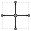
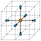
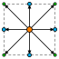
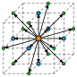

## Lattice Boltzmann Methods

In general, the lattice Boltzmann method (LBM) can be interpreted as a bottom-up procedure to numerically approximate a given partial differential equation (PDE).
In contrast to the conventional top-down discretization of the target equation (TEQ), the LBM emerges from the space and time discretization of a discrete velocity Boltzmann-type equation.
Subsequently, the solution to the TEQ is recovered in a limiting process.
Different PDEs can be approximated by altering certain features of the method.
Exemplary LBM building blocks which induce the recovery of the aimed at transport equation are discussed in the following sections.
Thorough derivations of specific LBM approaches are summarized more comprehensively for example in [@krause:21; @kruger2017lattice].

The LBM algorithm is typically divided into two steps: collision and streaming.
During the collision step every distribution function $f_i$ at a grid node $\symbf{x} \in \Omega_{\triangle x} \subseteq \mathbb{R}^{d}$ receives a collision term $J_{i}$, i.e. 
$$
f_i^*(t,\symbf{x}) = f_i(t,\symbf{x}) + \triangle t J_i  (t, \symbf{x}) ,
$${#eq-lbm_collision}
where $\triangle t$ is the time step size and $t \in I_{\triangle t} \subseteq \mathbb{R}_{\geq 0}$.
The most prominent collision operator introduced by Bhatnager, Gross and Krook (BGK)[@bhatnagar1954model] reads
$$
\begin{aligned}
J_i (t, \symbf{x})  = - \frac{1}{\tau}\left[ f_i (t, \symbf{x})-f_i^{\mathrm{eq}} (t, \symbf{x}) \right].
\end{aligned}
$${#eq-LBM_BGK}
The relaxation time $\tau > 0$ determines the speed at which the populations approach equilibrium and can for example be related to the viscosity in the hydrodynamic limit.
The local equilibrium function $f_i^{\mathrm{eq}}$ approximates the Maxwell\textendash Boltzmann distribution.
At the streaming step all populations are shifted to the next grid point
$$
\begin{aligned}
f_i \left( t + \triangle t, \symbf{x} + \triangle t \symbf{c}_i \right) = f_i^*(t, \symbf{x}),
\end{aligned}
$$
where $i=0,1, \ldots, q-1$ enumerates the discrete velocities $\symbf{c}_i$ of dimension $d$ contained in the underlying set $DdQq$. 
For the purpose of illustration, the $DdQ(2d+1)$ discrete velocity sets for $d = 2, 3$ are shown in @fig-velSets, respectively.
All velocity sets available in $\OpenLB$ are listed under [Lattice Structures](#sec-lattice-structures) below.

::: {#fig-velSets layout="[22,22,22,22,12]" layout-valign="center"}

{#fig-D2Q5}

{#fig-D3Q7}

{#fig-D2Q9}

{#fig-D3Q19}

Exemplary discrete velocity sets used for the descriptors implemented in $\OpenLB$.
(a), (b): $DdQ(2d+1)$ for $d = 2, 3$, respectively; (c): $D2Q9$; (d): $D3Q19$.
Coloring refers to the corresponding energy shell, where orange, cyan and green denote zeroth, first and second order nodes, respectively.
Figure reproduced from [@simonis:23b].

:::

As a linkage from the LBM to the TEQ, the macroscopic conservative variables are obtained by respective moment summation over the populations and typically yield an approximation up to second order in space and time. 

::: callout-tip
The following references are suggested for further insight into LBM.

- The book *The Lattice Boltzmann Method: Principles and Practice* [2017] by Krüger *et al.*[@kruger2017lattice] delivers a clear and complete introduction for beginners.
- A concise introduction is given by Mohamad [@mohamad:11].
The book *Lattice Boltzmann Method* [2011] documents for example the formal derivation of macroscopic limit equations using Chapman--Enskog expansion.
- An LBM predecessor\textemdash the Lattice-Gas Cellular Automata (LGCA)\textemdash is extensively described in Wolf-Gladrow's book *Lattice-Gas Cellular Automata and Lattice Boltzmann Models* [2000].
Starting with the derivation of LGCA, the author derives the LBM step by step.
Furthermore, a helpful interpretation of LBM is given in the beginning of the book.
- A quick overview of LBM, can be obtained from the paper *Lattice Boltzmann Method for Fluid Flows* [1998] by Chen and Doolen [@chen-doolen:98].
:::

## $\OpenLB$ Project

### Scope and Overview {#sec-openlb-overview}
$\OpenLB$ is a generic implementation of LBM written using the C++ programming language and is used by application programmers as well as method developers. It is the first implementation of a comprehensive platform for LBM, that is freely shared with the open source community. Since its conception, $\OpenLB$ is developed as open source under the GPL2 license. Therefore, everyone with access to the source code has the right to use, adapt and publish the software under the same license. Since the first release in 2007 [@olb03], the code has been continuously improved and extended across thirteen major releases. User guides and source code documentation for developers are available on the project website. In summary, $\OpenLB$ is a technically complex and feature-rich CFD software library with an extensive set of example cases also written in modern C++.

{#fig-turbulent-mixer width=80% fig-cap-location="bottom" .lightbox}

$\OpenLB$ is actively used in both developing novel methodologies and their applications. Developers of $\OpenLB$, especially researchers from mathematics and computer science, focus on the methodology-oriented approach. Here a selection of recent (after 2016) publications is given:

- General LBM [@mink:16; @hoecker:18; @haussmann:20b; @simonis:20; @simonis:21; @simonis:23; @simonis2025limit; @simonis:20a]
- HPC LBM: [@mohrhard:19; @kummerlaender:23; @kummerlander2022advances] 
- Particle LB -- Methods: [@trunk:16; @maier:17; @krause:17; @trunk:18; @dapelo:21; @maier:21; @trunk:21; @marquardt:23; @marquardt:24a; @marquardt:24b; @marquardt:24c]
- Turbulence LB -- Methods: [@nathen:17; @haussmann:19a; @haussmann:20; @simonis:21; @simonis:22]
- Optimal Control LB -- Methods: [@klemens:18; @klemens:18a; @zarth:21; @reinke:22]

The application-oriented approach is chosen by esp. engineering researchers. At the top level, each simulation in $\OpenLB$ currently consists of a fully parallel mesh construction (without any need for external tools ), physical parametrization, assignment of dynamics encoding the cell-specific models , configuration of operators for multi-physics coupling, non-local boundary treatment and a selection of post-processing functions for extracting the relevant flow features for further evaluation [@krause:21]. $\OpenLB$ enables application in a broad set of areas (physical characterizations) such as incompressible Newtonian and non-Newtonian fluid flows, multi–phase and multi–component flows (cf. @fig-turbulent-mixer), light and thermal radiation as well as thermal flows, particulate flows using both Euler–Euler and Euler–Lagrange with resolved and sub-grid scale models, turbulent flow models (LES models and wall function approaches) and porous media models [@krause:21]. A selection of recent (after 2016) application-oriented publications is listed here:

- Particle LB -- Applications: [@henn:16; @augusto:17; @maier:18; @bretl:21; @marquardt:21; @trunk:21a; @simonis:22a; @ditscherlein:22; @hafen:22; @mink:22; @thieringer:22; @bukreev:23; @hafen:23a; @hafen:23b; @hafen:23c; @marquardt:25; @teutscher2025predicting;@prinz:25;@marquardt:25]
- Turbulence LB -- Applications: [@mirzaee:16; @nadim:16; @gaedtke:18; @gaedtke:19; @haussmann:19; @gaedtke:19a; @haussmann:20; @haussmann:21; @siodlaczek:21; @bukreevMixer;@tacques:25; @hettel:24]
- Optimal Control LB -- Application: [@klemens:18a; @rossjones:19; @klemens:20; @jessberger:22; @ito:25; @ito:24]

$\OpenLB$ is not only an open source code, but also a community that aims to share resources for software development, produce reproducible scientific results, and provide a good start for students in LBM. Through the years, there have been about over 150 scientific articles published, over 90 with and over 60 without the $\OpenLB$ developers’ participation (2022). Until January 2023, more than 50 individuals from Germany, Switzerland, France, the United Kingdom, Brazil, the Czech Republic, and the USA have contributed to $\OpenLB$.

### What Makes $\OpenLB$ Special?
$\OpenLB$ is a numerical framework for lattice Boltzmann simulations, created by researchers with different backgrounds in computational fluid dynamics.
The code can be utilized by CFD users to implement specific flow geometries in a straightforward way, and by developers to formulate new models.
For this first group of users, $\OpenLB$ offers a convenient interface through which it is possible to set up a simulation with little effort.
For the second group, the structure of the code is kept conceptually simple, implementing basic concepts of the lattice Boltzmann theory step-by-step.
Thanks to this, the code is an excellent framework for programmers to develop pieces of reusable code that can be exchanged in the community.

One key aspect of the $\OpenLB$ code is genericity in its many facets. The core concept of generic programming is to offer a single code that can serve many purposes.
On one hand, the code implements dynamic genericity through the use of object-oriented interfaces.
One use of this is that the behaviour of lattice sites can be modified during program execution, to distinguish, for example, between bulk and boundary cells, or to modify the fluid viscosity or the value of a body force dynamically.
Furthermore, C++ templates are used to achieve static genericity. As a result, it is sufficient to write a single generic code for various 3D lattice structures, such as D3Q15, D3Q19, and D3Q27 (for more information on lattice structures, see [Section Descriptor](02_core.qmd#sec-Descriptor)).

### Which Features are Currently Implemented?
An excerpt of the current features is given below.
Note that an extended list is provided in [@krause:21].
For a detailed description of individual features, see the respective sections below.

### Pre-processing {.unnumbered}

| Feature                                                  | Section                   |
|----------------------------------------------------------|---------------------------|
| Simulation domain construction with volume meshes (VTI)  |                           |
| Simulation domain construction with surface meshes (STL)  | [Geometry Creation and Meshing](03_geometry.qmd#sec-geometry-creation) |
| Simulation domain construction with geometry primitives  | [Geometry Creation and Meshing](03_geometry.qmd#sec-geometry-creation) |
| Automatic parallel meshing                               | [Geometry Creation and Meshing](03_geometry.qmd#sec-geometry-creation) |
| Automatic load balancing                                 |                           |
| Segmentation for boundaries setting                      | [Material Numbers](03_geometry.qmd#sec-materialnumbers-setting) |
| Assigning boundary and initial values                    | [Functors](02_core.qmd#sec-functors), [Functor Application](07_input_output.qmd#sec-functor-application) |

: Pre-processing {#tbl-pre-processing tbl-colwidths="[60,40]"}

### Post-processing {.unnumbered}

| Feature                                                  | Section                   |
|----------------------------------------------------------|---------------------------|
| Interfaces to parallel VTK formats                       | [VTK Output](07_input_output.qmd#sec-outPut-vtk) |
| Interface CSV                                            | [CSV Writer](07_input_output.qmd#sec-csvWriter) |
| Writing images build-in                                  | [Writing Images](07_input_output.qmd#sec-writing-image) |
| Evaluating with Gnuplot                                  | [Gnuplot](07_input_output.qmd#sec-gnuplot) |
| Analytical functors for e.g. error norms, integrals, ... | [Functors](02_core.qmd#sec-functors), [Functor Application](07_input_output.qmd#sec-functor-application) |

: Post-processing {#tbl-post-processing tbl-colwidths="[60,40]"}

### Lattice Boltzmann Models {.unnumbered}

All collision models listed here are implemented as [Dynamics](02_core.qmd#sec-dynamics).

| Model                                                    | Reference                 |
|----------------------------------------------------------|---------------------------|
| BGK model for fluids                                     | [@chen-doolen:98]         |
| Regularized model for fluids                             | [@latt-regularized:06]    |
| Multiple Relaxation Times (MRT)                          | [@mrt-3d:02; @yu:03]      |
| Entropic Lattice Boltzmann                               | [@ansumali-thesis]        |
| BGK with adjustable speed of sound                       | [@tr2; @chopard:02]       |
| BGK and MRT with Smagorinsky model                       | [@nathen:13]              |
| Porous media model                                       |                           |
| Power law model                                          |                           |

: Lattice Boltzmann models {#tbl-lb-models tbl-colwidths="[60,40]"}

### Multiphysics Coupling {.unnumbered}

See [Coupling of Multiple Lattices](05_simulation_models.qmd#sec-couplings).

| Coupling                                                 | Reference                 |
|----------------------------------------------------------|---------------------------|
| Shan-Chen two-component fluid                            | [@shan_chen:93]           |
| Free energy model for multicomponent fluids              | [@semprebon:16]           |
| Thermal fluid with Boussinesq approximation              | [@guo:02c]                |

: Multiphysics coupling {#tbl-couplings tbl-colwidths="[60,40]"}

### Lattice Structures {#sec-lattice-structures .unnumbered}

See [Descriptor](02_core.qmd#sec-Descriptor).
Exemplary discrete velocity sets (lattices) available in $\OpenLB$ are $D2Q5$, $D2Q9$, $D3Q7$, $D3Q13$, $D3Q15$, $D3Q19$ and $D3Q27$.

### Boundary Conditions for Straight Boundaries (Including Corners) {.unnumbered}

See [Defining Boundary Conditions](06_initial_boundary.qmd#sec-defineBoundaryMethod).

| Boundary condition                        | Locality  | Remark                     |
|-------------------------------------------|-----------|----------------------------|
| Regularized                               | local     | Default choice in examples |
| Finite difference (FD) velocity gradients | non-local | Default choice in examples |
| Inamuro                                   | local     |                            |
| Zou/He                                    | local     |                            |
| Non-linear FD velocity gradients          | non-local |                            |

: Boundary conditions for straight boundaries {#tbl-bc-straight tbl-colwidths="[45,20,35]"}

### Boundary Conditions for Curved Boundaries {.unnumbered}

See [Defining Boundary Conditions](06_initial_boundary.qmd#sec-defineBoundaryMethod).

| Boundary condition | Locality  | Reference       |
|--------------------|-----------|-----------------|
| Bouzidi            | non-local | [@bouzidi:01]   |

: Boundary conditions for curved boundaries {#tbl-bc-curved tbl-colwidths="[45,20,35]"}

### Input / Output {.unnumbered}
The basic mechanism behind I/O operations in $\OpenLB$ is the (de)serialization of core data structures as well as VTK output of simulation results via the *functor* concept.
This mechanism is used to snapshot the state of a simulation and to produce output for post-processing with external tools.
For further details, see for example [VTI and PVD Format](07_input_output.qmd#sec-vti-pvd-format).

### Project Participants
The $\OpenLB$ project was initiated in 2006. 
Between 2006 and 2008 Jonas Latt was the project coordinator. 
As of 2009, Mathias J. Krause is coordinating the project. 
Since 2006 more than 45 persons contributed to $\OpenLB$. 
A list is provided in the [Appendix](../contributors.qmd).

### Getting Help with $\OpenLB$ {#sec-getting-help}
The following resources are available for $\OpenLB$ users:

**Web site:** Most recent releases of the code and documentation, including this user guide, can be found on the website [https://www.openlb.net](https://www.openlb.net).

**Git repository:** While most active development takes place in private repositories, we are starting to open up this important aspect by providing a public repository on Gitlab [https://gitlab.com/openlb/release](https://gitlab.com/openlb/release).  

**Forum:** If you encounter problems or have any questions on how to use $\OpenLB$, feel free to use the forum on the $\OpenLB$ homepage to reach out to the $\OpenLB$ community.

**Bug reports:** If you find a bug in $\OpenLB$, we encourage you to submit a report in the public repository, in the forum, or to [bug@openlb.net](mailto:bug@openlb.net). Useful bug reports include the full source code of the program in question, a description of the problem, an explanation of the circumstances under which the problem occurred, and a short description of the hardware and the compiler used.
Moreover, other Makefile switches, such as the mode of parallelization found in `config.mk` can provide useful information too.

**Spring School:** To lower the hurdle and the assistance of people new to this field is the motivation in organizing yearly spring schools, namely **Lattice Boltzmann Methods with $\OpenLB$ Software Lab**. The first spring school was organized in [2017 in Hammamet (Tunisia)](https://www.openlb.net/spring-school-2017/){.external target="_blank"}, 
followed by [Karlsruhe in 2018](https://www.openlb.net/spring-school-2018/){.external target="_blank"}, [Mannheim in 2019](https://www.openlb.net/spring-school-2019/){.external target="_blank"}, 
[Berlin in 2020](https://www.openlb.net/spring-school-2020/){.external target="_blank"}, 
[Krakow (Poland) in 2022](https://www.openlb.net/spring-school-2022/){.external target="_blank"}, 
[London (UK) in 2023](https://www.openlb.net/spring-school-2023/){.external target="_blank"}, 
[Heidelberg in 2024](https://www.openlb.net/spring-school-2024/){.external target="_blank"}, 
[Marseille in 2025](https://www.openlb.net/spring-school-2025/){.external target="_blank"} and 
[Liverpool (UK) in 2026](https://www.openlb.net/spring-school-2026/){.external target="_blank"}.
All spring schools are organized as open international workshops. The intention of creating an international platform with courses for beginners in LBM, which are researchers from academia and industry, was fulfilled with a response of 40 participants from 15 countries, averaged over the years. The event is based on the interlaced educational concept of comprehensive and methodology-oriented courses offered by the core developer team of $\OpenLB$ together with the local partner group as well as professional guest lecturers within the field of LBM. The first half of the week is dedicated to the theoretical fundamentals of LBM up to ongoing research on selected topics. Followed by mentored training on case studies using $\OpenLB$ in the second half, where the participants gain deep insights into LBM and its various applications in different disciplines. More information about the next spring school can be found on the $\OpenLB$ website. 

**Consortium:** If you need detailed support or would like to get deeply involved in the further development of $\OpenLB$, you can become a member of the consortium.
If you are interested, please send an email to [consortium@openlb.net](mailto:consortium@openlb.net){.external target="_blank"}.
The consortium manages the continuous development and maintenance of $\OpenLB$, especially for (1) improvement of the general usage according to GNU GPL2 License and regular publication, (2) maintenance of the executability on current standard HPC-Hardware, and (3) conservation of the current status of the LBM research in $\OpenLB$.

### How to Cite $\OpenLB$

For references to $\OpenLB$ in general, we recommend citing the most recent overview paper [@krause:21].
For references to a specific release of the code, each version is associated with a citable Zenodo publication.
Release 1.8 [@olb18], which is covered by the present user guide, is citable this way.
Starting with release 1.6, the same metadata is also defined in the standardized *Citation File Format* and included as a `CITATION.cff` in the release tarball.
The corresponding BibTeX entries are collected on the [Cite us](../cite.qmd) page.