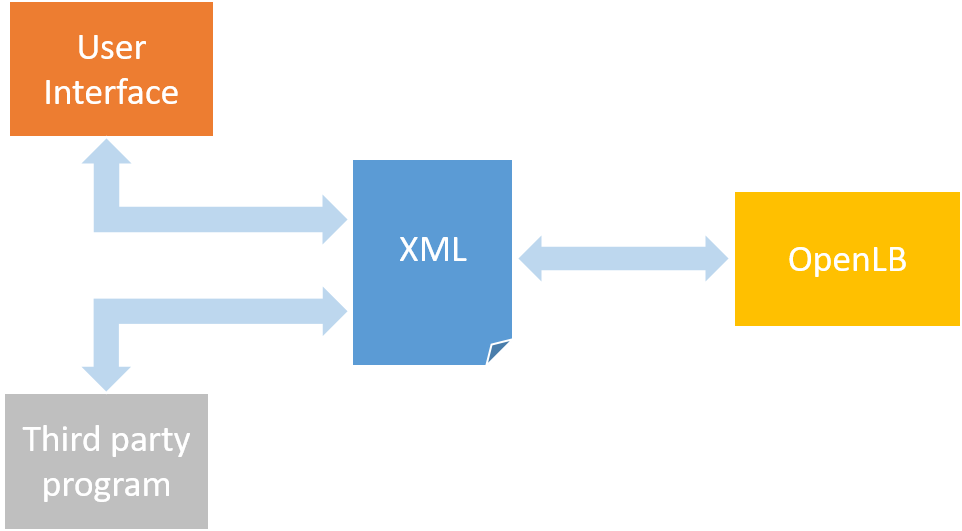

## Preprocessing Workflow

Prior to running a numerical simulation, all input data---including parameters, initial conditions, and boundary conditions---must be carefully prepared.
This preprocessing step ensures compatibility with the simulation model and enhances both robustness and accuracy.
In our system, preprocessing is performed either manually via a graphical user interface (GUI) or automatically through external sources, such as real-time sensor data.

## Input Handling and Workflow

Simulation input data can originate from two main sources: manual user input through the GUI or automatic feeds from external systems like meteorological stations.
When using the GUI, the user first selects the simulation type, for example, wind flow.
The interface then requests recommended parameters from the backend, presenting them with default values and valid input ranges.
After the user confirms or modifies these inputs, the system validates the parameters and configures the simulation domain, mesh, and boundary conditions accordingly.
The simulation is then initialized.

Alternatively, when connected to automated external sources, the system periodically receives real-time environmental data, such as wind speed or pollutant concentrations.
This data undergoes backend validation before dynamically updating the simulation environment, enabling continuous adaptation to current conditions.

Despite these differences in data origin, both approaches adhere to a common workflow: defining simulation dynamics (manually or automatically), validating input parameters, configuring the simulation domain, and starting or updating the simulation.
This unified process guarantees consistency, reliability, and flexibility in simulation setup.

## Integration with External Tools

To facilitate seamless external input and dynamic configuration, the system employs an XML-based communication interface.
This design enables runtime updates and robust integration with other tools.

- **Bidirectional communication:** Data exchange via XML files supports live updates and synchronization between tools.
- **Validation:** Input values are rigorously checked to prevent simulation errors.
- **Dynamic configuration:** Simulation setups can be modified at runtime without recompilation.

{#fig-preprocessing-com width=60% .lightbox}

## Dynamic Configuration in $\OpenLB$

In $\OpenLB$, simulation dynamics are defined using template tuples.
These configurations can be specified in XML for easier access and integration.

::: {#lst-dynamic-tuple}
```{.cpp}
template <typename T, typename DESCRIPTOR>
using BulkDynamics =
dynamics::Tuple<T, DESCRIPTOR, Porous<BulkTuple>, equilibria::SecondOrder,
collision::SmagorinskyEffectiveOmegacollision::BGK>;
```
C++ dynamic tuple definition.
:::

An example XML containing the to-be-read dynamics is shown below.

::: {#lst-xml-dynamic}
```{.xml}
<Methods>
<Map>
<Indicator>1</Indicator>
<Dynamic>
<Momenta>
<BulkDensity/>
<PorousMomentum><BulkMomentum/></PorousMomentum>
<BulkStress/>
<DefineToNEq/>
</Momenta>
<Equilibria><SecondOrder/></Equilibria>
<Collision>
<SmagorinskyEffectiveOmega><BGK/></SmagorinskyEffectiveOmega>
</Collision>
</Dynamic>
</Map>
</Methods>
```
Equivalent XML representation of dynamics.
:::

### Parsing XML to Tuples

The `DynamicsTupleParser` class translates XML input into valid C++ types using a predefined list of supported dynamics.

::: {#tbl-umlTupleParser}
| `DynamicsTupleParser<T,DESCRIPTOR>` |
|:------------------------------------|
| **&minus;** `filename : std::string` |
| **&minus;** `momentaLists : std::vector<std::vector<std::string>>` |
| **&minus;** `equilibriaList : std::vector<std::string>` |
| **&minus;** `collisionList : std::vector<std::string>` |
| **&minus;** `indicators : std::vector<int>` |
| **+** `DynamicsTupleParser(xmlFileName : std::string)` |
| **+** `readTupleFromXML() : std::vector<std::string>` |
| **+** `createDynamicString(dynamicElement : TiXmlElement*, dynamicString : std::string&) : void` |
| **+** `processElement(element : TiXmlElement*, dynamicString : std::string&) : void` |
| **+** `readIndicatorFromXML() : std::vector<int>` |

The `DynamicsTupleParser` class used to extract the dynamic strings from an XML file.
:::

Example usage:

::: {#lst-apply-xml-dynamics}
```{.cpp}
sLattice.defineDynamics("urbanDigitalTwin.xml", sGeometry);
```
Applying XML-defined dynamics.
:::

## Automated Geometry Parsing for Urban Environments

$\OpenLB$ supports the automated parsing of large-scale urban environments using OpenStreetMap (OSM) data.
This simplifies geometry setup and eliminates the need for manual STL file handling or watertight checks.

### OSM Parsing

The `OSMParser` class loads and converts OSM XML data into simulation-ready geometry using latitude and longitude coordinates.

::: {#tbl-umlOSMParser}
| `OSMParser<T>` |
|:---------------|
| **+** `filename : std::string` |
| **+** `trees, buildings, roads, ...` |
| **+** `_lonRange, _latRange, _xRange, _yRange : Vector<T,2>` |
| **+** `_minEasting, _minNorthing : T` |
| **+** `_domainSize : Vector<T,3>` |
| **+** `OSMParser(fileName : std::string, lonRange, latRange)` |
| **+** `parseOSMNodes()` |
| **+** `parseOSMWays(nodes)` |
| **+** `convertToUTMLocal(), convertToUTMLocalTrees(), ...` |
| **+** `createGeometry(type, superGeometry, matF, matTo, ...)` |
| **+** `calculateStreetStatistics(nitrogenConcentration, physDeltaX)` |
| **+** `generateBuildingExhaust(superGeometry, dimension, matF, matTo)` |
| **+** `serializeFootprint(footprint) : std::string` |
| **+** `getUTMZone(lon) : int` |
| **+** `isType(category, key, value) : bool` |
| **+** *... (additional methods)* |

The `OSMParser` class extracts and converts OpenStreetMap data into simulation-ready geometry.
:::

Typical usage:

::: {#lst-useOSM}
```{.cpp}
OSMParser<T> osmParser("map.osm");
olb::Vector<T,3> origin(0,0,0);
auto extent = osmParser.getDomainSize(30.);
olb::IndicatorCuboid3D<T> bounding(extent, origin);
olb::CuboidDecomposition3D<T> cGeometry(bounding,1,singleton::mpi().getSize());
olb::BlockLoadBalancer<T> loadBalancer(cGeometry);
olb::SuperGeometry<T,3> sGeometry(cGeometry, loadBalancer);
osmParser.createGeometry(sGeometry,0,1,type.BUILDING);
```
Use of the class `OSMParser`.
:::
