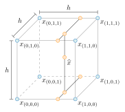
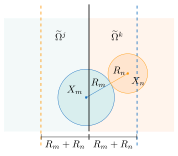

## Non-dimensionalization and Choice of Simulation Parameters

Basically, to describe a physical quantity you need a reference scale.
By dividing a quantity by a variable of the same dimension, a dimensionless quantity is derived.
The result is a number, which is called "the lattice value of the quantity" or the value of the amount "in lattice units" (denoted with $\cdot_{\mathrm{LB}}$), if you consider the Lattice Boltzmann Method.
The reference scale is named the conversion factor between two reference systems.
Furthermore, the conversion factor for the quantity $\phi$ is called $C_\phi$ and the non-dimensional quantity gets the symbol $\phi^*$.

::: callout-tip
To get into this topic, the book *The Lattice Boltzmann Method* [@kruger2017lattice], especially Chapters 7.1 and 7.2 therein, and the Wikipedia article on [dimensional analysis](https://en.wikipedia.org/wiki/Dimensional_analysis) are strongly recommended.
:::

## Porous Media Model

The permeability parameter $K$ is a physical parameter that describes the macroscopic drag in a porous media model.
For laminar flows, it is defined by Darcy's law
$$
K = - \frac{Q \mu L}{\triangle P}~,
$$
where $Q = UA$ is the flow rate, $U$ is a characteristic velocity, $A$ is a cross-sectional area, $\mu$ denotes the dynamic viscosity, $L$ is a characteristic length, and $\triangle P$ specifies the pressure difference between the starting point and endpoint of the volume.

The permeability can be derived from porosity $\epsilon=\frac{V_{fl}}{V_{t}}$ as well, which is the ratio of volume occupied by fluid $V_{fl}$ to the total volume $V_t$.
For that, different equations exist depending on the application case.
For flow through a packed bed, for example, the Kozeny--Carman equation can be applied
$$
K = \Phi_s^2 \frac{\epsilon^3 d_p^2}{180 (1-\epsilon)^2}~,
$$
where $\Phi_s$ is the particle sphericity and $d_p$ is their relevant diameter.

The lattice porosity-value $d \in [0,1]$ is a lattice-dependent value, where $d = 0$ means the medium is solid and $d = 1$ denotes a liquid.
According to @brinkman-permeability:49, @brinkman-viscousforce:1949, @borrvall:2003 and @pingen:2007, the Navier--Stokes equation is transformed (see @dornieden:2013 and @stasius:2014).
The discrete formulation of $d$ describes a flow region by its permeability
$$
d = 1 - h^{dim-1} \frac{\nu_{\mathrm{LB}} \tau_{\mathrm{LB}}}{K}~,
$$
where $\tau_{\mathrm{LB}}$ is the relaxation time, $\nu_{\mathrm{LB}}$ is the discrete kinematic viscosity, and $h$ is the cell length.
Therefore $K \in [ \nu_{\mathrm{LB}} \tau_{\mathrm{LB}} h^{dim-1}, \infty]$.
To describe the porosity or permeability of a medium, a descriptor for porosity must be used, such as the one below.

::: {#lst-porous-descriptor}
```{.cpp}
using DESCRIPTOR = descriptors::PorousD3Q19Descriptor;
```
:::

::: callout-warning
The porous media model only works in the generic compilation mode.
:::

In the function `prepareLattice`, dynamics for the corresponding number of the porous material are defined, for example, as follows.

::: {#lst-porous-prepare}
```{.cpp}
void prepareLattice(..., Dynamics<T, DESCRIPTOR>& porousDynamics, ...){
  /// Material=3 --> porous material
  sLattice.defineDynamics(superGeometry, 3, &porousDynamics);
  ...
}
```
:::

In the function `setBoundaryValues`, the initial porosity value and external field are defined.

::: {#lst-porous-boundary}
```{.cpp}
void setBoundaryValues(..., T physPermeability, int dim, ...){
  // d in [0,1] is a lattice-dependent porosity-value
  // depending on physical permeability K = physPermeability
  T d = converter->latticePorosity(physPermeability);
  AnalyticalConst3D<T,T> porosity(d);
  sLattice.defineField<descriptors::POROSITY>(superGeometry, 3, porosity);
  ...
}
```
:::

In the `main` function, the required parameters as well as the porous media dynamics are defined.

::: {#lst-porous-main}
```{.cpp}
int main(int argc, char* argv[]) {
  ...
  T physPermeability = 0.0003;
  ...
  PorousBGKdynamics<T, DESCRIPTOR> porousDynamics(converter->getOmega(),
    instances::getBulkMomenta<T, DESCRIPTOR>());
  ...
}
```
:::

Additionally, the class `UnitConverter` in `src/core/units.h` provides useful functions for conversion between physical and lattice values.

::: {#lst-porous-converter}
```{.cpp filename="src/core/units.h"}
/// converts a physical permeability K to a lattice-dependent porosity d
/// (a velocity scaling factor depending on Maxwellian distribution
/// function), needs PorousBGKdynamics
T latticePorosity(T K) const
{ return 1 - pow(physLength(),getDim()-1)*getLatticeNu()*getTau()/K; }

/// converts a lattice-dependent porosity d (a velocity scaling factor
/// depending on Maxwellian distribution function) to a physical
/// permeability K, needs PorousBGKdynamics
T physPermeability(T d) const
{ return pow(physLength(),getDim()-1)*getLatticeNu()*getTau()/(1-d); }
```
:::

## Power Law Model

The two most common deviations from Newton's Law observed in real systems are pseudo-plastic fluids and dilatant fluids.
For pseudo-plastic fluids, the viscosity of the system decreases as the shear rate is increased.
On the other hand, as the shear rate by dilatant fluids is increased, the viscosity of the system also increases.
The simplest model that describes these two types of deviations is called the (Ostwald--de Waele) Power Law model and defines the viscosity as
$$
\mu=m\dot{\gamma}^{n-1}~,
$${#eq-powerLaw}
where $m$ is the flow consistency index, $\dot{\gamma}$ is the shear rate, and $n$ denotes the flow behavior index.
Then

- $n < 1$: pseudoplastic fluids,
- $n = 1$: Newtonian fluids,
- $n > 1$: dilatant fluids.

To simulate a power law fluid, a descriptor for dynamic `omega` must be used, such as:

::: {#lst-powerlaw-descriptor}
```{.cpp}
using DESCRIPTOR = descriptors::DynOmegaD2Q9Descriptor;
```
:::

In the function `setBoundaryValues`, the initial `omega`-argument is defined.

::: {#lst-powerlaw-omega}
```{.cpp}
AnalyticalConst2D<T,T> omega0(converter.getOmega());
sLattice.defineField<descriptors::OMEGA>(
  superGeometry.getMaterialIndicator({1,2,3,4}), omega0);
```
:::

In the `main` function, the power law dynamics are defined.

::: {#lst-powerlaw-main}
```{.cpp}
int main(int argc, char* argv[]) {
  ...
  PowerLawBGKdynamics<T, DESCRIPTOR> bulkDynamics(converter.getOmega(), instances::getBulkMomenta<T, DESCRIPTOR>(), m, n, converter.physTime());
}
```
:::

In [the LBM collision equation](01_introduction.qmd#eq-lbm_collision) the kinematic viscosity is no longer constant, and then also the `omega`-argument is no longer constant.
Using the power law model @eq-powerLaw, the kinematic viscosity is computed in each step as
$$
\nu=\dfrac{1}{\rho}m\dot{\gamma}^{n-1}~.
$${#eq-powerLawKinematicViscosity}
The shear rate $\dot{\gamma}$ is computable via the second invariant of the strain rate tensor $D_{II}$, i.e.
$$
\dot{\gamma}=\sqrt{2D_{II}}~,
$${#eq-shearRate}
where
$$
D_{II}=\sum_{\alpha,\beta=1}^{d}E_{\alpha \beta}E_{\alpha \beta}~,
$${#eq-secondInvariant}
and
$$
E_{\alpha \beta} = - \Bigg(1-\dfrac{1}{\tau}\Bigg)\dfrac{1}{2\varrho \nu}\sum_{i=0}^{q-1}f_{i}^{h}\symbf{\xi}_{i\alpha}\symbf{\xi}_{i\beta}~.
$${#eq-strainRateTensor}
This concept is very significant, since $f_{i}^{h}\symbf{\xi}_{i\alpha}\symbf{\xi}_{i\beta}$ is usually computed during the collision process and therefore, in comparison to other CFD methods, adds almost no additional computational cost.
The computation of a new `omega`-argument is done in `src/dynamics/powerLawBGKdynamics.h` via:

::: {#lst-powerlaw-computeomega}
```{.cpp filename="src/dynamics/powerLawBGKdynamics.h"}
T computeOmega(T omega0_, T preFactor_, T rho_, T pi_[util::TensorVal<DESCRIPTOR >::n] );
```
:::

## Multiphysics Couplings {#sec-couplings}

### Shan--Chen Model {#sec-shanChen}

For the simulation of both multiphase and multicomponent flow, the Shan--Chen model is implemented in $\OpenLB$.
Since its first introduction [@shan_chen:93], many variants of the model have been developed.
In this implementation, there are several forcing schemes [@shan_doolen:95; @guo-forcing:02] and interaction potentials to choose from.

#### Implementation of Shan--Chen Two-phase Fluid

The two phases can be simulated on the same lattice instance.

::: {#lst-shanchen-2phase-lattice}
```{.cpp}
SuperLattice<T, DESCRIPTOR> sLattice(superGeometry);
```
:::

Then the dynamics are chosen, which have to support external forces.

::: {#lst-shanchen-2phase-dynamics}
```{.cpp}
ForcedShanChenBGKdynamics<T, DESCRIPTOR> bulkDynamics1 (
omega1, instances::getExternalVelocityMomenta<T,DESCRIPTOR>() );
```
:::

Possible choices for the dynamics are `ForcedBGKdynamics` and `ForcedShanChenBGKdynamics`.

Then the interaction potential is chosen.

::: {#lst-shanchen-2phase-potential}
```{.cpp}
ShanChen93<T,T> interactionPotential;
```
:::

Viable interaction potentials for one component multiphase flow are `ShanChen93`, `ShanChen94`, `CarnahanStarling` and `PengRobinson`.
In this model `PsiEqualsRho` should not be used, because this would make all the mass gather in the same place.

To enable interaction between the fluid, they have to be coupled, so the kind of coupling has to be chosen (here: `ShanChenForcedSingleComponentPostProcessor`) and the material numbers to which it applies.
Since in the case of single component flow there is only one lattice, it is coupled with itself.

::: {#lst-shanchen-2phase-coupling}
```{.cpp}
const T G      = -120.;
const T omega = 1.0;
using COUPLING = ShanChenForcedSingleComponentPostProcessor<T,DESCRIPTOR,interaction::ShanChen94>;
sLattice.addPostProcessor<stage::Coupling>(meta::id<COUPLING>{});
sLattice.setParameter<COUPLING::G>(G);
sLattice.setParameter<COUPLING::RHO0>(T(1));
sLattice.setParameter<COUPLING::OMEGA>(omega);
```
:::

The interaction strength $G$ has to be negative and the correct choice depends on the chosen interaction potential.
When using the `PengRobinson` or `CarnahanStarling` interaction potential, $G$ is cancelled out during computation, so the result is not affected by it (though it still has to be negative).

Finally, during the main loop, the same function for collision and streaming is called as for a single-phase model.

::: {#lst-shanchen-2phase-collide}
```{.cpp}
sLattice.collideAndStream();
```
:::

Examples for the implementation of an LB simulation using the Shan--Chen model for two-phase flow are `examples/phaseSeparation2d` and `examples/phaseSeparation3d`.

#### Implementation of Shan--Chen Two-component Fluid

Two lattice instances are needed, one for each component (though operating on one geometry).

::: {#lst-shanchen-2comp-lattice}
```{.cpp}
SuperLattice<T, DESCRIPTOR> sLatticeOne(superGeometry);
SuperLattice<T, DESCRIPTOR> sLatticeTwo(superGeometry);
```
:::

Then the dynamics are chosen, which have to support external forces.

::: {#lst-shanchen-2comp-dynamics}
```{.cpp}
using BulkDynamics = ForcedShanChenBGKdynamics<T, DESCRIPTOR, momenta::ExternalVelocityTuple>;
sLatticeOne.defineDynamics<BulkDynamics>(superGeometry, 1);
sLatticeTwo.defineDynamics<BulkDynamics>(superGeometry, 1);
```
:::

Possible choices for the dynamics are `ForcedBGKdynamics` and `ForcedShanChenBGKdynamics`.
One should keep in mind that tasks like definition of dynamics, external fields and initial values and the collide and stream execution have to be carried out for each lattice instance separately.
The same is true for data output.
Then the interaction potential is chosen.

::: {#lst-shanchen-2comp-potential}
```{.cpp}
PsiEqualsRho<T,T> interactionPotential;
```
:::

In the multicomponent case, the most frequently used interaction potential is `PsiEqualsRho`, but `ShanChen93`, for example, would also be a viable choice.

To enable interaction between the fluid, they have to be coupled, so the kind of coupling has to be chosen (here: `PseudopotentialForcedCoupling`) and the material numbers to which it applies.

::: {#lst-shanchen-2comp-coupling}
```{.cpp}
using COUPLING = PseudopotentialForcedCoupling<interaction::PsiEqualsRho,
multicomponent_velocity::ShanChen>;
SuperLatticeCoupling coupling(
    COUPLING{},
    names::A{}, sLatticeOne,
    names::B{}, sLatticeTwo);
coupling.template setParameter<COUPLING::G>(T(3.));
coupling.template setParameter<multicomponent_velocity::ShanChen::OMEGA_A>(omega1);
coupling.template setParameter<multicomponent_velocity::ShanChen::OMEGA_B>(omega2);
```
:::

The interaction strength $G$ has to be positive.
If the chosen interaction potential is `PsiEqualsRho`, $G>1$ is needed for the separation of the fluids, but it should not be much higher than $3$ for stability reasons.

Finally, during the main loop, the lattices have to interact with each other.

::: {#lst-shanchen-2comp-loop}
```{.cpp}
sLatticeOne.collideAndStream();
sLatticeTwo.collideAndStream();
sLatticeOne.executePostProcessors(stage::PreCoupling());
sLatticeTwo.executePostProcessors(stage::PreCoupling());
coupling.execute();
```
:::

These steps are placed after the `collideAndStream` command.

Examples for the implementation of an LB simulation using the Shan--Chen model for two-component flow are `examples/multiComponent2d` and `examples/multiComponent3d`.

### Pseudo-potential Model

#### Implementation of Pseudo-potential Two-phase Fluid

This section describes the implementation of a pseudo-potential model recently published [@czelusniak2025consistency].
Typically, pseudo-potential models require the user to provide internal model parameters, such as $G$, which influence physical properties like phase densities and surface tension.

In this pseudo-potential model, the user starts by providing only physical quantities to the model:

::: {#lst-pseudopotential-quantities}
```{.cpp}
const T nu_vapor   = 3.39e-7; // vapor kinematic viscosity [m2.s-1]
const T nu_liquid = 1.58e-7;   // liquid kinematic viscosity [m2.s-1]
const T SurfTension = 7.58e-3; // surface tension for water-air [N.m-1]
const T rho_vapor   = 37.5; // vapor density [kg.m-3]
const T rho_liquid = 1187;   // liquid density [kg.m-3]
const T thickness = 1.0; // interface thickness in grid nodes;
```
:::

All physical quantities are provided in physical units, with the exception of the interface thickness, which is given in lattice units for convenience.
However, the user can also choose to provide it in physical units if necessary.

::: callout-note
In this model we define the reference length for the interface thickness as the region where the fluid has a density satisfying $0.33 < (\rho - \rho_v)/(\rho_l - \rho_v) < 0.67$.
:::

A multiphase unit converter was implemented to help the user handle conversions from lattice to physical units and vice versa:

::: {#lst-pseudopotential-converter}
```{.cpp}
MultiPhaseUnitConverterFromRelaxationTime<T,DESCRIPTOR> converter(
    (T)   Nx,              // resolution
    (T)   0.6,             // lattice relaxation time
    (T)   rho_liquid/1000, // lattice density
    (T)   Lx,              // charPhysLength: reference length of simulation geometry
    (T)   nu_liquid,       // physViscosity: physical kinematic viscosity in __m^2 / s__
    (T)   rho_liquid       // physDensity: physical density in __kg / m^3__
  );
```
:::

In order to simulate fluids with different kinematic viscosities for the vapor and liquid phases, new dynamics for multiphase cases were created:

::: {#lst-pseudopotential-dynamics}
```{.cpp}
using BulkDynamics = MultiphaseForcedBGKdynamics<T, DESCRIPTOR>;
sLattice.defineDynamics<BulkDynamics> superGeometry, 1);
```
:::

It is necessary to provide the phase densities and relaxation frequencies to the dynamics, which are then used to compute the effective relaxation frequency:

::: {#lst-pseudopotential-parameters}
```{.cpp}
sLattice.setParameter<multiphase::RHO_VAPOR>( rho_vapor/converter.getConversionFactorDensity() );
sLattice.setParameter<multiphase::RHO_LIQUID>( rho_liquid/converter.getConversionFactorDensity() );
sLattice.setParameter<multiphase::OMEGA_VAPOR>( 1./converter.computeRelaxationTimefromPhysViscosity( nu_vapor ) );
sLattice.setParameter<multiphase::OMEGA_LIQUID>( 1./converter.computeRelaxationTimefromPhysViscosity( nu_liquid ) );
```
:::

The interaction force is computed using a coupling on a single lattice:

::: {#lst-pseudopotential-coupling}
```{.cpp}
using COUPLING = PseudopotentialForcedPostProcessor<interaction::Polinomial>;
SuperLatticeCoupling couplingInteractionForce(
    COUPLING{},
    names::Component1{}, sLattice
  );
```
:::

Notice that we provide an interaction potential to the coupling.
Here, the interaction potential is named `Polinomial`.
This interaction applies the equation of state described in [@czelusniak2025consistency].

The user is not required to provide internal model parameters, as they are automatically computed from the chosen interaction potential.
First, the user provides the necessary physical quantities to the interaction potential:

::: {#lst-pseudopotential-potential-parameters}
```{.cpp}
couplingInteractionForce.template setParameter<interaction::Polinomial::RHOV>(
    rho_vapor/converter.getConversionFactorDensity() );
couplingInteractionForce.template setParameter<interaction::Polinomial::RHOL>(
    rho_liquid/converter.getConversionFactorDensity() );
couplingInteractionForce.template setParameter<interaction::Polinomial::THICKNESS>(thickness);
couplingInteractionForce.template setParameter<interaction::Polinomial::SURFTENSION>(
    SurfTension/converter.getConversionFactorSurfaceTension() );
```
:::

Finally, the internal model parameters are computed using an internal function of the interaction potential:

::: {#lst-pseudopotential-compute}
```{.cpp}
interaction::Polinomial::computeParameters<T>(couplingInteractionForce);
```
:::

Inside `prepareLattice`, a postprocessor is defined to compute the density field after collision and streaming, and to store the information in a field called `STATISTICS`:

::: {#lst-pseudopotential-postprocessor}
```{.cpp}
sLattice.addPostProcessor<stage::PreCoupling>(meta::id<RhoStatistics>());
```
:::

In the main time loop, we execute the calculations in the following order:

::: {#lst-pseudopotential-loop}
```{.cpp}
sLattice.collideAndStream();
sLattice.executePostProcessors(stage::PreCoupling());
sLattice.getCommunicator(stage::PreCoupling()).communicate();
couplingInteractionForce.execute();
```
:::

After collision and streaming, the `STATISTICS` field is used to store the density values inside the postprocessor.
A communicator is used to allow access to this field by neighboring lattice nodes.
Finally, the interaction force is computed using the coupling.

#### Implementation of Pseudo-potential Multi-component Fluid

With $n$ components, $n$ lattice instances are needed -- one for each component (though there is still only one geometry):

::: {#lst-mcmp-lattices}
```{.cpp}
SuperLattice<T, DESCRIPTOR> sLattice1( superGeometry );
SuperLattice<T, DESCRIPTOR> sLattice2( superGeometry );
SuperLattice<T, DESCRIPTOR> sLattice3( superGeometry );
```
:::

Then the dynamics are chosen, which have to support external forces and shared velocity:

::: {#lst-mcmp-dynamics}
```{.cpp}
using BulkDynamics = MultiComponentForcedBGKdynamics<T, DESCRIPTOR>;
...
sLattice1.defineDynamics<BulkDynamics>(superGeometry, 1);
sLattice2.defineDynamics<BulkDynamics>(superGeometry, 1);
sLattice3.defineDynamics<BulkDynamics>(superGeometry, 1);
```
:::

One should keep in mind that tasks like the definition of dynamics, external fields, initial values, the collide and stream, and coupling execution have to be carried out for each lattice instance separately.
The same is true for data output.

The interaction potential is chosen when initialized with the `SuperLatticeCoupling`:

::: {#lst-mcmp-coupling}
```{.cpp}
SuperLatticeCoupling coupling(
  MCMPForcedPostProcessor<interaction::MCPRpseudoPotential>{},
  names::Component1{}, sLattice1,
  names::Component2{}, sLattice2,
  names::Component3{}, sLattice3);
```
:::

In the lattice preparation, the binary interaction parameters of the mixture components as well as general equation of state parameters of all components are initialized:

::: {#lst-mcmp-parameters}
```{.cpp}
...
coupling.template setParameter<COUPLING::GI>(gI_L);
coupling.template setParameter<COUPLING::GII>(gII_L);
```
:::

In the particular pseudo-potential model of `MCMPForcedPostProcessor`, the surface tension can be adjusted by adjusting the `sigma` parameter.

::: {#lst-mcmp-sigma}
```{.cpp}
coupling.template setParameter<COUPLING::SIGMA>(sigma);
```
:::

This parameter is in lattice units, so the true physical surface tension should be measured in a Young--Laplace test.

Finally, during the main loop, the lattices have to interact with each other:

::: {#lst-mcmp-loop}
```{.cpp}
sLattice1.getCommunicator(stage::PreCoupling()).communicate();
sLattice1.executePostProcessors(stage::PreCoupling());
sLattice2.getCommunicator(stage::PreCoupling()).communicate();
sLattice2.executePostProcessors(stage::PreCoupling());
sLattice3.getCommunicator(stage::PreCoupling()).communicate();
sLattice3.executePostProcessors(stage::PreCoupling());
coupling.execute();
```
:::

These steps are placed immediately after the `collideAndStream` command.

Examples for the implementation of an LB simulation using the pseudo-potential model (Shan--Chen force with a thermodynamic equation of state) for three-component flow are `examples/multiComponent/airBubbleCoalescence3d` and `examples/multiComponent/waterAirFlatInterface2d`.

### Two-phase Free Energy Model {#sec-twophase-freeEnergy}

The free energy model employed in [@czelusniak2025analytical] is implemented in $\OpenLB$.
The forcing scheme used in this model was proposed by Wagner [@wagner2006thermodynamic].
The forcing scheme is modified to add high-order correction terms to assure the method thermodynamic consistency.
Then, the method can be applied using the appropriate dynamics:

::: {#lst-wagner-dynamics}
```{.cpp}
using BulkDynamics = ForcedWagnerBGKdynamics<T, DESCRIPTOR>;
sLattice.defineDynamics<BulkDynamics>(superGeometry, 1);
```
:::

These dynamics were created to receive the relaxation frequency from an external field called `OMEGA`:

::: {#lst-wagner-tuple}
```{.cpp}
template <typename T, typename DESCRIPTOR, typename MOMENTA=momenta::BulkTuple>
using ForcedWagnerBGKdynamics = dynamics::Tuple<
  T, DESCRIPTOR,
  MOMENTA,
  equilibria::SecondOrder,
  collision::ParameterFromCell<descriptors::OMEGA, collision::BGK>,
  forcing::Wagner
>;
```
:::

The reason for this choice is explained in the `isothermalEvaporation2d` example.
It is important to mention that the Wagner forcing scheme was validated for 1D problems, and its extension to higher dimensions is still an open topic.

Two couplings are required in this model.
The couplings here just receive one lattice, working as a postprocessor placed after the collision and streaming process.
The first coupling is used to compute the chemical potential:

::: {#lst-freeenergy-chemical-coupling}
```{.cpp}
using COUPLING1 = ChemicalPotentialPostProcessor<EOS::Landau>;
SuperLatticeCoupling chemicalCoupling(
    COUPLING1{},
    names::Component1{}, sLattice
  );
```
:::

Since the chemical potential depends on the choice of the equation of state, this one needs to be provided to the coupling.
Notice that here we give `EOS::Landau` to the coupling.

The free energy also has some internal parameters that influence fluid properties such as interface thickness and surface tension.
Our implementation computes the necessary parameters from the physical quantities that are provided to the EOS:

::: {#lst-freeenergy-eos-parameters}
```{.cpp}
chemicalCoupling.template setParameter<EOS::Landau::RHOV>(
            rho_vapor/converter.getConversionFactorDensity());
chemicalCoupling.template setParameter<EOS::Landau::RHOL>(
            rho_liquid/converter.getConversionFactorDensity());
chemicalCoupling.template setParameter<EOS::Landau::THICKNESS>(thickness);
chemicalCoupling.template setParameter<EOS::Landau::SURFTENSION>(
            surfTension/converter.getConversionFactorSurfaceTension());
EOS::Landau::computeParameters<T>(chemicalCoupling);
```
:::

The other coupling is used to compute the thermodynamic force related to the gradients of the chemical potential:

::: {#lst-freeenergy-force-coupling}
```{.cpp}
using COUPLING2 = FreeEnergyForcedPostProcessor;
SuperLatticeCoupling forceCoupling(
    COUPLING2{},
    names::Component1{}, sLattice
  );
```
:::

Finally, the main loop with time assumes the following form:

::: {#lst-freeenergy-loop}
```{.cpp}
// Collide and stream (and coupling) execution
sLattice.collideAndStream();
// Compute chemical potential
sLattice.executePostProcessors(stage::PreCoupling());
sLattice.getCommunicator(stage::PreCoupling()).communicate();
chemicalCoupling.execute();
// Compute thermodynamic force
sLattice.executePostProcessors(stage::PreCoupling());
sLattice.getCommunicator(stage::PreCoupling()).communicate();
forceCoupling.execute();
```
:::

### Multi-component Free Energy Model {#sec-freeEnergy}

As an alternative option for simulating multi-component flow, the free energy model has been implemented in $\OpenLB$, and can be used for either two or three fluid components.
Examples for the binary case are given in `youngLaplaceXd` and `contactAngleXd`, while an example of the ternary case with boundaries is provided in `microFluidics2d`.
These are all contained within the `examples/multiComponent/` folder.

The approach taken in $\OpenLB$ is similar to that given in [@semprebon:16] and assumes equal densities and viscosities for each of the fluids.
In the next sections, the method will be outlined briefly for three components.
The two-component case is identical to taking the third fluid component to be zero and instead only uses two lattices.

#### Bulk Free Energy Model

Three lattices are required to track the density $\rho$, and order parameters $\phi$ and $\psi$.
These are related to the individual component densities $C_i$ by
$$
\rho = C_1 + C_2 + C_3,  \qquad  \phi = C_1 - C_2,  \qquad  \psi = C_3,
$$
respectively.
By considering the free energy, a force is derived to drive the fluid towards the thermodynamic equilibrium.
The density therefore obeys the Navier--Stokes equation with this added force.
The equation of motion for the order parameters is the Cahn--Hilliard equation.
The dynamics chosen for the first lattice must therefore include an external force, such as `ForcedBGKdynamics`, while for the second and third lattices `FreeEnergyBGKdynamics` is required.

::: {#lst-bulk-freeenergy-dynamics}
```{.cpp}
using bulkDynamics1 = ForcedBGKdynamics<T, DESCRIPTOR>;
using bulkDynamics2 = FreeEnergyBGKdynamics<T, DESCRIPTOR>;
...
sLattice1.defineDynamics<bulkDynamics1>(superGeometry, 1);
sLattice2.defineDynamics<bulkDynamics2>(superGeometry, 1);
sLattice3.defineDynamics<bulkDynamics2>(superGeometry, 1);
```
:::

To compute the force, two lattice couplings are required.
The first computes the chemical potentials for each lattice using the equations
$$
\begin{aligned}
  \mu_{\rho}  = &
      A_1 + A_2 + \frac{\alpha^2}{4} \left[ (\kappa_1 + \kappa_2)
      \left( \symbf{\nabla}^2\psi - \symbf{\nabla}^2\rho \right) +
      (\kappa_2 - \kappa_1) \symbf{\nabla}^2\phi \right],  \\
  \mu_{\phi}  = &
      A_1 - A_2 + \frac{\alpha^2}{4} \left[ (\kappa_2 - \kappa_1)
      \left( \symbf{\nabla}^2\rho - \symbf{\nabla}^2\psi \right) -
      (\kappa_1 + \kappa_2) \symbf{\nabla}^2\phi \right],  \\
  \mu_{\psi} = & - A_1 - A_2 + \kappa_3 \psi (\psi - 1) (2\psi - 1)
        + \frac{\alpha^2}{4} \left[(\kappa_1 + \kappa_2)
        \symbf{\nabla}^2\rho \right. \\
        & - \left. (\kappa_2 - \kappa_1) \symbf{\nabla}^2\phi -
        (\kappa_1 + \kappa_2 + 4\kappa_3) \symbf{\nabla}^2 \psi \right],
\end{aligned}
$${#eq-chemicalPotentials}
where $A_1$ and $A_2$ are defined as
$$
\begin{aligned}
  A_1 = \frac{\kappa_1}{8} (\rho + \phi - \psi)
            (\rho + \phi - \psi - 2) (\rho + \phi - \psi - 1), \\
  A_2 = \frac{\kappa_2}{8} (\rho - \phi - \psi)
            (\rho - \phi - \psi - 2) (\rho - \phi - \psi - 1),
\end{aligned}
$$
respectively.
The $\alpha$ and the $\kappa$ parameters are input parameters for the lattice coupling and can be used to tune the interfacial width and surface tensions.
The interfacial width is given by $\alpha$ and the surface tensions are $\gamma_{mn} = \alpha(\kappa_m + \kappa_n)/6$.
The chemical potential values are stored using `FIELDS` named `CHEM_POTENTIAL` and declared with the descriptor `using DESCRIPTOR = D2Q9<CHEM_POTENTIAL,FORCE>`.

The second lattice coupling then computes the force using
$$
\symbf{F} = - \rho \symbf{\nabla} \mu_\rho
                   - \phi \symbf{\nabla} \mu_\phi
                   - \psi \symbf{\nabla} \mu_\psi.
$$

The two lattice couplings are applied using `SuperLatticeCoupling`:

::: {#lst-bulk-freeenergy-couplings}
```{.cpp}
SuperLatticeCoupling coupling1(
  ChemicalPotentialCoupling2D{},
  names::Component1{}, sLattice1,
  names::Component2{}, sLattice2,
  names::Component3{}, sLattice3);
coupling1.restrictTo(superGeometry.getMaterialIndicator({1}));

SuperLatticeCoupling coupling2(
  ForceCoupling2D{},
  names::Component1{}, sLattice1,
  names::Component2{}, sLattice2,
  names::Component3{}, sLattice3);
coupling2.restrictTo(superGeometry.getMaterialIndicator({1}));
```
:::

The component parameters must be provided after the `coupling1` declaration:

::: {#lst-bulk-freeenergy-parameters}
```{.cpp}
...
coupling1.template setParameter<ChemicalPotentialCoupling2D::ALPHA>(alpha);
coupling1.template setParameter<ChemicalPotentialCoupling2D::KAPPA1>(kappa1);
coupling1.template setParameter<ChemicalPotentialCoupling2D::KAPPA2>(kappa2);
coupling1.template setParameter<ChemicalPotentialCoupling2D::KAPPA3>(kappa3);
```
:::

The fields `CHEM_POTENTIAL` and `RhoStatistics` must be communicated to allow proper computation between blocks.
The following is then used in the main loop to calculate the force at each timestep.

::: {#lst-bulk-freeenergy-loop}
```{.cpp}
sLattice1.executePostProcessors(stage::PreCoupling());
sLattice2.executePostProcessors(stage::PreCoupling());
sLattice3.executePostProcessors(stage::PreCoupling());

sLattice1.getCommunicator(stage::PreCoupling()).communicate();
sLattice2.getCommunicator(stage::PreCoupling()).communicate();
sLattice3.getCommunicator(stage::PreCoupling()).communicate();

coupling1.execute();

sLattice1.getCommunicator(stage::PostCoupling()).communicate();
sLattice1.executePostProcessors(stage::PostCoupling());

coupling2.execute();
```
:::

#### Boundaries in Free Energy Models

Bounce-back wall boundaries with controllable contact angles may be added using the `setFreeEnergyWallBoundary` function.

::: {#lst-freeenergy-wall}
```{.cpp}
setFreeEnergyWallBoundary<T,DESCRIPTOR>(sLattice1, superGeometry, 2,
    alpha, kappa1, kappa2, kappa3, h1, h2, h3, 1);
setFreeEnergyWallBoundary<T,DESCRIPTOR>(sLattice2, superGeometry, 2,
    alpha, kappa1, kappa2, kappa3, h1, h2, h3, 2);
setFreeEnergyWallBoundary<T,DESCRIPTOR>(sLattice3, superGeometry, 2,
    alpha, kappa1, kappa2, kappa3, h1, h2, h3, 3);
```
:::

The final parameter, `latticeNumber`, is necessary to change each lattice differently, while the $h_i$ parameters are related to the contact angles at the boundary.
The contact angles $\theta_{mn}$ are given by the following relation
$$
\cos\theta_{mn} =
        \frac{(\alpha\kappa_n \! + \! 4h_n)^{3/2} -
              (\alpha\kappa_n \! - \! 4h_n)^{3/2}}
             {2 (\kappa_m + \kappa_n) \sqrt{\alpha\kappa_n}} -
        \frac{(\alpha\kappa_m \! + \! 4h_m)^{3/2} -
              (\alpha\kappa_m \! - \! 4h_m)^{3/2}}
             {2 (\kappa_m + \kappa_n) \sqrt{\alpha\kappa_m}}.
$${#eq-contactAngles}
Notably, to set neutral wetting ($90^\circ$ angles), the values can be set to $h_i=0$.

A demonstration of using these solid boundaries for a binary fluid case is provided in the `contactAngle(2,3)d` examples.
The examples compare the simulated angles to those given by @eq-contactAngles, respectively for dimensions $d=2,3$.

Open boundary conditions can also be implemented using the `setFreeEnergyInletBoundary` and `setFreeEnergyOutletBoundary` functions.
These can be used to specify constant density or velocity boundaries.
The first lattice is used to define the density or velocity boundary condition, while on the second and third lattices $\phi$ and $\psi$ must instead be defined.
For example, to set a constant velocity inlet, see the code snippet below.

::: {#lst-freeenergy-inlet}
```{.cpp}
setFreeEnergyInletBoundary(
    sLattice1, inletIndicator, "velocity", 1 );
setFreeEnergyInletBoundary(
    sLattice2, inletIndicator, "velocity", 2 );
setFreeEnergyInletBoundary(
    sLattice3, inletIndicator, "velocity", 3 );

sLattice1.defineU( inletIndicator, 0.002 );
sLattice2.defineRho( inletIndicator, 1. );
sLattice3.defineRho( inletIndicator, 0. );
```
:::

However, this alone is insufficient to set a constant density outlet because $\rho$, $\phi$, and $\psi$ are redefined by a convective boundary condition on each time step.
In this case, an additional lattice coupling is required, using `DensityOutletCoupling2D`.

There are two additional requirements for open boundaries.
The first is that the velocity must be coupled between the lattices using `InletOutletCoupling2D`, because this is required for the collision step.
The second is that the communication of the external field must now include two values.
This ensures that $\rho$, $\phi$, and $\psi$ are properly set on block edges at the outlet.
To see a full example of applying these boundary conditions, see the `microFluidics2d` example.

### Incompressible Phase-field Allen--Cahn Model {#sec-PhaseField}

#### Conservative Phase Field Model

This model requires two lattices, one to solve the momentum conservation equation and the other for the Allen--Cahn equation that governs a conservative phase field in order to track the diffusive phase interface.

::: {#lst-allencahn-lattices}
```{.cpp}
SuperLattice<T, NSDESCRIPTOR> sLatticeNS(converter, superGeometry);
SuperLattice<T, ACDESCRIPTOR> sLatticeAC(converterAC, superGeometry);
```
:::

This model uses an explicitly designed incompressible Navier--Stokes solver to decouple pressure and density such that density can be a function of the phase field.
Each lattice receives the appropriate dynamics:

::: {#lst-allencahn-dynamics}
```{.cpp}
using NSBulkDynamics = MultiPhaseIncompressbileInterfaceTRTdynamics<T,NSDESCRIPTOR>;
using ACBulkDynamics = AllenCahnBGKdynamics<T, ACDESCRIPTOR>;
sLatticeNS.defineDynamics<NSBulkDynamics>(superGeometry, 1);
sLatticeAC.defineDynamics<ACBulkDynamics>(superGeometry, 1);
```
:::

A coupling is used mainly to compute the thermodynamic force for the multicomponent system and also to compute other quantities such as the effective relaxation frequency.

::: {#lst-allencahn-coupling}
```{.cpp}
SuperLatticeCoupling coupling(LiangPostProcessor {},
names::NavierStokes {}, sLatticeNS,
names::Component1 {}, sLatticeAC);
coupling.restrictTo(superGeometry.getMaterialIndicator({1, 4}));
```
:::

The coupling needs to receive the necessary parameters for the computations:

::: {#lst-allencahn-parameters}
```{.cpp}
coupling.template setParameter<Coupling::SIGMA>( surfaceTension / converter.getConversionFactorSurfaceTension() );
coupling.template setParameter<Coupling::W>( interfaceThickness );
coupling.template setParameter<Coupling::TAUS>({tau_g, tau_l});
coupling.template setParameter<Coupling::RHOS>( {densityGas/converter.getConversionFactorDensity(),
    densityLiquid/converter.getConversionFactorDensity()});
coupling.template setParameter<Coupling::SWITCH>(1);
```
:::

#### Boundaries in the Incompressible Allen--Cahn Model

The boundary conditions for this model involve wetting boundary conditions on arbitrarily shaped surfaces,

::: {#lst-allencahn-walls}
```{.cpp}
// walls
std::vector<T> origin = {-2.*dx, dx*0.5};
std::vector<T> extend = {dx*(Nx+4), dx*(Ny-2)};
IndicatorCuboid2D<T> wallLocation( extend, origin );
setBouzidiBoundary(sLatticeNS, superGeometry, 2, wallLocation);
setBouzidiPhaseField(sLatticeAC, superGeometry, 2, wallLocation);
```
:::

as well as velocity and pressure boundaries for the Navier--Stokes lattice with convective and Dirichlet boundaries for the conservative phase field on flat boundaries:

::: {#lst-allencahn-inlet-outlet}
```{.cpp}
// inlet and outlet
boundary::set<boundary::IncompressibleZouHeVelocity>(sLatticeNS, inlet);
boundary::set<boundary::RegularizedTemperature>(sLatticeAC, inlet);
boundary::set<boundary::IncompressibleZouHePressure>(sLatticeNS, outlet);
setConvectivePhaseFieldBoundary<T,ACDESCRIPTOR>(sLatticeAC, outlet);
```
:::

Together with a fringe zone, this ensures the stable outlet of diffusive interfaces across open boundaries.

### Coupling Between Momentum and Energy Equations

As explained in reference [@mohamad2010critical], there are different schemes to couple the momentum and energy equations by means of a buoyancy force (also called Boussinesq approximation).
Some schemes add an extra force term to the collision term, other methods shift the velocity field according to Newton's second law, and others combine an extra force term and a velocity shift.
The implementation applied in $\OpenLB$ belongs to this last group of schemes.

Once the boundary values for the velocity and temperature fields are set, collision and streaming functions are called.
The dynamics with an external force $\symbf{F}$ used for the velocity calculation (e.g. `ForcedBGKdynamics`) shift the velocity $\symbf{v}$ before executing the collision step.
The shift follows @eq-FBD,
$$
\symbf{u}_{\mathrm{shift}}= \symbf{u} + \frac{\symbf{F}}{2} .
$${#eq-FBD}
The code snippet responsible for this shift is defined in the collision function of the file `dynamics/dynamics.hh` for the class `ForcedBGKdynamics`.

::: {#lst-velocity-shift}
```{.cpp filename="src/dynamics/dynamics.hh"}
this->momenta . computeRhoU( cell , rho , u) ;
FieldPtr<T,DESCRIPTOR,FORCE> force = cell.template getFieldPointer<descriptors::FORCE>();
for ( int iVe l=0; iVel<DESCRIPTOR >::d; ++iVel ) {
  u[iVel] += force[iVel] / T{2};
}
```
Velocity shift.
:::

After the corresponding collision step using the shifted velocity, the value of the density distribution functions $f_i$ is modified by the external force with the call to the function.

::: {#lst-add-external-force}
```{.cpp}
lbm< Lattice >::addExternalForce( cell , u , omega )
```
:::

This function follows
$$
\bar{f_i}
=
f_i
+ \left( 1 - \frac{\omega}{2} \right)
  w_i
  \left( \frac{\symbf{c}_i - \symbf{u}}{c_s^2} + \frac{\symbf{c}_i \cdot \symbf{u}}{c_s^4}\symbf{c}_i \right)
\cdot \symbf{F} ~,
$${#eq-dF}
where $\tilde{f_i}$ represents the new distribution function (see reference [@guo-forcing:02] for the BGK model and [@fakhari2010phase] for MRT models), $w_{i}$ are the weights of the discrete velocities $\symbf{c}_{i}$, and $\omega = \tau^{-1}$ denotes the relaxation frequency.
The coupling in the collision step for the temperature field is given by the use of the velocity from the isothermal field.

::: {#lst-temperature-velocity}
```{.cpp}
auto u = cell.template getFieldPointer<descriptors::VELOCITY>();
```
:::

The equilibrium density distribution function for the temperature only has terms of first order (see e.g. [@siodlaczek:21]).
After the collision step, the coupling function is called `NSlattice.executeCoupling()`, where the values of the external force in the `NSlattice` and of the advected velocity in the `ADlattice` are updated.

::: {#lst-velocity-coupling}
```{.cpp}
auto u = tPartner->get(iX, iY).template getFieldPointer<descriptors::VELOCITY>();
blockLattice.get(iX, iY).computeU(u);
```
Velocity coupling.
:::

The new force is computed via the Boussinesq approximation
$$
\symbf{F} = \rho \frac{T-T_0}{\triangle T} \symbf{g}~.
$${#eq-bA}
The temperature $T$ is obtained from the `ADlattice`, $T_0$ is the average temperature between the defined cold and hot temperatures, whereas $\triangle T$ is the difference between the hot and cold temperatures.

::: {#lst-boussinesq-force}
```{.cpp}
auto force = blockLattice.get(iX, iY).template getFieldPointer<descriptors::FORCE>();
T temperature = tPartner->get(iX, iY).computeRho();
T rho = blockLattice.get(iX, iY).computeRho();
for (unsigned iD = 0 ; iD < L :: d ; ++iD) {
  force[iD] = gravity * rho * (temperature - T0) / deltaTemp * dir[iD];
}
```
Computation of the Boussinesq force.
:::

## Advection--Diffusion Equation {#sec-ade}

The advective and diffusive transport of a macroscopic density, energy or temperature is governed by the advection--diffusion equation
$$
\frac{\partial c}{\partial t} + \symbf{\nabla} \cdot (\symbf{v}c) = \symbf{\nabla} \cdot (D\symbf{\nabla} c) \quad \text{in } \Omega \times I,
$$
where $c\colon \Omega \times I \to \mathbb{R}, (\symbf{x}, t)\mapsto c(\symbf{x}, t)$ is the considered physical quantity (temperature, chemical concentration, particle density), $D>0$ is the diffusion coefficient, and $\symbf{v}$ is a velocity field affecting $c$.
It is possible to approximate this equation with LBM by using an equilibrium distribution function different from the one for the Navier--Stokes equations [@chopard:02; @simonis:20; @simonis:23]
$$
g_i^{eq} = w_i \rho \bigg(1+\frac{\symbf{c}_i \cdot \symbf{v}}{c_s^2}\bigg),
$${#eq-equilibriumfirstOrder}
that takes the advective transport into account.
In @eq-equilibriumfirstOrder, $w_i$ is a weighting factor, $\symbf{c}_i$ a unit vector along the lattice directions, $c_s$ the speed of sound, and $i$ denotes the discrete velocity counter.
To use this implementation the dynamics object has to be replaced by special advection--diffusion dynamics:

::: {#lst-ade-dynamics}
```{.cpp}
template<typename T, typename DESCRIPTOR, typename MOMENTA=momenta::AdvectionDiffusionBulkTuple>
using AdvectionDiffusionBGKdynamics = dynamics::Tuple<
  T,DESCRIPTOR,
  MOMENTA,
  equilibria::FirstOrder,
  collision::BGK,
  AdvectionDiffusionExternalVelocityCollision
>;
```
Advection diffusion dynamics object.
:::

Additionally, a different descriptor with fewer lattice velocities is used [@huang:11]:

::: {#lst-ade-descriptor}
```{.cpp}
using DESCRIPTOR = D3Q7<VELOCITY,SOURCE>;
```
Exemplary advection diffusion descriptor with field for a source term.
:::

In $\OpenLB$, the descriptors `D2Q5` and `D3Q7` are implemented for the advection--diffusion equation, whereby higher lattice velocity numbers can be used as well.
Since the advection--diffusion equation is a scalar transport equation differing from the Navier--Stokes momentum conservation, another set of boundary conditions is needed.
Dirichlet, Neumann and Robin boundary conditions are implemented in $\OpenLB$.
The Dirichlet condition sets a constant scalar value in the cells with chosen material number, the Neumann zero gradient boundary copies flux from the neighbor fluid cells, and with the Robin boundary condition a zero or non-zero flux can be set in the boundary cells.

::: {#lst-ade-boundaries}
```{.cpp}
void prepareLattice(...) {
...
/// Material=3 -> Dirichlet boundary with constant scalar value for axes aligned surfaces (vertical or horizontal)
setAdvectionDiffusionTemperatureBoundary<T,ADDESCRIPTOR>(
      sLatticeAD, superGeometry, 3);

/// Material=3 -> Dirichlet boundary with constant scalar value for curved or inclined surfaces
sLatticeAD.defineDynamics<FirstOrderEquilibriumBoundary>(superGeometry, 3);

/// Material=4 -> Neumann boundary with zero flux gradient
setZeroGradientBoundary<T,ADDESCRIPTOR>(
      sLatticeAD, superGeometry, 4);

/// Material=5 -> Robin boundary with constant reaction rate on the boundary surface
setRobinBoundary<T,ADDESCRIPTOR>(
      sLatticeAD, omegaAD, superGeometry, 5);
T reactionRate = converter.getCharLatticeVelocity(); //determines speed of reaction, here equal to velocity
AnalyticalConst3D <T,T> coefficients(reactionRate, -converter.getLatticeDiffusivity(), reactionRate * Ceq); //set Robin coefficients
sLatticeAD.template defineField<descriptors::G>(superGeometry.getMaterialIndicator({5}), (coefficients)); //save coefficient in a field
...
}
```
Setup of advection diffusion boundary conditions.
:::

To apply convective transport, a velocity vector has to be passed.
This can either be done individually on each cell by using the following.

::: {#lst-ade-cell-velocity}
```{.cpp}
T velocity[3] = {vx,vy,vz};
...
cell.defineField<descriptors::VELOCITY>(velocity);
```
Add advective velocity on a cell.
:::

Alternatively, it can be passed to the whole `SuperLattice` using:

::: {#lst-ade-superlattice-velocity}
```{.cpp}
AnalyticalConst3D<T,T> velocity(vel);
...
/// sets advective velocity for material 1
superLattice.defineField<descriptors::Velocity>(superGeometry, 1, velocity);
```
Add advective velocity on a superlattice.
:::

Here, `vel` is a `std::vector<T>`.

### Closer Look at Advection Diffusion Boundary Conditions

#### Dirichlet Boundary Condition

At the boundaries of a lattice, only the outgoing directions of the distribution functions are known, while those towards the domain need to be computed.
Several types of implementations for Dirichlet boundary conditions are summarized in [Section Defining Boundary Methods](06_initial_boundary.qmd#sec-defineBoundaryMethod).
At a Dirichlet boundary for the advection--diffusion equation, the observable, e.g. temperature, is set to a constant value.
This boundary condition can be applied to flat walls, corners and edges (for three-dimensional domains).
The algorithm to set a certain temperature on a wall is defined in the dynamics class `AdvectionDiffusionBoundariesDynamics` in the file `boundary/dynamics/advectionDiffusionBoundaries.h` and works as described below.

First, the index $i$ of the unknown distribution function $g_i$ incoming to the fluid domain is determined.

::: {#lst-temperature-boundary-collision}
```{.cpp filename="src/boundary/dynamics/advectionDiffusionBoundaries.h"}
template <typename CELL, typename PARAMETERS, typename V=typename CELL::value_t>
CellStatistic<V> apply(CELL& cell, PARAMETERS& parameters) any_platform {
    constexpr auto unknownIndices = util::subIndexOutgoing<DESCRIPTOR, direction, orientation>();
    constexpr auto knownIndices = util::subIndexOutgoingRemaining<DESCRIPTOR, direction, orientation>();
}
```
Collision step for a temperature boundary.
:::

Then, the sum of the rest of the populations is computed.

::: {#lst-temperature-boundary-sum}
```{.cpp}
V sum = V{0};
for (unsigned iPop : knownIndices) {
  sum += cell[iPop];
}
```
:::

The difference between the desired scalar value (given when setting the boundary condition) and this sum is the value assigned to the unknown distribution.

::: {#lst-temperature-boundary-difference}
```{.cpp}
V dirichletTemperature = MomentaF().computeRho(cell);
V difference = dirichletTemperature - V{1} - sum;
cell[unknownIndices[0]] = difference;
```
:::

After that, all distribution functions are determined, and a regular collision step is performed.

::: {#lst-temperature-boundary-return}
```{.cpp}
return typename DYNAMICS::template exchange_momenta<MOMENTA>::CollisionO().apply(cell, parameters);
```
:::

As an example, take the case of a left wall in 2D.
After the streaming step, all populations are known except for $g_3$.
Once the desired transported scalar, e.g. temperature $T_{wall}$, at the wall is known, the value of the unknown distribution is computed via
$$
\begin{aligned}
T_{wall} & = \sum \limits_{i=0}^{4} g_i  \\
\Leftrightarrow
g_3 & = T_{wall} - (g_0+g_1+g_2+g_4) ~.
\end{aligned}
$$

In the case of a curved surface, the Bouzidi Dirichlet boundary condition can be applied.

#### Neumann Zero Gradient Boundary Condition

For flat walls there is also an opportunity to prescribe a zero flux through the wall as a boundary condition which is
$$
\symbf{\nabla} c \cdot \symbf{n} = 0 ~.
$$
Here $\symbf{n}$ stands for the outer normal vector of the boundary.

The setter `setZeroGradientBoundary` adds a postprocessor `ZeroGradientLatticePostProcessor3D` which propagates an average population value of the two neighbor cells to the boundary cell.
As an example, we take an outlet wall and have that
$$
g_i (x_{out}) = \frac{1}{2} (g_i (x_{out} - \triangle x) + g_i (x_{out} - 2 \triangle x)) ~.
$$

#### Robin Boundary Condition

The most complex boundary condition that can prescribe convective and diffusive fluxes at a flat surface is the Robin boundary condition, which can be written as
$$
u_{\symbf{n}} c + D \frac{\partial c}{\partial \symbf{n} } = s ~.
$$
Here, $u_{\symbf{n}}$, $D$ and $s$ can be defined by the user.

#### Adiabatic Boundary Condition

Additionally, thanks to the simplified lattice velocity sets used in the thermal descriptors (`D2Q5` and `D3Q7`, cf. the [discrete velocity sets](01_introduction.qmd#fig-velSets)), it is possible to implement an adiabatic boundary using bounce-back dynamics [@mezrhab2010double].

An adiabatic boundary condition requires no scalar transport in the normal direction of the boundary.
In a general situation, the adiabatic boundary is set on a solid wall, meaning that the normal velocity to the wall is zero.
To implement an adiabatic wall, take a 2D south wall as an example.
The distribution function $g_4$ and the scalar, e.g. temperature, at the wall are undetermined.
The population $g_4$ can be computed from the distribution function in the opposite direction, in order to ensure that at the macroscopic level there is no heat conduction, i.e.
$$
g_4=g_2 ~.
$${#eq-ade_bouzidi}
This procedure corresponds to the bounce-back scheme.
With all the distribution functions known, the temperature at the wall can be determined from its definition
$$
T_{wall}= \sum \limits_{i=0}^{4} g_i ~.
$$

For curved surfaces, the Bouzidi boundary condition can be applied to get the 2nd convergence order.
In that case, populations are weighted according to the real distance from the boundary point to the surface.
@eq-ade_bouzidi can then be rewritten as
$$
\begin{aligned}
g_2(t+1) &= 2q g_2(t) + (1-2q) g_4(t), \quad \text{if} \quad q<\frac{1}{2}, \\
g_2(t+1) &= \frac{1}{2q} g_2(t) + \frac{2q-1}{2q} g_4(t), \quad \text{if} \quad q \geq \frac{1}{2}.
\end{aligned}
$$
Here, $q$ is the ratio between the distance from the boundary point to the surface and the cell size.

### Convergence Criterion {#sec-convergenceCrit}

For thermal applications, the following convergence criterion can be applied to one of the computed fields or to both of them.
Generally, a value tracer on the average energy is used, which is also available for any other quantity and in turn applicable for any TEQ approximated with LBM in $\OpenLB$.
Here, the average energy is defined proportional to the velocity squared, which makes it independent to use the `NSlattice` or the `ADlattice`, since both share the same macroscopic velocity field $\symbf{u}$.

The parameters to initialize the tracer object are the characteristic velocity of the system `converter.getU()`, the characteristic length of the system `converter.getNy()`, and the desired precision of the convergence `eps`.
@lst-convergence-check shows how the object is defined in the main function, and how its value is updated and checked at each time step.

::: {#lst-convergence-check}
```{.cpp}
util::ValueTracer<T> converge( converter.getU( ), converter.getNy( ), eps );
for ( iT=0; iT<maxIter ; ++iT) {
  converge.takeValue( ADlattice.getStatistics( ).getAverageEnergy( ), true );
  if ( converge.hasConverged() ) {
    break;
  }
}
```
Convergence check.
:::

### Creating an Application with AdvectionDiffusionDynamics

#### Lattice Descriptors

Lattice descriptors used for the `AdvectionDiffusionDynamics` are `D2Q5` and `D3Q7`, which have fewer degrees of freedom for the velocity space than the classical discrete velocity sets for the Navier--Stokes equations (see the [discrete velocity sets](01_introduction.qmd#fig-velSets)).
With the Chapman--Enskog expansion, it can be shown that approximating the advection--diffusion equation as a target does not require fourth order isotropic lattice tensors (see for example [@zheng2006lattice]); descriptors with fewer discrete velocities can be used without loss of accuracy.

To approximate the Navier--Stokes velocity field $\symbf{u}$, a first descriptor should be defined that can include an external force, e.g. `ForcedD3Q19Descriptor`.
Another descriptor is necessary to approximate the temperature $T$ governed by an advection--diffusion equation, e.g. `AdvectionDiffusionD3Q7Descriptor`.

#### Preparing the Geometry

This step is similar to the isothermal procedure (without the second lattice for $T$).
With the help of indicators and STL files, the desired geometry can be created.
Cells can be assigned different material numbers, which in turn can be used to specify several bulk, initial, and boundary collision schemes and/or dynamics.

##### Reading STL files

To conveniently read STL files, the $\OpenLB$ class `stlReader` is provided.
However, there are differences when compared to the isothermal case, due to the differing converter objects.
An example of its use could be:

::: {#lst-thermal-stlreader}
```{.cpp}
STLreader<T> nameIndicator( " fileName.stl ", converter.getConversionFactorLength(), stlSize );
```
Initialization of an `STLreader` object.
:::

The offsets between the STL file and the global geometry are much easier handled if they are directly defined when creating the STL file, rather than trying to do it in the application code afterwards.

#### Preparing the Lattices

Recall that in a typical thermal application there are two independent lattices: one for the isothermal flow (usually referred to as `NSlattice`), and one for the thermal variables (e.g. the temperature, usually referred to as `ADlattice`).
For each material number the desired dynamics behavior has to be defined.
Commonly used possibilities are `instances::getNoDynamics` (do nothing), `instances::getBounceBack` (no slip), or `bulkDynamics` (previously set collision for the bulk).
For a thermal lattice we can define a boundary with a given temperature.

::: {#lst-thermal-boundary}
```{.cpp}
setAdvectionDiffusionTemperatureBoundary<T,TDESCRIPTOR>(
     ADlattice, Tomega, superGeometry, 2);
```
Definition of a temperature boundary.
:::

The chosen dynamics for a material number may differ between the isothermal and the thermal lattices, e.g. an obstacle with a given temperature inside a flow channel would have a no-slip behavior for the fluid part, but be part of the bulk and have a given temperature in the thermal lattice.

#### Initialization of the Lattices (iT=0)

##### NSlattice

For all material numbers defined as `bulkDynamics`, an initial velocity and density have to be set (usually fluid flow at rest).
Additionally, since the velocity field and the temperature are related by a force term, an external field has to be defined.
The easiest way to do this is by the material number.

::: {#lst-thermal-force-field}
```{.cpp}
NSlattice.defineField<descriptors::FORCE>( superGeometry, 1,  force );
```
Initialization of an external force field.
:::

Here `force` is an element of type `AnalyticalF`, which can initially be set to zero.

##### ADlattice

For the advection--diffusion lattice, an initial temperature is set (similar to the density variable on the Navier--Stokes lattice), as well as the distribution functions corresponding to this temperature value:

::: {#lst-thermal-temperature-field}
```{.cpp}
T Texample = 0.5;
T zerovel[descriptors::d<T,DESCRIPTORS>()] = {0., 0.};
ConstAnalyticalF2D<T,T> Example( Texample );
std::vector<T> tEqExample(descriptors::q<T,DESCRIPTORS>() );
for ( int iPop = 0; iPop < descriptors::q<T,DESCRIPTORS>(); ++iPop )
  {tEqExample [ iPop ] = advectionDiffusionLbHelpers<T,TDESCRIPTOR>::
    quilibrium( iPop, Texample, zerovel ); }
ConstAnalyticalF2D<T,T> EqExample( tEqExample );
ADlattice.defineRho( superGeometry, 1 ,Example );
ADlattice.definePopulations( superGeometry, 1, EqExample );
```
Initialization of the temperature field.
:::

To apply convective transport, a velocity vector has to be passed, which can also be done by material number.

::: {#lst-thermal-velocity-field}
```{.cpp}
std::vector<T> zero ( 2, T( ) );
ConstAnalyticalF2D<T,T> velocity ( zero );
ADlattice.defineField<descriptors::VELOCIY>(superGeoemtry, 1,velocity);
```
:::

The last step is to make the lattice ready for the simulation:

::: {#lst-thermal-initialize}
```{.cpp}
NSlattice.initialize( );
ADlattice.initialize( );
```
Initialization of the lattices.
:::

#### Setting the Boundary Conditions

If the value of a boundary condition has to be updated during the simulation, e.g. via increasing the velocity at the inflow or changing the temperature of a boundary, this can be achieved following the same procedure as for the initial conditions (see [Section Defining Initial Conditions](06_initial_boundary.qmd#sec-defineInitialConditions)).

#### Getting the Results

The desired data is saved using the `VTKwriter` objects, which can write the value of functors in VTI files (VTK format used e.g. by Paraview [@paraview-web]).
The functors which are usually saved are the velocity field from the `NSlattice`, and the temperature field (referred to as density) of the `ADlattice`.
Thermal and isothermal information must be saved in two different objects, since they have two different descriptors.

::: {#lst-thermal-vtk}
```{.cpp}
SuperLatticeVelocity2D<T,NSDESCRIPTOR> velocity( NSlattice );
SuperLatticeDensity2D<T,TDESCRIPTOR> density( ADlattice );
vtkWriterNS.addFunctor( velocity );
vtkWriterAD.addFunctor( density );
vtkWriterNS.write(iT);
vtkWriterAD.write(iT);
```
Saving results in VTK files.
:::

It is important to emphasize that the data saved is in *lattice units*.
However, the data can also be directly saved in *SI units*, by substituting e.g. `SuperLatticeVelocity2D` with `SuperLatticePhysVelocity2D` where appropriate.

#### Structure of the Program

It is advisable to structure the main loop of the `.cpp`-file along the following steps:

1. **Initialization.** The converter between dimensionless and lattice units is set via e.g. $N$, $\triangle t$ and the parameters for the simulation $Ra$, $Pr$, $T_{\mathrm{cold}}$, $T_{\mathrm{hot}}$, $L_{x,y,z}$.
2. **Prepare geometry.** The mesh is created and voxels are classified with different material numbers according to their behavior (inflow, outflow, etc.).
3. **Prepare lattice.** The lattice dynamics are set according to the material numbers assigned before. The boundary conditions are initialized. Since there are two different lattices, the definition of the dynamics and the kind of boundary conditions (though not the actual values yet) have to be made for each of them separately. At this point the coupling generator is initialized (usually on the `NSlattice`) and then it is indicated which material numbers are to be coupled with the `ADlattice`.
4. **Main loop with timer.** The functions `setBoundaryValues`, `collideAndStream`, and `getResults` are called repeatedly until the maximum of iterations is reached or the simulation has converged (if a convergence criterion is set).
5. **Definition of initial and boundary conditions.** The values for the boundary functions are set. In some applications the values are to be refreshed at each time step. Thermal and isothermal lattices are treated separately. As indicated before, velocity and density (`NSlattice`), as well as temperature (`ADlattice`) have to be defined. Additionally, the couplings, and external forces and velocities should be initialized and reused as required.
6. **Collide and stream execution.** The collision and the streaming steps are performed. This function is called for each of the lattices separately. After the streaming step, the coupling between the lattices (here, based on the Boussinesq approximation) is executed.
7. **Computation and output of the results.** Console and data outputs of the results at certain time steps are created.

### Obtaining Results in Thermal Simulations {#sec-oRITS}

Here, the Rayleigh and the Prandtl numbers are the dimensionless numbers which control the physics of a convection problem.
The Rayleigh number for a fluid is associated with buoyancy-driven flow.
When the Rayleigh number is below the critical value for that fluid, heat transfer is primarily in the form of conduction.
When it exceeds the critical value, heat transfer is primarily in the form of convection.
For natural convection, it is defined as
$$
Ra=\frac{g \beta}{\nu \alpha} \triangle T L^3 ~,
$$
where $g$ is the acceleration magnitude due to gravity, $\beta$ is the thermal expansion coefficient, $\nu$ is the kinematic viscosity, $\alpha$ is the thermal diffusivity, $\triangle T$ is the temperature difference, and $L$ denotes the characteristic length.
The Prandtl number is defined as the ratio of momentum diffusivity $\nu$ to thermal diffusivity $\alpha$
$$
Pr=\frac{\nu}{\alpha}~.
$$
To handle differences between the converter objects for isothermal and thermal simulations, some of the isothermal functions have been re-implemented for thermal simulations in a way that they only depend on lattice parameters and the Rayleigh and Prandtl numbers by modifying existing functors in the following files:

- `src/functors/lattice/blockLatticeIntegralF3D.(h,hh)`
- `src/functors/lattice/superLatticeIntegralF3D.(h,hh)`

#### Velocity

The resulting velocity magnitude $v_{res}$, independent of the lattice velocity `latticeU` selected, can be computed by
$$
v_{res}
=
\frac{v_{\mathrm{LB}}}{\texttt{latticeU}}\sqrt{Ra \, Pr}
=
\frac{v_{\mathrm{LB}}}{N \triangle t}\sqrt{Ra \, Pr}.
$$

The lattice velocity `latticeU` is obtained from the function `converter.getCharLatticeVelocity()` in the thermal converter object.

#### Pressure

The pressure in physical units is derived from the lattice pressure by using its definition from the isothermal converter object
$$
\begin{aligned}
p_{\mathrm{phys}} & = p_{\mathrm{LB}}\frac{\texttt{physcForce}}{\texttt{physL}^{d-1}} \\
& =p_{\mathrm{LB}}\frac{\texttt{physL}^{d+1}}{\texttt{physT}^2}\frac{1}{\texttt{physL}^{d-1}} \\
& =p_{\mathrm{LB}}\left( \frac{\texttt{physL}}{\texttt{physT}}\right)^2 \\
& =p_{\mathrm{LB}}\left( \frac{\texttt{charU}}{\texttt{latticeU}} \right)^2 \\
& =p_{\mathrm{LB}}\frac{Ra \, Pr}{\texttt{latticeU}^2} ~.
\end{aligned}
$$
The lattice pressure can easily be computed from the lattice density using
$$
p_{\mathrm{LB}}=\frac{\rho -1}{3} ~.
$$
The physical force can also be obtained from the computed lattice force
$$
\begin{aligned}
F_{\mathrm{phys}}
& =
F_{\mathrm{LB}}\frac{\texttt{physL}^{d+1}}{\texttt{physT}^2} \\
& =
F_{\mathrm{LB}} \frac{ \left( \texttt{charL} \frac{\texttt{latticeL}}{\texttt{charL}} \right)^{d+1}}{\left( \frac{\texttt{charL}}{\texttt{charU}}\frac{\texttt{latticeU} \, \texttt{latticeL}}{\texttt{charL}} \right)^2}\\
& =
F_{\mathrm{LB}} \, \texttt{latticeL}^{d-1}\left(\frac{\texttt{charU}}{\texttt{latticeU}} \right)^2 \\
& =
F_{\mathrm{LB}}\frac{\texttt{latticeL}^{d-1}}{\texttt{latticeU}^2} Ra \,  Pr ~,
\end{aligned}
$$
where $d$ is the number of dimensions in the problem.

For most applications, the value of the force coefficients in the different coordinate directions can be of interest, which can be computed with
$$
C_{F_i}= F_{i,\mathrm{phys}}\frac{1}{\frac{1}{2} \texttt{charU}^2 \cdot \texttt{count}_i \cdot \texttt{latticeL}^{d-1}}=F_{i,\mathrm{LB}} \frac{1}{\frac{1}{2} \texttt{latticeU}^2 \cdot \texttt{count}_i} ~,
$$
where $\texttt{count}_i$ is the number of cells in the surface perpendicular to the direction $i$ of the force coefficient computed.

### Conduction Problems

For heat conduction problems, there is no velocity field that advects the temperature (see [@mishra2007solving] and [@kaluza2012numerical]).
In the absence of convection, radiation, and heat generation, the energy equation for a homogeneous medium is given by
$$
\frac{\partial T}{\partial t}=\alpha \symbf{\Delta} T ~.
$$
A conduction simulation can be executed using an independent advection--diffusion lattice, without any velocity field coupled.
In the same way as in the convection--diffusion heat transfer, the temperature is obtained after summing the distribution functions over all directions.
The equilibrium distribution function in this case with the BGK approximation is given by
$$
g_i^{eq}=\omega_i\rho=\omega_i T ~,
$$
which is equivalent to the one used in advection--diffusion simulations with the flow velocity set to zero.
It means that conduction problems could be computed based on the available $\OpenLB$ code by only using a lattice with advection--diffusion dynamics and by setting the external velocity field to zero at any time.

#### Multiple-Relaxation-Time (MRT)

The implementation of the thermal lattice Boltzmann equation using the multiple-relaxation-time collision model is done similarly to the procedure used with the BGK collision model.
A double MRT-LB is used, which consists of two sets of distribution functions: an isothermal MRT model for the mass-momentum equations, and a thermal MRT model for the temperature equation.
Both sets are coupled by a force term according to the Boussinesq approximation.
The macroscopic governing equation for the temperature is
$$
\frac{\partial T}{\partial t} +v\symbf{\nabla} T = \alpha \symbf{\Delta} T~,
$$
where $\alpha$ is the thermal diffusivity coefficient.

The isothermal MRT model with an external force is already implemented in $\OpenLB$ for the `D2Q9` and `D3Q19` lattice models (dynamics class `ForcedMRTdynamics`).
This means that only the thermal MRT counterparts for 2D and 3D have to be developed.

The computation of the force term in the MRT model in the `ForcedMRTdynamics` class uses the body force as described in [@ladd2001lattice].
However, it does not include a velocity shift like the BGK model, due to negligible differences in benchmark tests.

##### D2Q5 thermal model

The formulation for the `D2Q5` thermal MRT model is based on [@liu2015double].
The temperature field distribution functions $g_i$ are governed by the following equation
$$
g_{i} (\symbf{x} + \symbf{c}_{i} \triangle t, t+ \triangle t ) - g_{i} (\symbf{x} , t )
=
- \symbf{N}^{-1}_{i} \theta_{i} [\symbf{n} (\symbf{x},t) - \symbf{n}^{eq} (\symbf{x},t)],
$$
where $\symbf{g}$ and $\symbf{n}$ are column vectors with entries $g_{i}$ and $n_{i}$ for $i=0, 1, \ldots, q-1$, and denote the distribution functions and the moments, respectively.
The vectors $\symbf{N}_{i}$ are the rows of the orthogonal transformation matrix $\mathbf{N}$ and $\theta_{i}$ are the entries of a non-negative, diagonal relaxation matrix.
The macroscopic temperature $T$ can be calculated by
$$
T =\sum \limits_{i=0}^{4} g_i.
$$
The weight coefficients for each lattice direction are given in @eq-wC with
$$
\omega_i = \begin{cases}
\frac{3}{5}, & \quad \text{if } i = 0,\\
\frac{1}{10}, & \quad \text{if } i = 1,2,3,4.
\end{cases}
$${#eq-wC}
The transformation matrix $\mathbf{N}$ maps the distribution functions for the temperature $g_i$ to the corresponding moments $n_i$, i.e.
$$
\symbf{n}= \mathbf{N} \symbf{g} .
$$
The transformation matrix $\mathbf{N}$ and its inverse matrix $\mathbf{N}^{-1}$ are shown in @eq-matrixN and @eq-matrixNinv.
There are some differences in the order of the columns with respect to what is specified in the reference [@liu2015double].
This is due to the different sequence used in numbering the velocity directions.
$$
\mathbf{N}
=
\begin{pmatrix}
   \langle 1| \\
   \langle e_x| \\
   \langle e_y| \\
   \langle 5e^2 - 4| \\
   \langle e_x^2-e_y^2|
\end{pmatrix}
=
\begin{bmatrix}
 1 & 1 & 1 & 1 & 1 \\
 0  &-1 & 0 & 1 & 0 \\
 0 & 0 & -1 & 0 & 1 \\
 -4 & 1 & 1 & 1 & 1 \\
 0 & 1 & -1 & 1 & -1
\end{bmatrix} ~,
$${#eq-matrixN}
$$
\mathbf{N}^{-1}
=
\begin{pmatrix}
 \frac{1}{5} & 0 & 0 & -\frac{1}{5}  & 0\\
 \frac{1}{5}   &-\frac{1}{2} & 0 & \frac{1}{20} & \frac{1}{4} \\
 \frac{1}{5}& 0 & -\frac{1}{2} & \frac{1}{20}  & -\frac{1}{4} \\
 \frac{1}{5} & \frac{1}{2}& 0 & \frac{1}{20}  & -\frac{1}{4} \\
 \frac{1}{5}  & 0 & \frac{1}{2}  & \frac{1}{20}  & -\frac{1}{4}
\end{pmatrix} ~.
$${#eq-matrixNinv}
The equilibrium moments $\symbf{n}^{eq}$ are defined as
$$
\symbf{n}^{eq} = \left( T, u_{x} T, u_{y} T, \varpi T , 0 \right)^T,
$$
where $\varpi$ is a constant of the $D2Q5$ model, which we set to $-2$.
The diagonal relaxation matrix $\mathbf{\theta}$ is defined by
$$
\mathbf{\theta}
=
\mathrm{diag} \left( 0, \zeta_a, \zeta_a, \zeta_e, \zeta_{\nu} \right).
$$
The first relaxation rate, corresponding to the temperature, is set to zero for simplicity, since the first moment is conserved.
The relaxation rates $\zeta_e$ and $\zeta_{\nu}$ are set to $1.5$, whereas the relaxation rates $\zeta_a$ are functions of the thermal diffusivity $\alpha$ in @eq-tD.
The speed of sound of the $D2Q5$ model is $c_s^2 = 0.2$.
$$
\begin{aligned}
\alpha & = c_s^2 \left( \tau_a -\frac{1}{2} \right) = \frac{1}{5} \left( \tau_a - \frac{1}{2} \right)  \\
\Rightarrow
\zeta_a & = \frac{1}{\tau_a} = \frac{1}{5\alpha + \frac{1}{2}} ~.
\end{aligned}
$${#eq-tD}

### Particle Flows as an Advection--Diffusion Problem {#sec-particleADE}

The quantity $c$ in the advection--diffusion equation can be considered as a particle density, thereby giving a continuous ansatz for simulating particle flows.
To solve for the particle distribution, an additional lattice is required with an appropriate descriptor and dynamics, which are only implemented for the 3D case.

::: {#lst-particleADEdescriptor}
```{.cpp}
using ADDESCRIPTOR = D3Q7<VELOCITY,VELOCITY2>;
```
Advection diffusion descriptor for particle flows.
:::

The descriptor in @lst-particleADEdescriptor allocates additional memory, since, for the computation of the particle velocity, the velocity of the last time step has to be stored as well.
These calculations are also non-local; therefore, the communication of the additional data has to be ensured by an additional object, which is constructed according to line 1 of @lst-ADEsExternal and communicates the data by a function, as shown in line 2, which has to be called in the time loop.

::: {#lst-ADEsExternal}
```{.cpp}
SuperExternal3D<T, ADDESCRIPTOR, descriptors::VELOCITY> sExternal( superGeometry, sLatticeADE, sLatticeAD.getOverlap() );
sExternal.communicate();
```
`SuperExternal3D` object for the communication of additional data.
:::

Although the same unit converter can be used for the advection--diffusion lattice, another relaxation parameter has to be handed to the dynamics, as shown in @lst-particleADEdynamics.
Additionally, some of the boundary conditions have to take the diffusion coefficient into account.
Therefore a new $\omega_{ADE}$ is computed by
$$
\omega_{ADE} = \left(4D \frac{U_{\mathrm{LB}}}{L_{\mathrm{LB}} U_C}+0.5\right)^{-1} ~,
$$
with characteristic lattice velocity $U_{\mathrm{LB}}$, characteristic velocity $U_C$, lattice length $L_{\mathrm{LB}}$, as well as the desired diffusion coefficient $D$.

::: {#lst-particleADEdynamics}
```{.cpp}
ParticleAdvectionDiffusionBGKdynamics<T, ADDESCRIPTOR> bulkDynamicsAD ( omegaAD, instances::getBulkMomenta<T, ADDESCRIPTOR>() );
```
Dynamics for the simulation of particle flows via advection--diffusion equations.
:::

Applying the advection--diffusion equation to particle flow problems requires new dynamics due to the handling of the particle velocity by the coupling processor of the two lattices, which differs for reasons of efficiency.
When constructing the coupling post-processor as shown in @lst-particleADEcoupling, forces acting on the particle can be added like the Stokes drag force as shown in line 2 of @lst-particleADEcoupling.
The implementation of new forces is straightforward, since only a new struct which provides a method `applyForce(...)`, computing the force in a cell, needs to be written analogously to the existing `AdvDiffDragForce3D`.

::: {#lst-particleADEcoupling}
```{.cpp}
SuperLatticeCoupling coupling(
  AdvectionDiffusionParticleCoupling3D<ade_forces::AdvDiffDragForce3D>{},
  names::NavierStokes{}, sLatticeNS,
  names::AdvectionDiffusion{}, sLatticeAD);
ade_forces::AdvDiffDragForce3D::computeParametersFromRhoAndRadius<T>(partRho, radius, coupling, converter);
```
Coupling of an advection--diffusion and a Navier--Stokes lattice for particle flow simulations.
:::

For the boundary conditions the same basic objects as for the advection--diffusion equation can be used, however there is an additional boundary condition shown in @lst-particleADEboundary which has to be applied at all boundaries to ensure correctness of the finite differences scheme used to compute the particle velocity.
Further information as well as results can be found in Trunk *et al.* [@trunk:16] as well as in the examples section.

::: {#lst-particleADEboundary}
```{.cpp}
boundary::set<boundary::ExternalField<T,ADDESCRIPTOR,descriptors::VELOCITY,descriptors::VELOCITY2>>(
  sLatticeAD, superGeometry.getMaterialIndicator({2, 3, 4, 5, 6}));
```
Example of a boundary condition for the particle velocity for particle flow simulations.
:::

## Particles {#sec-dpm}

This section summarizes $\OpenLB$'s functionality regarding the consideration of discrete particles in a Lagrangian framework.
This includes both *sub-grid* particles assuming spherical shapes and *surface resolved* particles with arbitrary shapes, which can be handled by a common particle framework.
As the framework follows advances in the data concept of the lattice (cf. [Section (Super,Block)Lattice](02_core.qmd#sec-superblocklattice)), it provides a dimension-agnostic, flexible and easily extendable implementation.
While abstract template meta functionality characterizes the data handling level, accessible high-level user functions are provided for e.g. particle creation or coupling handling.
In order to guarantee support for previously developed applications, the 3D-only sub-grid particle framework from the previous releases is included as *sub-grid (legacy) framework* (cf. @sec-subGridLegacy) as well.
The resolved particle model is described in detail in [@MarquardtDissertation].

### Overview {#sec-dpm-overview}

The core concept of the framework is to decouple data and operations [@MarquardtDissertation], as depicted in @fig-particle-data-operations.
This means that the particle object is solely responsible for storing data, while various operations are performed on this data independently.
For example, the particle object acts as a repository for attributes such as position, velocity, and other properties relevant to the simulation.
Instead of embedding methods within the particle object to manipulate this data directly, a set of separate operations is provided.
These operations interact with the particle data without being tightly coupled to it, adhering to the principles of single responsibility and open/closed design.

![Illustration of the simplified separation of data and operations in the discrete particle framework. Reprinted from [@MarquardtDissertation].](../fig/particle-data-and-operations.svg){#fig-particle-data-operations width=85% .lightbox}

Moreover, the particle data is modular, meaning it is easy to add or remove data based on the simulation's requirements by modifying the `PARTICLETYPE`.
For instance, one can easily replace the particle mass with density if needed.
@fig-particle-data visualizes this concept, showing general data such as position and particle validity, as well as more specific parameters like the forcing group and the mobility group.
The former includes the forces acting on the particle, while the latter encompasses all parameters needed to solve the chosen time integration scheme.
The particle can also be extended with physical properties, such as mass and density, and mechanical properties, among others.

![Visualization of the concept of modular particle data, allowing the addition and removal of data based on the model's needs. Reprinted from [@MarquardtDissertation].](../fig/particle-data.svg){#fig-particle-data width=85% .lightbox}

To facilitate the processing of particles located within the same subdomain of the computational domain (block), they are stored in a blockwise container called `ParticleSystem`.
In parallel simulations, multiple blocks exist, so they are combined into the `SuperParticleSystem`.

The `ParticleDynamics` defines the time integration scheme used to solve the equations of motion, such as computing the new position and velocity of the particle.
Particle tasks are constructs that define operations on the particle data.
They solve the equations of motion using the defined `ParticleDynamics` and handle coupling and communication.
While these tasks alone would suffice, the `ParticleManager` is employed to avoid redundant iterations over all particles.
It allows a list of tasks to be performed in a predefined order per particle, enhancing computational performance, especially for large particle systems with tens of thousands of particles.

Given the potential complexity of introducing particles into such a system, factory methods are provided for easy particle creation, thereby increasing ease of use and sustainability.

### Explanatory Examples {#sec-explanatory-particle-examples}

To get a good overview of the particle framework, the code of the `settlingCube3d` example is reviewed, focusing on the simulation of particles.
The example examines the settling of a cubical silica particle under the influence of gravity in surrounding water.
It starts with integrating some libraries and namespaces, followed by the definition of different types (@lst-SetCube3d-1), e.g. the *descriptor* and the *particle type*.
Afterwards, some variables are set to a concrete value, used in the fluid and particle calculation (@lst-SetCube3d-2).
Particle settings include all the data to solve the equations of motion, such as the particle's starting position and density.

::: {#lst-SetCube3d-1}
```{.cpp}
#include <olb.h>
#include "olb3D.hh"

using namespace olb;
using namespace olb::descriptors;
using namespace olb::graphics;
using namespace olb::util;
using namespace olb::particles;
using namespace olb::particles::dynamics;

using T = FLOATING_POINT_TYPE;
typedef D3Q19<POROSITY,VELOCITY_NUMERATOR,VELOCITY_DENOMINATOR> DESCRIPTOR;

//Define lattice type
typedef PorousParticleD3Q19Descriptor DESCRIPTOR;

//Define particleType
typedef ResolvedParticle3D PARTICLETYPE;
```
Types used by the `settlingCube3d` example.
:::

::: {#lst-SetCube3d-2}
```{.cpp}
//Particle Settings
T centerX = lengthX*.5;
T centerY = lengthY*.5;
T centerZ = lengthZ*.9;
T const cubeDensity = 2500;
T const cubeEdgeLength = 0.0025;
Vector<T,3> cubeCenter = {centerX,centerY,centerZ};
Vector<T,3> cubeOrientation = {0.,15.,0.};
Vector<T,3> cubeVelocity = {0.,0.,0.};
Vector<T,3> externalAcceleration = {.0, .0, -T(9.81) * (T(1) - physDensity / cubeDensity)};


// Characteristic Quantities
T const charPhysLength = lengthX;
T const charPhysVelocity = 0.15;    // Assumed maximal velocity
```
Particle settings in the `settlingCube3d` example.
:::

Like other simulations, particle flow simulations need basic, non particle-specific functions like `prepareGeometry` or `prepareLattice`.
After initializing those functions, the main function starts.
The main section begins with the initialization of physical units in the unit converter.
The unit converter is followed by the preparation of the geometry using the `prepareGeometry` function and afterwards the `prepareLattice` function.
After those general simulation functions, the particle simulation starts.
First, the `ParticleSystem` (@lst-SetCube3d-3, explained in @sec-particleSystem) is called, followed by the calculation of the particle quantities like a smoothing factor and the extent of the particles.
After those calculations, the particles are created.
In the following lines, dynamics are assigned to the particles.

::: {#lst-SetCube3d-3}
```{.cpp}
// Create ParticleSystem
ParticleSystem<T,PARTICLETYPE> particleSystem;

//Create particle manager handling coupling, gravity and particle dynamics
ParticleManager<T,DESCRIPTOR,PARTICLETYPE> particleManager(
  particleSystem, superGeometry, sLattice, converter, externalAcceleration);

// Create and assign resolved particle dynamics
particleSystem.defineDynamics<
  VerletParticleDynamics<T,PARTICLETYPE>>();

// Calculate particle quantities
T epsilon = 0.5*converter.getConversionFactorLength();
Vector<T,3> cubeExtend( cubeEdgeLength );

// Create Particle 1
creators::addResolvedCuboid3D( particleSystem, cubeCenter,
                               cubeExtend, epsilon, cubeDensity, cubeOrientation );

// Create Particle 2
cubeCenter = {centerX,lengthY*T(0.51),lengthZ*T(.7)};
cubeOrientation = {0.,0.,15.};
creators::addResolvedCuboid3D( particleSystem, cubeCenter,
                               cubeExtend, epsilon, cubeDensity, cubeOrientation );

// Check ParticleSystem
particleSystem.checkForErrors();
```
Creation of particles and assigning dynamics.
:::

Before the main loop starts (@lst-SetCube3d-4), we create a timer and set initial values to the distribution functions by calling `setBoundaryValues`.
After this, the following is processed at every time step.
The fluid's influence on the particles is calculated by evaluating hydrodynamic forces acting on the particle surface.
Afterwards, an external acceleration, e.g. gravity, is applied onto the particles and the equations of motion are solved for each one.
The back coupling from the particles to the fluid follows afterwards.
Finally, the main loop ends with the `getResults` function, which prints the results to the console and writes VTK data for post-processing with ParaView (see [Section Paraview](07_input_output.qmd#sec-paraview)) at previously defined time intervals.

::: {#lst-SetCube3d-4}
```{.cpp}
/// === 4th Step: Main Loop with Timer ===
Timer<T> timer(converter.getLatticeTime(maxPhysT), superGeometry.getStatistics().getNvoxel());
timer.start();


/// === 5th Step: Definition of Initial and Boundary Conditions ===
setBoundaryValues(sLattice, converter, 0, superGeometry);

clout << "MaxIT: " << converter.getLatticeTime(maxPhysT) << std::endl;

for (std::size_t iT = 0; iT < converter.getLatticeTime(maxPhysT)+10; ++iT) {

  // Execute particle manager
  particleManager.execute<
    couple_lattice_to_particles<T,DESCRIPTOR,PARTICLETYPE>,
    apply_gravity<T,PARTICLETYPE>,
    process_dynamics<T,PARTICLETYPE>,
    couple_particles_to_lattice<T,DESCRIPTOR,PARTICLETYPE>
  >();

  // Get Results
  getResults(sLattice, converter, iT, superGeometry, timer, particleSystem );

  // Collide and stream
  sLattice.collideAndStream();
}

timer.stop();
timer.printSummary();
```
Main loop with timer.
:::

As we followed the `settlingCube3d` example for particle simulation, some functions necessary for the simulations were introduced.
Therefore, in the next sections, the individual parts of the framework are examined.

### Class ParticleSystem {#sec-particleSystem}

The `ParticleSystem` stores all data concerning the particles in containers.
Therefore, the class is used multiple times in a particle simulation.
First, the `ParticleSystem` is created according to the desired `PARTICLETYPE` (@lst-SetCube3d-3).
However, the container of particles is empty.
Therefore, we add two particles to it using creator functions and add dynamics via the `ParticleSystem`.
Additionally, it is utilized in the `ParticleManager` (cf. @sec-particleManager) to access the particles and perform predefined operations on them.

One focus of the new particle system is the separation of data and operations according to the lattice framework (cf. [Section (Super,Block)Lattice](02_core.qmd#sec-superblocklattice)).
Therefore, only the data is stored in the `ParticleSystem`.
For the operations, it is non-relevant and only used to store data of the calculations.

### Class SuperParticleSystem

The `bifurcation3d` example makes use of $\OpenLB$'s domain decomposition approach, which can also be used for surface-resolved particle simulations.
In order to use this, a `SuperParticleSystem` has to be created by passing the `SuperGeometry`, which holds all information regarding the lattice decomposition:

::: {#lst-createSuperParticleSystem}
```{.cpp}
SuperParticleSystem<T,PARTICLETYPE> superParticleSystem(superGeometry);
```
Initialization of a `SuperParticleSystem`.
:::

### Class ParticleManager {#sec-particleManager}

The `ParticleManager` can be used to encapsulate relevant recurring particle tasks such as the particle-lattice-coupling.
After its initial instantiation by providing access to relevant particle, lattice, and set-up specific data, its `execute()` method can be called with the respective tasks specified as template arguments in the desired order.
The individual tasks (included in `particleTasks.h`) provide an `execute()` method as well and a parameter set specifying the coupling type and the potential embedding into a loop over all available particles.
The `ParticleManager` also takes care of combining respective tasks into a single particle loop.

When using a domain decomposition, the particle core distribution has to be updated in every time step.
The use of the `ParticleManager` in the `bifurcation3d` example respectively looks as follows:

::: {#lst-createParticleManager}
```{.cpp}
ParticleManager<T,DESCRIPTOR,PARTICLETYPE> particleManager(
    superParticleSystem, superGeometry, superLattice, converter);
```
Initialization of a `ParticleManager`.
:::

::: {#lst-executeParticleManager}
```{.cpp}
particleManager.execute<
      couple_lattice_to_particles<T,DESCRIPTOR,PARTICLETYPE>,
      process_dynamics<T,PARTICLETYPE>,
      update_particle_core_distribution<T,PARTICLETYPE>
    >();
```
Execution of the `ParticleManager`.
:::

### Resolved Lattice Interaction

In the directory `resolved`, all surface resolved specific functionality is bundled.
The `blockLatticeInteraction.h` (only header file) and `blockLatticeInteraction.hh` files consist of five functions.
All of those functions are needed to calculate and check the position of the particles inside the geometry.
For example, the `checkSmoothIndicatorOutOfGeometry` function checks if every part of the particle is inside the cell barrier.
If the particle is partly outside of the geometry, the position needs to be changed.
Another important function is `setBlockParticleField`, where all cells that are inside the particle are set as a particle field.
Similar to `blockLatticeInteraction.hh`, `superLatticeInteraction.hh` also exists.
In this file, `setBlockParticleField` gets converted to the lattice structure with the function `setSuperParticleField`.
The file `momentumExchangeForce.h` provides functions to calculate hydrodynamic forces on the particle's surface via an adapted momentum exchange algorithm.
The file `smoothIndicatorInteraction.h` is needed for the simulation of the area directly at the surface of the particles.

### Particle Descriptors {#sec-particle-descriptors}

The first file is `particleDescriptorAlias.h`, in which the aliases are given to different types of `PARTICLETYPE`s.
In the `settlingCube3d` example, right in the beginning, the `PARTICLETYPE` `ResolvedParticle3D` is chosen.
After the choice of this alias, the dynamics and other main properties are set.
Other possible particle types that can be chosen are `ResolvedParticle2D` or `ResolvedSphere3D`.

For the `bifurcation3d` example, a respective descriptor is chosen:

::: {#lst-particle-type-descriptor}
```{.cpp}
typedef D3Q19<> DESCRIPTOR;
typedef SubgridParticle3D PARTICLETYPE;
```
Particle type and descriptor.
:::

### Particle Dynamics {#sec-particle-dynamics}

Another important part of the particle system is the dynamics.
The files are used to define those properties for the chosen particle type.
For example, in `particleDynamics.h` and `particleDynamics.hh` all dynamic functions for the particle type are implemented.
Therefore, all information for the calculation of dynamic values can be found here, e.g. acceleration or angular acceleration.
Those functions get called in the main part of simulations, e.g. in the `settlingCube3d` example (`VerletParticleDynamics`), in @lst-SetCube3d-3, as the dynamics are assigned to the particle type.

In the `bifurcation3d` example, different capture methods can be used by choosing the respective setting beforehand:

::: {#lst-particle-dynamics-setup}
```{.cpp}
//Set capture method:
// materialCapture: based on material number
// wallCapture:     based on more accurate stl description
typedef enum {materialCapture, wallCapture} ParticleDynamicsSetup;
const ParticleDynamicsSetup particleDynamicsSetup = wallCapture;
```
Enum `ParticleDynamicsSetup` and example initialization.
:::

If `wallCapture` is chosen, a `SolidBoundary` object has to be created and passed to the respective dynamics:

::: {#lst-solid-wall-creation}
```{.cpp}
STLreader<T> stlReader( "../bifurcation3d.stl", converter.getConversionFactorLength() );
IndicatorLayer3D<T> extendedDomain( stlReader, converter.getConversionFactorLength() );
// Create solid wall
const unsigned latticeMaterial = 2; //Material number of wall
const unsigned contactMaterial = 0; //Material identifier (only relevant for contact model)
SolidBoundary<T,3> wall( std::make_unique<IndicInverse<T,3>>(stlReader),
                         latticeMaterial, contactMaterial );
```
Solid wall creation.
:::

When using `materialCapture` instead, a `MaterialIndicator` is necessary to identify material numbers that initialize the capture treatment.

::: {#lst-superindicator-material}
```{.cpp}
std::vector<int> materials {2,4,5};
SuperIndicatorMaterial<T,3> materialIndicator (superGeometry, materials);
```
Initialization of a `SuperIndicatorMaterial`.
:::

Both `SolidBoundary` and `MaterialIndicator` are then used in the function `prepareParticles` to define the chosen dynamics:

::: {#lst-verlet-dynamics}
```{.cpp}
if (particleDynamicsSetup==wallCapture){
    //Create verlet dynamics with material aware wall capture
    superParticleSystem.defineDynamics<
      VerletParticleDynamicsMaterialAwareWallCapture<T,PARTICLETYPE>>(
        wall, materialIndicator);
  } else {
    //Create verlet dynamics with material capture
    superParticleSystem.defineDynamics<
      VerletParticleDynamicsMaterialCapture<T,PARTICLETYPE>>(materialIndicator);
  }
```
Creation of Verlet dynamics.
:::

### Particle Functions

In the functions directory, additional free functions are defined.
These functions are callable anywhere in the code.
The first set of files including `particleCreatorFunctions.h`, `particleCreatorFunctions2D.h`, `particleCreatorFunctions3D.h` and `particleCreatorHelperFunctions.h` concentrates on functions concerning the creation of particles with different types of surface structures.
These functions are therefore called first to create particles in the desired shape.
In the `settlingCube3d` example, the function `addResolvedCuboid` is called and creates a particle in the shape of a cuboid.
Also, other geometries, like circles or squares in 2D and cylinders, cubes or spheres in 3D can be added.
The function `addResolvedArbitraryShape3D` can also be used to add arbitrarily shaped particles using an `stlReader` indicator as an argument.
All of those functions are implemented in these files.

The file `particleMotionfunctions.h` concentrates on the main algorithms for solving the equations of motion.
Two functions exist, using different integration types: the velocity Verlet algorithm (`velocityVerletIntegration`) or Euler integration (`eulerIntegration`).
The former function is used in the `VerletParticleDynamics` class (@sec-particle-dynamics) and is therefore called in the main part of the example.
Often two functions for the same calculation exist as they need to match the dimension of a problem.
Those are differentiated by partial template specialization.

The file `particleDynamicsFunctions.h` also contains other important functions to simulate particle flows.
Tasks are included in `particleTasks.h` like e.g. `couple_lattice_to_particles` or `couple_resolved_particles_to_lattice`.
Both functions are used in the main loop of the example to realize a two-way coupling.

To sum up, many of the most important functions for the simulations of the particle flow are implemented in `particleDynamicsFunctions.h`.
Other functions, e.g. concerning the calculation of rotation of the particle body, are implemented in `bodyMotionfunctions.h`.
The file `particleIoFunctions.h` contains functions to get the output of the calculation to the console.
It consists of two important functions (`printResolvedParticleInfo` and `printResovedParticleInfoSimple`), which are used in the `getResults` function.
The `getResults` function is called at the end of the main part of every simulation.

### Discrete Contact Model for Surface Resolved Particles {#sec-particle-discrete-contact}

The inclusion of solid-solid interactions necessitates the storage of additional data and the implementation of more operations [@MarquardtDissertation].
To eliminate unnecessary dependencies and facilitate the easy replacement of the contact model, contact types for particle-wall and particle-particle interactions are introduced.
@lst-contact-types presents the contact types and their definitions for the discrete contact model [@marquardt:23], which calculates contact forces for arbitrary shapes based on overlapping volumes.
These contact types define the dynamic data stored by each individual contact, including the IDs of the objects in contact, the minimum and maximum coordinates of the overlap region, a damping factor, and the ID of the process unit responsible for computing and applying the resulting contact forces.

::: callout-note
While the contact model supports arbitrary shapes, the current contact detection implementation is limited to convex shapes.
:::

::: {#lst-contact-types}
```{.cpp}
typedef ParticleContactArbitraryFromOverlapVolume<T,
        PARTICLETYPE::d> PARTICLECONTACTTYPE;
typedef WallContactArbitraryFromOverlapVolume<T,
        PARTICLETYPE::d> WALLCONTACTTYPE;
```
Definition of types for particle-particle and particle-wall contacts.
:::

The `ContactContainer` provides a unified container to store all particle-particle and particle-wall contacts, requiring the aforementioned contact types upon creation, as shown in @lst-contact-container.

::: {#lst-contact-container}
```{.cpp}
ContactContainer<T, PARTICLECONTACTTYPE, WALLCONTACTTYPE>
        contactContainer;
```
Creation of a contact container that stores individual contacts after rough detection for later processing.
:::

When calculating contact forces, it is essential to consider parameters specific to the material combination, such as the effective Young's modulus and coefficients of friction.
Since these parameters are constant for material pairs, they are stored in the lookup table `ContactProperties`.
This approach reduces memory usage, especially in scenarios with a high number of contacts, such as in tightly packed configurations.
Materials in this context are user-defined IDs that allow common mechanical properties to be utilized during contact treatment.
For example, particles in the system may be made of the same rubber, identified by `particleContactMaterial`, while walls are made of steel, identified by `wallContactMaterial`.
@lst-contact-properties demonstrates the use of the `ContactProperties`.
It is crucial to call `ContactProperties.set(...)` with the appropriate parameters for each material pair to populate the lookup table correctly.

::: {#lst-contact-properties}
```{.cpp}
ContactProperties<T, NUMBER_OF_MATERIALS> contactProperties;
T effectiveYoungsModulus = evalEffectiveYoungModulus(
        youngsModulusParticle,
        youngsModulusWall,
        poissonRatioParticle,
        poissonRatioWall ),
contactProperties.set(
        particleContactMaterial,
        wallContactMaterial,
        effectiveYoungsModulus,
        coefficientOfRestitution,
        coefficientKineticFriction,
        coefficientStaticFriction );
```
Initialization of contact properties for a pair of materials.
:::

@tbl-contact-vs-contact-properties provides concrete details about parameters stored in individual contacts and those shared in the lookup table.
The examples illustrate that parameters varying for individual contacts are associated with the corresponding contact object, while constant data for material combinations is located in the shared lookup table.

| `Contact` | `ContactProperties` |
|-----------|---------------------|
| Bounding box of the contact region | Effective Young's modulus |
| Damping factor | Coefficient of restitution |
| IDs of the objects in contact | Coefficient of static friction |
| Responsible processing unit | Coefficient of kinetic friction |

: Comparison of examples of contact-specific (`Contact`) and material-dependent (`ContactProperties`) data [@MarquardtDissertation]. {#tbl-contact-vs-contact-properties tbl-colwidths="[50,50]"}

While the aforementioned particle systems contain the particles, `SolidBoundary` refers to individual solid boundary objects like walls, stored in a simple vector called `solidBoundaries`.
This is necessary to make solid boundary information, such as geometry, easily accessible during contact handling, as the `SolidBoundary` stores the material ID used for identification and lookup.
@lst-solid-boundary provides an example of creating a single `SolidBoundary` and adding it to a container named `solidBoundaries`.
Note that in addition to the contact material, called `wallContactMaterial` in this example, a lattice material `wallLatticeMaterialNumber` is also passed to and stored in the object.
The lattice material allows the assignment of regions on the lattice to the wall for an initial rough particle-wall contact detection.
Since the materials are used for identification in the context of walls, each wall in the container must have different materials.
To handle complex geometries of the same material, the $\OpenLB$ functor concept can be used to combine different indicators, or different IDs can be used, but the `ContactProperties` can be populated with the same properties.

::: {#lst-solid-boundary}
```{.cpp}
std::unique_ptr<IndicatorF3D<T>> wallIndicator =
        std::make_unique<IndicatorCuboid3D<T>>( wallExtend,
        wallOrigin );
solidBoundaries.push_back(SolidBoundary<T, PARTICLETYPE::d>(
        std::move(wallInd), wallLatticeMaterialNumber,
        wallContactMaterial) );
```
Creation of a solid boundary from an indicator and addition to a vector of multiple solid boundaries.
:::

The aforementioned rough contact detection is performed during the step that maps the particles onto the lattice to speed up computations.
Therefore, the task `couple_particles_to_lattice` is replaced by the method call shown in @lst-couple-resolved-to-lattice-with-detection to map the particles to the fluid lattice while simultaneously performing a rough contact detection and updating the `ContactContainer`.

::: {#lst-couple-resolved-to-lattice-with-detection}
```{.cpp}
coupleResolvedParticlesToLattice<T, DESCRIPTOR,
        PARTICLETYPE, PARTICLECONTACTTYPE, WALLCONTACTTYPE>(
        particleSystem, contactContainer, superGeometry,
        superLattice, converter, solidBoundaries );
```
Mapping of particles to the fluid lattice with simultaneous rough contact detection.
:::

Before solving the equations of motion using the task `process_dynamics`, the contact forces must be computed and applied to the particles, which is done by the function call shown in @lst-process-contacts.

::: {#lst-process-contacts}
```{.cpp}
processContacts<T, PARTICLETYPE, PARTICLECONTACTTYPE,
        WALLCONTACTTYPE, ContactProperties<T, NUMBER_OF_MATERIALS>>(
        particleSystem, solidBoundaries,
        contactContainer, contactProperties,
        superGeometry );
```
Computing contact forces for all found contacts.
:::

### Sub-grid Legacy Framework {#sec-subGridLegacy}

In this section, the use of subgrid Lagrangian particles with the legacy framework is explained.
This framework is used in the `bifurcation3d` example.
Note that in this example, the particles are only one-way coupled; the particles do not influence the field or each other.
Therefore, this example can also be run from a previously calculated flow solution, requiring no further calculation of the flow.

::: callout-warning
This example can only be run with MPI enabled.
See [Building and Running](10_building_and_running.qmd) for more information on compiling.
:::

Due to the similar naming of classes and functions in the new common framework, it is worth noting that all terms primarily refer to the naming convention used in the legacy framework itself and should not be mixed up with those of the new one.

Similar to the `BlockLattice` and `SuperLattice` structure, a `ParticleSystem3D` and `SuperParticleSystem3D` structure exists.
They are created the same way as for resolved particle simulations.
The setup for the subgrid particles is done in the `prepareParticles` function.
In this function, the wall capture and dynamics are set for the particle system and the particles are added in the inlet cylinder with the `addParticles` function.
This function takes as parameters the volume where to set particles, their density, their radius, their number and a randomizer.

::: {#lst-addParticles}
```{.cpp}
addParticles( superParticleSystem, inletCylinder, partRho, radius, noOfParticles, randomizer );
```
:::

To simulate the particles, the same function as in the other examples is called.

::: {#lst-subgrid-execute}
```{.cpp}
particleManager.execute<
  couple_lattice_to_particles<T,DESCRIPTOR,PARTICLETYPE>,
  process_dynamics<T,PARTICLETYPE>,
  update_particle_core_distribution<T,PARTICLETYPE>
>();
```
:::

Note that no gravity or surface forces have to be applied in this case.

The particles are then written out with the `VTUwriter`, which is a special writer for parallel particles.

Results of this simulation are published in @henn:16.

#### Interpolation of Fluid Velocity {#sec-interpolation}

As the particle position $\symbf{X}: I \to \Omega$ moves in the continuous domain $\Omega$ and information on the fluid velocity can only be computed on lattice nodes $\symbf{x}_i \in \Omega_h$, interpolation of the fluid velocity is necessary every time fluid-particle forces are computed.
Let $\symbf{u}^F_i = \symbf{u}^F(\symbf{x}_i)$ be the computed solution of the Navier--Stokes equation at lattice nodes $\symbf{x}_i$.
Let $p\in P_n$ be the interpolating polynomial of order $n$ with $p(\symbf{x}_i) = \symbf{u}^F_i$ and $\overline{\left(\symbf{x}_0, \ldots \symbf{x}_n\right)}$ the smallest interval containing all points in the brackets.
Furthermore, let $C^{n}\left[\symbf{a}, \symbf{b}\right]$ be the vector space of continuous functions that have continuous first $n$ derivatives in $\left[\symbf{a}, \symbf{b}\right]$.
Then the interpolation error of the polynomial interpolation is stated by the following theorem.

::: {.callout-important appearance="simple"}
## Theorem (Interpolation error)

Let $\symbf{u}\in C^{n+1}\left[\symbf{a}, \symbf{b}\right]$, $\symbf{a}, \symbf{b} \in \Omega$.
Then for every $\symbf{x} \in \left[\symbf{a}, \symbf{b}\right]$ there exists one $\widehat{\symbf{x}}\in \overline{\left(\symbf{x}_0, \ldots \symbf{x}_n, \symbf{x}\right)}$, such that
$$
\symbf{u}^F(\symbf{x}) - p_n(\symbf{x}) = \frac{d_{\symbf{x}}^{n+1}\symbf{u}^{F}(\widehat{\symbf{x}})}{(n+1)!} \prod^n_{j=0}(\symbf{x}-\symbf{x}_j)
$$
holds.

*Proof.* See [@rannacher:06, Satz 2.3].
:::

Using linear ($n=1$) interpolation for the fluid velocity between two neighbouring lattice nodes $\symbf{a}=\symbf{x}_0\in\Omega_h, \symbf{b}=\symbf{x}_1\in\Omega_h, \|\symbf{x}_1-\symbf{x}_0\|_2 = h$, clearly the following holds
$$
\begin{aligned}
  f( \symbf{x} ) - p_1( \symbf{x} ) &= \frac12 d_{\symbf{x}}^2 \symbf{u}^{F}( \widehat{\symbf{x}} ) (\symbf{x}-\symbf{x}_0)(\symbf{x}-\symbf{x}_1) \\
  &\leq \frac12 d_{\symbf{x}}^2 \symbf{u}^{F}(\widehat{\symbf{x}}) h^2~
\end{aligned}
$${#eq-linInter}
and the approximation error of the linear interpolation is of order $\mathbb{O}(h^2)$.
In the following, we give reasons why this order of interpolation is sufficient.

Let us assume there exists an ideal error law of the form
$$
\| \symbf{u}_i^F - \symbf{u}_i^{F^*}\|_{L^2(\Omega_h)} = c h^{\alpha}~,
$$
for the discrete solution $\symbf{u}^F_h$ obtained by an LBM with lattice spacing $h$ and the analytic solution $\symbf{u}^{F^*}$.
Then $\alpha \in \mathbb{R}^+$ is the to-be-determined order of convergence.
We further define the relative error
$$
\text{Err}_h = \frac{\|\symbf{u}^F_h - \symbf{u}^{F^*}\|_{L^2(\Omega_h)}}{\|\symbf{u}^{F^*}\|_{L^2(\Omega_h)}}~.
$$
The ratio of the error laws of two distinct lattice spacings $h_i$ and $h_j$ forms the EOC as
$$
\text{EOC}_{i,j} = \frac{\ln(\text{Err}_{h_i} / \text{Err}_{h_j})}{\ln(h_i / h_j)}~.
$${#eq-eoc}
With this, [@krause:10b, Chapter 2.3] determines an $\text{EOC}\approx 2$ for the discrete solution towards the analytic solution of a stationary flow in the unit cube governed by the incompressible NSE.
Therefore the order of convergence of the fluid velocity obtained by an LBM can be assumed to be $\mathbb{O}(h^2)$.
This conclusion is backed up by the theoretical results obtained by [@caiazzo:13].
This leads to the assumption that each interpolation scheme of higher order than $2$ would not be effective as the error of the incoming data is too large.

{#fig-interpolation width=55% .lightbox}

The interpolation is implemented as a trilinear interpolation using the eight nodes surrounding the particle.
Let the point of interpolation $\widehat{\symbf{x}} \in[x_{(0,0,0)}, x_{(1,1,1)}]$ be in the cube spanned by the lattice nodes $\symbf{x}_{(0,0,0)}$ and $\symbf{x}_{(1,1,1)}$, see @fig-interpolation for an illustration.
We will denote by
$$
\symbf{d} = (d_0,d_1,d_2)^T = \widehat{\symbf{x}}-\symbf{x}_{(0,0,0)}
$$
the distance of the particle to the next smaller lattice node.
The fluid velocities at the eight corners are named accordingly $\symbf{u}_{(i,j,k)},\ i,j,k\in \{0,1\}$.
The trilinear interpolation is executed by three consecutive linear interpolations in the three different space directions.
First we interpolate along the $x$-axis
$$
\begin{aligned}
  u_{(d,0,0)} &= u_{(0,0,0)}(h-d_0) + u_{(1,0,0)}d_0 \\
  u_{(d,1,0)} &= u_{(0,1,0)}(h-d_0) + u_{(1,1,0)}d_0 \\
  u_{(d,0,1)} &= u_{(0,0,1)}(h-d_0) + u_{(1,0,1)}d_0 \\
  u_{(d,1,1)} &= u_{(0,1,1)}(h-d_0) + u_{(1,1,1)}d_0
\end{aligned}
$$
followed by interpolation along the $y$-axis
$$
\begin{aligned}
  u_{(d,d,0)} &= u_{(d,0,0)}(h-d_1) + u_{(d,1,0)}d_1 \\
  u_{(d,d,1)} &= u_{(d,0,1)}(h-d_1) + u_{(d,1,1)}d_1
\end{aligned}
$$
and finally in the direction of the $z$-axis
$$
\symbf{u}(\widehat{\symbf{x}}) = u_{(d,d,d)} = u_{(d,d,0)}(h-d_2) + u_{(d,d,1)}d_2.
$$

#### Class SuperParticleSystem3D

The implementation of the particle phase follows a hierarchical ansatz, similar to the `Cell` $\to$ `BlockLattice3D` $\to$ `SuperLattice` ansatz used for the implementation of the LBM.
The equivalent classes in the context of Lagrangian particles are `Particle3D` $\to$ `ParticleSystem3D` $\to$ `SuperParticleSystem3D`.
The class `Particle3D` allocates memory for the variables of one single particle, such as its position, velocity, mass, radius and the force acting on it.
It also provides the function `bool getActive()`, which returns the active state of the particle.
Active particles' positions are updated during the simulation, in contrast to non-active particles, which are only used for particle-particle interaction.
The class `Particle3D` is intended to be inherited from, in order to provide additional properties, such as electric or magnetic charge.
The particles in the domain of a specific `BlockLattice3D` are combined in the class `ParticleSystem3D`.
Finally the class `SuperParticleSystem3D` combines all `ParticleSystem3D`s, and handles the transfer of particles between them.

The concept of the class `SuperParticleSystem3D` is to provide an easily adaptable framework for simulation of a large number of particles arranged in and interacting with a fluid.
In this context *easily adaptable* means that simulated forces and boundary conditions are implemented in a modular manner, such that they are easily exchangeable.
Development of new forces and boundary conditions can be readily done by inheritance of provided base classes.
Particle-particle interaction can be activated if necessary and deactivated to decrease simulation time.
The contact detection algorithm is interchangeable.
This section introduces the `SuperParticleSystem3D` and the mentioned properties in more detail.

The class `SuperParticleSystem3D` is initialised by a call to the constructor simultaneously on all PUs.

::: {#lst-superParticleSystem3D-ctor}
```{.cpp}
SuperParticleSystem3D(CuboidDecomposition3D<T>& cuboidDecomposition, LoadBalancer<T>& loadBalancer, SuperGeometry<T,3>& superGeometry);
```
:::

During the construction each PU instantiates one `ParticleSystem3D` for each local cuboid.
Subsequently for each `ParticleSystem3D` a list of the ranks of PUs holding neighbouring cuboids is created.

Particles can be added to the `SuperParticleSystem3D` by a call to one of the `addParticle()` functions.

::: {#lst-addParticle-overloads}
```{.cpp}
/// Add a Particle to SuperParticleSystem
void addParticle(PARTICLETYPE<T> &p);
/// Add a number of identical Particles equally distributed in a given IndicatorF3D
void addParticle(IndicatorF3D<T>& ind, T mas, T rad, int no=1, std::vector<T> vel={0.,0.,0.});
/// Add a number of identical Particles equally distributed in a given Material Number
void addParticle(std::set<int>  material, T mas, T rad, int no=1, std::vector<T> vel={0.,0.,0.});
/// Add Particles form a File. Save using saveToFile(std::string name)
void addParticlesFromFile(std::string name, T mass, T radius);
```
:::

Currently there are four implementations of this class.
The first adds single predefined particles, the second and third add a given number of equally distributed particles of the same mass and radius in an area that can be defined by either a set of material numbers or an indicator function.
The initial particle velocity can be set optionally.
Finally particles can be added from an external file, containing their positions.
In all cases the assignment to the correct `ParticleSystem3D` is carried out internally.

Particle forces and boundaries are implemented by the base classes `Force3D` and `Boundary3D`.

::: {#lst-force3D}
```{.cpp}
template<typename T, template<typename U> class PARTICLETYPE>
class Force3D {
public:
  Force3D();
  virtual void applyForce(typename std::deque<PARTICLETYPE<T> >::iterator p, int pInt, ParticleSystem3D<T, PARTICLETYPE>& psSys)=0;
}
```
:::

Both classes are intended to be derived from in order to implement force and boundary specialisations.
The key functions in both classes are `applyForce()` and `applyBoundary()`, which are called during each timestep of the main LBM loop.
`Force3D` and `Boundary3D` specialisations are added to the `SuperParticleSystem3D` by passing a pointer to a class instantiation via a call to the respective function.

::: {#lst-addForce-addBoundary}
```{.cpp}
/// Add a force to system
void addForce(std::shared_ptr<Force3D<T, PARTICLETYPE> > f);
/// Add a boundary to system
void addBoundary(std::shared_ptr<Boundary3D<T, PARTICLETYPE> > b);
```
:::

Both functions add the passed pointer to a list of forces and boundaries, which will be looped over during the simulation step.
If necessary a contact detection algorithm can be added.

::: {#lst-setContactDetection}
```{.cpp}
/// Set contact detection algorithm for particle-particle contact.
void setContactDetection(ContactDetection<T, PARTICLETYPE>& contactDetection);
```
:::

A force based on contact between two particles is the contact force like described in the theory of Hertz and others and is named here as `HertzMindlinDeresiewicz3D`.

::: {#lst-hertz}
```{.cpp}
auto hertz = make_shared < HertzMindlinDeresiewicz3D<T, PARTICLE, DESCRIPTOR>
             > (0.0003e9, 0.0003e9, 0.499, 0.499);
spSys.addForce(hertz);
```
:::

Finally one timestep is computed by a call to the function `simulate()`.

::: {#lst-superParticleSystem3D-simulate}
```{.cpp}
template<typename T, template<typename U> class PARTICLETYPE>
void SuperParticleSystem3D<T, PARTICLETYPE>::simulate(T dT)
{
  for (auto pS : _pSystems) {
    pS->_contactDetection->sort();
    pS->simulate(dT);
    pS->computeBoundary();
  }
  updateParticleDistribution();
}
```
:::

This function contains a loop over the local `ParticleSystem3D`s calling the local sorting algorithm and the functions `ParticleSystem3D::simulate()` and `ParticleSystem3D::computeBoundary()`.
The sorting algorithm determines potential contact between particles according to the set `ContactDetection`.

::: {#lst-particleSystem3D-simulate}
```{.cpp}
inline void simulate(T dT) {
  _pSys->computeForce();
  _pSys->explicitEuler(dT);
}
```
:::

The inline function `ParticleSystem3D::simulate()` first calls the local function `ParticleSystem3D::computeForce()`.

::: {#lst-particleSystem3D-computeForce}
```{.cpp}
template<typename T, template<typename U> class PARTICLETYPE>
void ParticleSystem3D<T, PARTICLETYPE>::computeForce()
{
  typename std::deque<PARTICLETYPE<T> >::iterator p;
  int pInt = 0;
  for (p = _particles.begin(); p != _particles.end(); ++p, ++pInt) {
    if (p->getActive()) {
      p->resetForce();
      for (auto f : _forces) {
        f->applyForce(p, pInt, *this);
      }
    }
  }
}
```
:::

This function consists of a loop over all particles stored by the calling `ParticleSystem3D`.
If the particle state is active, its force variable is reset to zero.
Then the value computed by each previously added particle force is added to the particle's force variable.
Finally, the particle velocity and position is updated by one step of an integration method.

Returning to the function `SuperParticleSystem3D::simulate(T dT)`, the next command in the loop is a call of the function `ParticleSystem3D::computeBoundary()`, which has the same structure as `ParticleSystem3D::computeForce()`.
After executing the loop, the function `updateParticleDistribution()` is called, which redistributes the particles over the `ParticleSystem3D`s according to their updated position.
A detailed description of this function is provided at the end of the next section.

#### Implementation of the *Communication Optimal Strategy* {#sec-implParPar}

The *communication optimal strategy* is implemented in the function `SuperParticleSystem3D::updateParticleDistribution()` already mentioned above.
The function has to be called after every update of the particle positions, in order to check if the particle remained in its current cuboid, as otherwise segmentation faults may occur during the computation of particle forces.
The transfer is implemented using nonblocking operations of the MPI library.

::: {#lst-updateParticleDistribution-1}
```{.cpp}
template<typename T, template<typename U> class PARTICLETYPE>
void SuperParticleSystem3D<T, PARTICLETYPE>::updateParticleDistribution()
{
  /* Find particles on wrong cuboid, store in relocate and delete */
  //maps particles to their new rank
  _relocate.clear();
  for (unsigned int pS = 0; pS < _pSystems.size(); ++pS) {
    auto par = _pSystems[pS]->_particles.begin();
    while (par != _pSystems[pS]->_particles.end()) {
      //Check if particle is still in his cuboid
      if (checkCuboid(*par, 0)) {
        par++
      }
      //If not --> find new cuboid
      else {
        findCuboid(*par, 0);
        _relocate.insert(
          std::make_pair(this->_loadBalancer.rank(par->getCuboid()), (*par)));
        par = _pSystems[pS]->_particles.erase(par);
      }
    }
  }
```
:::

The function begins with two nested loops.
The outer loop is over all local `ParticleSystem3D`s, the inner loop over the `Particle3D`s of the current `ParticleSystem3D`.
Each particle is checked if it remained in its cuboid during the last update, by the function `checkCuboid(*par, 0)`.
The first parameter of `checkCuboid(*par, 0)` is the particle to be tested and the second parameter is an optional spatial extension of the cuboid.
If the function returns `true` the counter is incremented and the next particle is tested.
If the function returns `false` the particle together with the rank of its new cuboid are copied to the `std::multimap<int, PARTICLETYPE<T> > _relocate` for future treatment and removed from the `std::deque<PARTICLETYPE<T> > _particles` of particles.

::: {#lst-updateParticleDistribution-2}
```{.cpp}
  /* Communicate number of Particles per cuboid*/
  singleton::MpiNonBlockingHelper mpiNbHelper;

  /* Serialise particles */
  _send_buffer.clear();
  T buffer[PARTICLETYPE<T>::serialPartSize];
  for (auto rN : _relocate) {
    rN.second.serialize(buffer);
    _send_buffer[rN.first].insert(_send_buffer[rN.first].end(), buffer, buffer+PARTICLETYPE<T>::serialPartSize);
  }
```
:::

The function continues by instantiating the class `singleton::MpiNonBlockingHelper`, which handles memory for `MPI_Request` and `MPI_Status` messages.
Then the particles buffered in `_relocate` are serialized, meaning their data is written consecutively in memory and stored in a buffer `std::map<int, std::vector<double> > _send_buffer` in preparation for the transfer.

::: {#lst-updateParticleDistribution-3}
```{.cpp}
  /*Send Particles */
  int noSends = 0;
  for (auto rN : _rankNeighbours) {
    if (_send_buffer[rN].size() > 0) {
      ++noSends;
    }
  }
  mpiNbHelper.allocate(noSends);
  for (auto rN : _rankNeighbours) {
    if (_send_buffer[rN].size() > 0) {
      singleton::mpi().iSend<double>(&_send_buffer[rN][0], _relocate.count(rN)*PARTICLETYPE<T>::serialPartSize, rN, &mpiNbHelper.get_mpiRequest()[k++], 1);
    }
  }
  singleton::mpi().barrier();
```
:::

To find the number of send operations a loop over the ranks of neighbouring cuboids is carried out, increasing the variable `count` each time data for a specific rank is available.
Then the appropriate number of `MPI_Request`s is allocated.
Finally the data is sent to the respective PUs via a nonblocking `MPI_Isend()` and all PUs wait until the send process is finished on each PU.

::: {#lst-updateParticleDistribution-4}
```{.cpp}
  /*Receive and add particles*/
  int flag = 0;
  MPI_Iprobe(MPI_ANY_SOURCE, 1, MPI_COMM_WORLD, &flag, MPI_STATUS_IGNORE);
  if (flag) {
    for (auto rN : _rankNeighbours) {
      MPI_Status status;
      int flag = 0;
      MPI_Iprobe(rN, 1, MPI_COMM_WORLD, &flag, &status);
      if (flag) {
        int amount = 0;
        MPI_Get_count(&status, MPI_DOUBLE, &number_amount);
        T recv_buffer[amount];
        singleton::mpi().receive(recv_buffer, amount, rN, 1);
        for (int iPar=0; iPar<amount; iPar+=PARTICLETYPE<T>::serialPartSize) {
          PARTICLETYPE<T> p;
          p.unserialize(&recv_buffer[iPar]);
          if (singleton::mpi().getRank() == this->_loadBalancer.rank(p.getCuboid())) {
            _pSystems[this->_loadBalancer.loc(p.getCuboid())]->addParticle(p);
          }
        }
      }
    }
  }
  if (noSends > 0) {
    singleton::mpi().waitAll(mpiNbHelper);
  }
}
```
:::

On the receiving side the nonblocking routine `MPI_Iprobe()` checks whether an incoming transmission is available.
The constant `MPI_ANY_SOURCE` indicates that messages from all ranks are accepted.
If a message is awaiting reception the flag `flag` is set to a nonzero value and the following switch will be true.
This query is not necessary, but the following loop can be entirely skipped if no particles are transferred, which is expected to be the case most of the time.

The subsequent loop tests for each single neighbouring rank if a message awaits reception.
If `true` the number of sent `MPI_Double`s is read from the `status` variable via an `MPI_Get_count()`.
The appropriate memory is allocated and the message is received by a wrapped call to `MPI_Recv()`, and written consecutively.
Then new `Particle3D`s are instantiated, initialised with the received data and assigned to the respective `ParticleSystem3D` on the updated PU.
Finally, a call to `MPI_Waitall()` makes sure that all `MPI_Isend()`s have been processed by the recipients.

{#fig-particleOverlap width=55% .lightbox}

#### Shadow Particles

If particle collisions are considered, it may happen that particles $P_m$ with centre $\symbf{X}_m\in \widetilde{\Omega}^j$ collide with particles $P_n$ with centre $\symbf{X}_n\in \widetilde{\Omega}^k$ in a different cuboid, as illustrated in @fig-particleOverlap.
Therefore $P_n$ has to be known on $\symbf{X}_m\in \widetilde{\Omega}^j$ and so-called shadow particles are introduced.
Shadow particles are static particles, whose positions and velocities are not explicitly computed during the update step.
Particle collision across cuboid boundaries can only occur if the distance $d=\|\symbf{X}_n-\symbf{X}_m\|_2$ between the participating particles is less than the sum of the two largest radii of all particles in the system.
Hence the width of the particle overlap has to be at least the sum of the two largest particle radii and all particles within this overlap have to be transferred to the neighbour cuboid after each update of the particle position by an additional communication step similar to the one introduced above.
