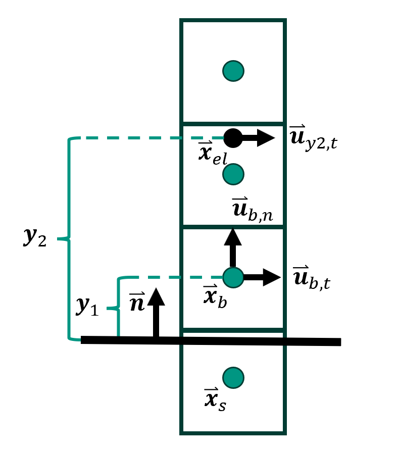
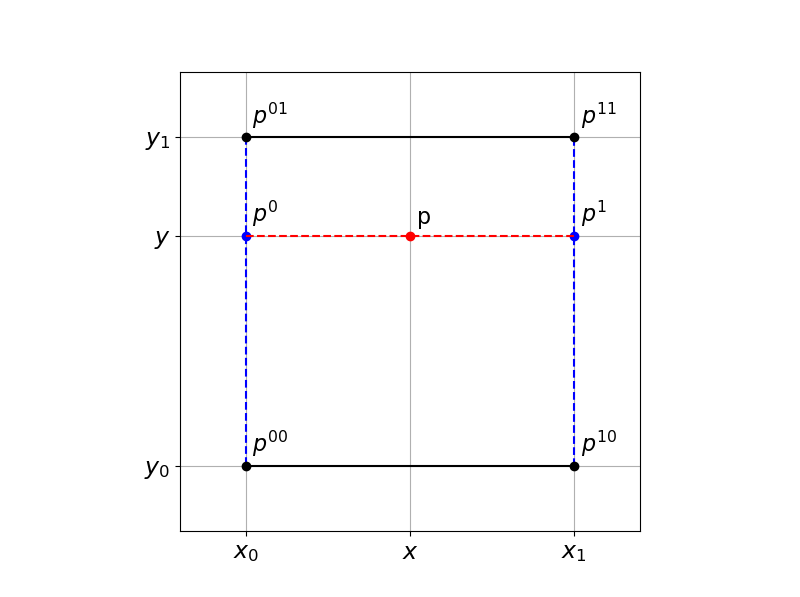
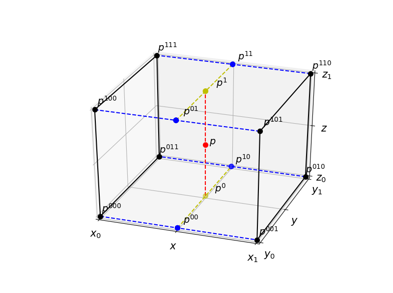
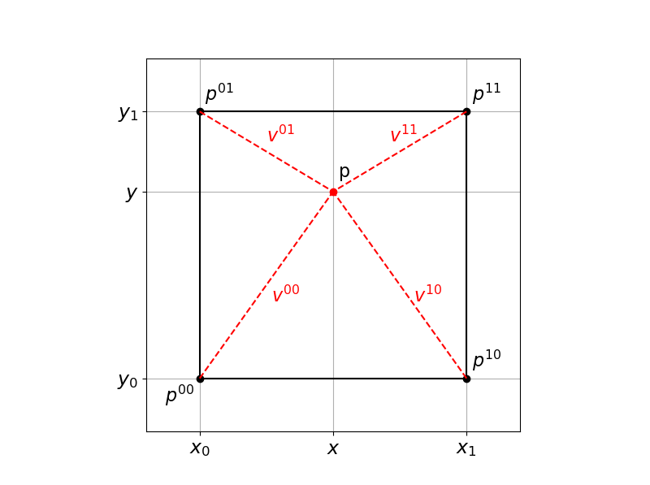

Each example located in `examples/` is typically structured along several function definitions and a `main` part.
The function `setBoundaryValues` usually sets initial values for density and velocity (if not yet done in `prepareLattice`).
Boundary values can be refreshed at certain time steps.
In some applications, this function may be missing or empty, if there is no temporal change in the boundary values.
An exemplary implementation can be found in `examples/laminar/poiseuille2d`, where a smooth start-up is used at the velocity inflow boundary as follows:

::: {#lst-smooth-startup}
```{.cpp filename="examples/laminar/poiseuille2d"}
// No of time steps for smooth start-up
int iTmaxStart = converter.getLatticeTime( maxPhysT*0.4 );
int iTupdate = 5;

if (iT%iTupdate == 0 && iT <= iTmaxStart) {

    // Smooth start curve, polynomial
    PolynomialStartScale<T,T> StartScale(iTmaxStart, T(1));
    // Creates and sets the Poiseuille // inflow profile using functors
    T iTvec[1] = {T( iT )};
    T frac[1] = {};
    StartScale( frac,iTvec );
    T maxVelocity = converter.getCharLatticeVelocity()*3./2.*frac;
    T distance2Wall = L/2.;
    Poiseuille2D<T>
        poiseuilleU(superGeometry, 3,
        maxVelocity, distance2Wall);
    sLattice.defineU(superGeometry, 3,
        poiseuilleU);
}
```
:::

## Define Boundary Method {#sec-defineBoundaryMethod}

There are two different types of boundaries, namely wet-node boundaries (on the nodes) and link-wise boundaries (in between the nodes).
Examples of wet-node boundaries are `LocalVelocity`, `LocalPressure`, `InterpolatedPressure`, `InterpolatedVelocity`, `ZouHePressure`, `ZouHeVelocity` and `AdvectionDiffusion`.
Examples of link-wise boundaries are `Bouzidi`, `BouzidiVelocity`, `BouzidiZeroVelocity` (+ `Interpolation`) and `YuPostProcessor` (+ `Interpolation`).
The boundary declarations are usually designed as in the following code snippets:

::: {#lst-boundary-declarations}
```{.cpp}
boundary::set<boundary::BounceBack>(superLattice, superGeometry, materialNumber);
boundary::set<boundary::LocalVelocity>(superLattice, superGeometry, materialNumber);
setBouzidiBoundary(superLattice, superGeometry, materialNumber, indicator);
```
:::

$\OpenLB$ offers implementations of several methods for approximating macroscopic boundary conditions.
Some of the frequently used boundary methods are listed below and described in terms of locality of operations and general applicability.
This list does not raise a claim to completeness.
$\OpenLB$ includes the following boundary methods, which are callable with `set...Boundary` and the respective arguments.

1. **`LocalPressure`, `LocalVelocity`, `LocalConvection`**, etc.:
    - local
    - wet-node
    - *Application:* boundary for fluid flows
    - regularized boundary, re-computes all $f_{i}$ from local momenta reconstructing off-equilibrium parts
    - stable in most regimes
    - implemented according to Latt and Chopard [@latt2008straight]
2. **`InterpolatedPressure`, `Interpolated`**, etc.:
    - non-local
    - wet-node
    - *Application:* boundary for fluid flows (stable for higher Reynolds numbers)
    - re-computes all $f_{i}$ using a finite-difference scheme over adjacent cells for the velocity gradient
    - implemented according to Skordos [@skordos:93]
3. **`setZouPressure`, `setZouHeVelocity`**, etc.:
    - local
    - wet-node
    - *Application:* boundary for fluid flows (low Reynolds number)
    - computes missing $f_{i}$ by applying symmetry conditions on the off-equilibrium part, enforcing velocity and pressure on the equilibrium
    - highly accurate, but less stable
    - implemented according to Zou and He [@zou-he:97]
4. **`Bouzidi`, `BouzidiVelocity`**, etc.:
    - non-local
    - link-wise
    - *Application:* boundary for fluid flows (for curved boundaries)
    - computes missing $f_{i}$ using a bounce-back rule which takes the distance between node and boundary into account
    - second order accuracy in space
    - implemented according to Bouzidi *et al.* [@bouzidi:01]
5. **`AdvectionDiffusionTemperature`**, etc.:
    - local and non-local
    - wet-node
    - *Application:* boundary for advection-diffusion problems (temperature, particle, ...)
    - various boundary conditions for advection diffusion problems
    - type of implementation differs for each condition
    - for details see e.g. Trunk *et al.* [@trunk:16]

The typical macroscopic effects that can be obtained with the wet-node method are, for example, velocity and pressure Dirichlet boundary conditions and for the link-wise methods, for example, Dirichlet boundary conditions for a specific velocity, zero-velocity, convection, and slip walls.
With the `advectionDiffusion` methods, macroscopic boundary conditions in terms of Dirichlet boundaries with respect to temperature, convection, zero-distribution, or the external field are recoverable.

### Wet-node Method

With the wet-node approach, for example, Dirichlet-type boundaries for the velocity can be obtained.
On a macroscopic level, this is used, for example, at inflow boundaries where the values for the inflow velocity are given.

::: {#lst-wetnode-velocity}
```{.cpp}
boundary::set<boundary::LocalVelocity>(superLattice, superGeometry, materialNumber);
```
:::

Moreover, the wet-node approach is applied for macroscopic boundaries for the pressure.
This is used, for example, at outflow boundaries and fixes the values for the pressure in terms of a Dirichlet condition.

::: {#lst-wetnode-pressure}
```{.cpp}
boundary::set<boundary::LocalPressure> (superLattice, omega, superGeometry, materialNumber);
```
:::

### Link-wise Method

The link-wise method is applicable to recover macroscopic convection, which is used for outflow boundaries and approximates
$$
\frac{\partial u}{\partial t}+ u_{\text{average}}\frac{\partial u}{\partial n} = 0 ~,
$$
similar to a Neumann-type boundary for the velocity.

::: {#lst-linkwise-convection}
```{.cpp}
setInterpolatedConvectionBoundary<T, DESCRIPTOR> (superLattice, omega, superGeometry, materialNumber, averageVelocity);
```
:::

Additionally, a slip boundary can be constructed that is used for solid boundaries and reflects outgoing $f_{i}$.
The latter has the effect of zero velocity normal to the boundary and free flow tangential to the boundary.

::: {#lst-linkwise-slip}
```{.cpp}
setSlipBoundary<T, DESCRIPTOR> (superLattice, superGeometry, materialNumber);
```
:::

Further, a macroscopic velocity used for curved boundaries with fixed values can be superimposed.
It is realized as a Dirichlet boundary for the velocity and considers the boundary shape via an indicator functor.
There are multiple `bulkMaterials` possible.

::: {#lst-linkwise-bouzidi-velocity}
```{.cpp}
setBouzidiBoundary<T, DESCRIPTOR,BouzidiVelocityPostProcessor> (superLattice, superGeometry, material , indicator, bulkMaterialsList);
AnalyticalConstF3D<T> u;
setBouzidiVelocity(superLattice, superGeometry, material, u);
```
:::

As a special case, the zero velocity boundary for curved boundaries which fixes the velocity to zero is callable with simplified syntax.
It is a Dirichlet-type boundary for velocity and considers the shape by indicator.
Here are also multiple `bulkMaterials` possible.

::: {#lst-linkwise-bouzidi-zero}
```{.cpp}
setBouzidiBoundary<T, DESCRIPTOR>(superLattice, superGeometry, material, indicator, bulkMaterialsList);
```
:::

### AdvectionDiffusionBoundary

An exemplary macroscopic effect of the `advectionDiffusion` boundary methods is the Dirichlet boundary condition for the temperature, which is used for inflow or wall boundaries and fixes the values for the temperature.

::: {#lst-ad-temperature}
```{.cpp}
setAdvectionDiffusionTemperatureBoundary<T, DESCRIPTOR> (superLattice, omega, superGeometry, materialNumber);
```
:::

In addition, convection can be modeled, which is used for outflow boundaries and interpolates incoming $f_{i}$ from neighbors.
It is similar to a Neumann-type temperature boundary.

::: {#lst-ad-convection}
```{.cpp}
setAdvectionDiffusionConvectionBoundary<T, DESCRIPTOR> (superLattice, superGeometry, materialNumber);
```
:::

Further, the zero-distribution boundary is used for "sticky" boundaries and sets the incoming $f_{i}$ to zero, such that particles touching the boundary are *trapped*.

::: {#lst-ad-zerodistribution}
```{.cpp}
setZeroDistributionBoundary<T, DESCRIPTOR> (superLattice, superGeometry, materialNumber);
```
:::

At last also macroscopic external fields used, for example, in particle simulations can be supplied with boundary conditions.
The following boundary method provides data on the boundary for particle calculations (velocity gradient).

::: {#lst-ad-externalfield}
```{.cpp}
boundary::set<boundary::ExternalField<T,DESCRIPTOR,descriptors::VELOCITY,descriptors::VELOCITY2>>(
  superLattice, superGeometry, materialNumber);
```
:::

### Robin-type Boundary Condition

The code for the boundary condition approach is almost identical for one, two or three missing populations.
The implementation from [@zhang18] is realized as a post-processor.
Two boundary schemes are implemented where the use of a flag variable enables the selection of the desired scheme.
Certain values are prepared including the velocity field, the coefficients of the Robin boundary condition, the normal vector and the outgoing population indices.
@lst-CoefficientFieldUpdate is the main part of a procedure that updates $a_3$ of the Robin boundary condition, as it depends on the local concentration value of the other species.

::: {#lst-CoefficientFieldUpdate}
```{.cpp}
{ // Update for component C
  T concP = cell.template get<names::Concentration1>().computeRho(); //get concentration of P

  auto a1_a2_a3 = cell.template get<names::Concentration0>().template getField<descriptors::G>(); //pull out current field
  a1_a2_a3[2] = backwardConstant*concP; //update a3 according to k_b*P = k*C_eq = a3
  cell.template get<names::Concentration0>().template setField<descriptors::G>(a1_a2_a3); //put updated field back
}
{ // Update for component P
  T concC = cell.template get<names::Concentration0>().computeRho(); //get concentration of C

  auto a1_a2_a3 = cell.template get<names::Concentration1>().template getField<descriptors::G>(); //pull out current field
  a1_a2_a3[2] = forwardConstant*concC; //update a3 according to k_f*C = k*P_eq = a3
  cell.template get<names::Concentration1>().template setField<descriptors::G>(a1_a2_a3); //put updated field back
}
```
Code updating the coefficient $a_3$.
:::

### Additional Options

An additional option to supply boundary conditions in $\OpenLB$ is to choose LBM collision dynamics also at the boundary.
One can add a specific dynamics object to a boundary material number, e.g. `BulkDynamics` which executes the collision step as in a fluid node (e.g. with `BGKdynamics`).

::: {#lst-boundary-bulkdynamics}
```{.cpp}
using BulkDynamics = BGKdynamics<T,DESCRIPTOR>;
[...]
boundary::set<boundary::LocalVelocity<T,DESCRIPTOR,BulkDynamics>>(superLattice, superGeometry, materialNumber);
```
:::

Another option is to choose an implementation via boundary dynamics.
One can add boundary methods as dynamics, e.g. `BounceBack` (zero velocity), `BounceBackVelocity` (prescribes a nonzero velocity).

::: {#lst-boundary-dynamics}
```{.cpp}
superLattice.defineDynamics<BounceBack> (superGeometry, materialNumber);
superLattice.defineDynamics <BounceBackVelocity>(superGeometry, materialNumber);
```
:::

## Define Initial Conditions {#sec-defineInitialConditions}

::: {#lst-defineRhoU}
```{.cpp}
sLattice.defineRhoU(superGeometry, materialNumber, analyticalFunctor, analyticalFunctor);
```
:::

For each material number, the density (usually $\rho =1$), the velocity (usually $u=0$), and the distribution functions should be initialized.
The functions expect lattice values, therefore physical values have to be converted, e.g. via the function `getLatticeDensity(density)` of the `UnitConverter`.
Note that instead of the `materialNumber` argument, any discrete indicator function can be used.
Exemplary initializations are given below.

::: {#lst-initial-conditions}
```{.cpp}
// Initial conditions
AnalyticalConst2D<T,T> rhoF(1);
std::vector<T> velocity(dim,T(0));
AnalyticalConst2D<T,T> uF(velocity);

// Initialize density
superLattice.defineRho(superGeometry, materialNumber, rhoF);

// Initialize velocity
superLattice.defineU(superGeometry, materialNumber, uF);

// Initialize distribution functions
// to local equilibrium
superLattice.iniEquilibrium(superGeometry, materialNumber,
       rhoF, uF);
```
:::

## Define Boundary Values

::: {#lst-defineU}
```{.cpp}
sLattice.defineU(superGeometry, materialNumber, analyticalFunctor);
```
:::

Just like the initial conditions, boundary values can be set using `defineRho(...)` and `defineU(...)`.
For a smooth start-up, the values can be scaled, e.g. according to a sinusoidal scale or polynomial scale for a given startup time.

::: {#lst-startscale}
```{.cpp}
// Smooth start curve, sinus
SinusStartScale<T,int>
StartScale(numerStartTimeSteps, maxValue);

//Smooth start curve,polynomial PolynomialStartScale<T,T>
StartScale(numerStartTimeSteps, maxValue);

// compute scale-factor "frac"
T iTvec[1] = {T(timestep)};
T frac[1] = {};
StartScale( frac, iTvec );
```
:::

To apply a flow profile, one first has to update values in every $n$th time step, then initialize a functor and then set values using `defineRho(...)` and `defineU(...)`.
These are the same functions as for the initial conditions.
However, the time point when to call them is crucial.

::: {#lst-flow-profile}
```{.cpp}
if (timestep%updatePeriod==0 &&
       timestep <= numberStartupTimesteps) {
  Poiseuille2D<T> poiseuilleU(superGeometry,
         materialNumber, maxVelocity*frac[0],
         distance2Wall);
sLattice.defineU(superGeometry, materialNumber, poiseuilleU);
}
```
:::

Further examples of 3D functors for this purpose are rotating functors (linear for a rotating velocity field and quadratic for a rotating pressure field), Circle-Poiseuille, Elliptic-Poiseuille, and Rectangular-Poiseuille.
The latter are only for on-axis boundaries and can be constructed from points spanning a plane or a material number.
These functors are summarized with arguments as follows:

::: {#lst-3d-functors}
```{.cpp}
RotatingLinear3D(axisPoint,
  axisDirection, angularVelocity);

RotatingQuadratic1D(axisPoint, axisDirection, angularVelocity);

CirclePoiseuille3D(axisPoint,
  axisDirection, maxVelocity, radius);

EllipticPoiseuille3D(center, semiPrincipalAxis1, semiPrincipalAxis2, maxVelocity);

RectanglePoiseuille3D(point1, point2,
  point3, maxVelocity);

RectanglePoiseuille3D(superGeometry, materialNumber, maxVelocity, offsetX, offsetY, offsetZ);
```
:::

## Turbulent Wall Model

This section is dedicated to the turbulent wall model, used to simulate flows close to walls accurately without increasing the resolution close to the geometry and, in turn, increasing the computational requirements.

### Describing the Wall Model

We choose an arbitrary distance from the wall to a sampling point where we use the local velocity to calculate the wall shear stress with the turbulent velocity profile.
Note that we write
$$
y_1 = \lVert \symbf{y}_1 \rVert,\qquad y_{2} = \lVert \symbf{y}_{2} \rVert
$$
for the distances $y_1$ from the wall to the boundary node $\symbf{x}_b$ and $y_{2}$ to the exchange location $\symbf{x}_{el}$, respectively.

Our first step is to calculate the bounced-back populations according to the Bouzidi bounce-back method as
$$
f_{\overline{i}}(\symbf{x}_b, t+\Delta t) =
\begin{cases}
    2qf_i^*(\symbf{x}_b,t)+ (1-2q)f_i^*(\symbf{x}_f,t) & q \leq \frac{1}{2}, \\
    \frac{1}{2q}f_i^*(\symbf{x}_b,t) + \frac{2q-1}{2q}f_{\overline{i}}^*(\symbf{x}_b,t) & q > \frac{1}{2}.
\end{cases}
$${#eq-bbwm}
We proceed by calculating the distance vector
$$
\symbf{y}_{d} = \symbf{y}_{2} - \symbf{y}_1
$${#eq-yd}
from the boundary node $\symbf{x}_b$ to the sampling point $\symbf{x}_{el}$ and linearly interpolate the velocity $\symbf{u}_{y2}$ from the nodes surrounding $\symbf{x}_{el}$.
We then extract the stream-wise velocity $u_{2}$ from $\symbf{u}_{y2}$ by subtracting its component in the unit-normal direction $\symbf{n}$ as
$$
u_{2} = \symbf{u}_{y2} \cdot \frac{\symbf{u}_{y2} - (\symbf{u}_{y2}\cdot \symbf{n})\symbf{n}}{\lVert \symbf{u}_{y2} - (\symbf{u}_{y2}\cdot \symbf{n})\symbf{n} \rVert} =: \symbf{u}_{y_{2}} \cdot \symbf{t}_s,
$${#eq-u2}
where
$$
\symbf{t}_s = \frac{\symbf{u}_{y2} - (\symbf{u}_{y2}\cdot \symbf{n})\symbf{n}}{\lVert \symbf{u}_{y2} - (\symbf{u}_{y2}\cdot \symbf{n})\symbf{n} \rVert}
$${#eq-tangent}
denotes the stream-wise or tangential unit vector.

Thereafter, we approximate the wall shear stress $\tau_w$ via $u_{\tau_w}=\sqrt{\frac{\tau_w}{\rho}}$, where we first calculate
$$
\nu = \big(\tau - \frac{1}{2}\big) c_s^2,
$${#eq-nu}
to get
$$
y_2^+(u_{\tau_w}) = \frac{y_2}{\nu}u_{\tau_w},
$$
and then apply the Newton method to the Spalding function with
$$
u_2^+(u_{\tau_w}) = \frac{u_2}{u_{\tau_w}}
$$
to solve
$$
f(u_{\tau_w}) = \frac{u_2}{u_{\tau_w}} + 0.1108\bigg[ e^{0.4\frac{u_2}{u_{\tau_w}}} - 1 -0.4\frac{u_2}{u_{\tau_w}} - \frac{1}{2}\Big(0.4\frac{u_2}{u_{\tau_w}}\Big)^2 - \frac{1}{6}\Big(0.4\frac{u_2}{u_{\tau_w}}\Big)^3 \bigg] - y_2^+ = 0
$${#eq-spalding1}
for $u_{\tau_w}$.
Consequently, we use
$$
y_1^+ = \frac{y_1}{\nu}u_{\tau_w}
$$
and once again the Newton method, to approximate $u_1^+$ as solution of
$$
f(u_1^+) = u_1^+ + 0.1108\bigg[ e^{0.4u_1^+} - 1 -0.4u_1^+ - \frac{1}{2}(0.4u_1^+)^2 - \frac{1}{6}(0.4u_1^+)^3 \bigg] - y_1^+ = 0.
$${#eq-spalding2}
This lets us compute the modelled stream-wise velocity
$$
u_1 = u_1^+ u_{\tau_w}
$${#eq-u1}
at $\symbf{x}_b$.

{#fig-WallmodelSketch width=55% .lightbox}

Now we take the actual velocity $\tilde{\symbf{u}}_b$ at $\symbf{x}_b$ and exchange the stream-wise component by separating the normal component
$$
\tilde{\symbf{u}}_{b\symbf{n}} = (\tilde{\symbf{u}}_b \cdot \symbf{n})\symbf{n}
$${#eq-utilde}
and add the newly calculated stream-wise component through
$$
\symbf{u}_b = \tilde{\symbf{u}}_{b\symbf{n}} + u_1\cdot \symbf{t}_s.
$${#eq-ub}
Finally, we obtain the updated populations $f_i$ by assimilating the modelled velocity for the upcoming collision step.
We will later give different ways to approach this part.

### Algorithm {#sec-sumalg}

Summed up, the wall model presented in the previous segment adapts the local velocity of the turbulent boundary layer in the streaming step by updating the particle distribution functions for every boundary node $\symbf{x}_b$ through the steps in @algo-wallmodel.

```pseudocode
#| label: algo-wallmodel
#| html-line-number: true
#| pdf-placement: "htb!"

\begin{algorithm}
\caption{Wall Model}
\begin{algorithmic}
\Procedure{WallModel}{$\mathbf{x}_b$}
  \State Bouzidi bounce-back
  \State Calculate $\mathbf{y}_{d}$
  \State Interpolate $\mathbf{u}_{y2}$ at $\mathbf{x}_{2}$
  \State Calculate $u_2$ from the tangential unit vector
  \State Compute $u_{\tau_w}$ with the Spalding wall function and $y_2$
  \State Compute $u^+$ with the Spalding wall function and $y_1$
  \State Calculate $u_1 = u_1^+ u_{\tau_w}$
  \State Retrieve normal component from current velocity $\tilde{\mathbf{u}}_b$ at $\mathbf{x}_b$
  \State Reassemble $\mathbf{u}_b$
  \State Update populations $f_i(\mathbf{x}_b,t+\Delta t)$ by incorporating $\mathbf{u}_b$
\EndProcedure
\end{algorithmic}
\end{algorithm}
```

The individual steps correspond to @eq-bbwm, @eq-yd, @eq-u2 together with @eq-tangent, @eq-spalding1, @eq-spalding2, @eq-u1, @eq-utilde and @eq-ub, respectively.

### Implementation of the Wall Model

The implementation covers all required mathematical methods as well as the steps of the algorithm summarized in @sec-sumalg, thus we advance by displaying the relevant code segments of the wall model in three-dimensional space and additional explanations.
This is motivated by the aim of illustrating the underlying methods and further giving a thorough understanding of the wall model as a whole.

One of the central steps is the interpolation of the velocity at an arbitrary exchange location $\symbf{x}_{el}$.
For a three-dimensional regular grid, this can be done by *trilinear interpolation*, where the attached scheme basically repeats one-dimensional linear interpolation in all directions [@Bou97trilinear].
Exemplary, this means for the two-dimensional case shown in @fig-tri2a, that we interpolate a value $p$ at $\symbf{p}$ through linearly interpolating the values $p^0$ and $p^1$ at supporting points $\symbf{p}^0$ and $\symbf{p}^1$ respectively, as
$$
\begin{aligned}
    p^0 = p^{00} + (p^{10} - p^{00})\frac{y-y_0}{y_1-y_0},\\
    p^1 = p^{01} + (p^{11} - p^{01})\frac{y-y_0}{y_1-y_0},
\end{aligned}
$$
where
$$
y_d := \frac{y-y_0}{y_1-y_0}, \qquad x_d := \frac{x-x_0}{x_1-x_0},
$$
gives
$$
\begin{aligned}
    p^0 &= p^{00} + (p^{10} - p^{00})y_d\\
        &= p^{00}(1-y_d) + p^{10}y_d,\\
    p^1 &= p^{01}(1-y_d) + p^{11}y_d,
\end{aligned}
$$
and consequently
$$
\begin{aligned}
    p &= p^{0}(1-x_d) + p^{1}x_d\\
      &= p^{00}(1-x_d)(1-y_d) + p^{10}(1-x_d)y_d + p^{01}x_d(1-y_d) + p^{11}x_dy_d.
\end{aligned}
$${#eq-int2dform}
Similarly, we calculate the value at $\symbf{p}$ in a three-dimensional grid iteratively with additional supporting points $\symbf{p}^{00},\symbf{p}^{10},\symbf{p}^{01}$ and $\symbf{p}^{11}$ as illustrated in @fig-tri2b.

::: {#fig-interpolation layout-ncol=2}

{#fig-tri2a width="100%"}

{#fig-tri2b width="100%"}

Bilinear and trilinear interpolation
:::

Once again examining @eq-int2dform, we notice more weight is given to the values at points $\symbf{p}^i$ closer to $\symbf{p}$ in terms of $x_d$ and $y_d$ according to the coordinate origin in $\symbf{p}^{00}$.
So by defining distance vectors
$$
\symbf{v}^i = \symbf{p}-\symbf{p}^i,
$$
we can rewrite the previous formula with the absolute value components of $\symbf{v}^i$ as
$$
\begin{aligned}
    p = {}& p^{00}(1-\lvert v_x^{00} \rvert)(1-\lvert v_y^{00} \rvert) + p^{10}(1-\lvert v_x^{10} \rvert)(1-\lvert v_y^{10} \rvert)\\
        & +\, p^{01}(1-\lvert v_x^{01} \rvert)(1-\lvert v_y^{01} \rvert) + p^{11}(1-\lvert v_x^{11} \rvert)(1-\lvert v_y^{11} \rvert),
\end{aligned}
$${#eq-trilint}
where the weights now depend on the surrounding points $\symbf{p}^i$ instead of $x_d$ and $y_d$ (@fig-tri2v).

{#fig-tri2v width="60%" .lightbox}

With the above considerations, we formulate the trilinear interpolation method in two steps: first, we determine the $2^d$ lattice nodes $\symbf{x}_i$ surrounding $\symbf{x}_{el}$ and then interpolate $\symbf{u}_{y2}$ by expanding on @eq-trilint as
$$
\symbf{u}_{y2} = \sum_{\symbf{x}_i} (1-\lvert v_x^i \rvert)(1-\lvert v_y^i \rvert)(1-\lvert v_z^i \rvert) \symbf{u}_{x_i},
$$
where $\symbf{u}_{x_i}$ is the velocity at $\symbf{x}_i$ and $\symbf{v}^i$ the distance vector from $\symbf{x}_i$ to $\symbf{x}_{el}$.

::: {#lst-interpolateVelocity}
```{.cpp}
void interpolateVelocity(CELL& cell, Vector<V,3> y_d, V u_y2[3])
any_platform{
 Vector<V,3> floorV(util::floor(y_d[0]),
                    util::floor(y_d[1]),
                    util::floor(y_d[2]));
 Vector<Vector<V,3>,8> surroundingPoints(floorV);
 surroundingPoints[1][0] += 1.;
 surroundingPoints[2][1] += 1.;
 surroundingPoints[3][2] += 1.;
 surroundingPoints[4][0] += 1.; surroundingPoints[4][1] += 1.;
 surroundingPoints[5][0] += 1.; surroundingPoints[5][2] += 1.;
 surroundingPoints[6][1] += 1.; surroundingPoints[6][2] += 1.;
 surroundingPoints[7][0] += 1.; surroundingPoints[7][1] += 1.;
 surroundingPoints[7][2] += 1.;

 for (auto point : surroundingPoints) {
  const Vector<V,3> dist = y_d - point;
  const V weight =  (V(1) - util::abs(dist[0]))*
                    (V(1) - util::abs(dist[1]))*
                    (V(1) - util::abs(dist[2]));
  V uNP[3] = {0.};
  cell.neighbor(point).computeU(uNP);
  u_y2[0] += uNP[0]*weight;
  u_y2[1] += uNP[1]*weight;
  u_y2[2] += uNP[2]*weight;
 }
};
```
Trilinear interpolation.
:::

Since we use a wall function to find the wall shear stress $\tau_w$ with $u_{\tau_w}$ through the interpolated stream-wise velocity $u_2$ at $\symbf{x}_{el}$ as well as $y_2$ by means of
$$
u^+_2 = \frac{u_2}{u_{\tau_w}} ,\quad y^+_2 = \frac{y_2}{\nu}u_{\tau_w},
$${#eq-uplusyplus}
and thereafter directly calculate the normalized stream-wise velocity $u_1^+$ at $\symbf{x}_b$ with the Newton method, we need to take the change of variable into account.

Hence, to utilize the Spalding function we initialize a vector containing all required parameters for the computation with Newton, as well as an operational value which sets if @eq-uplusyplus gets calculated.
Then, the values of the Spalding wall function are provided to the Newton method in the form of
$$
f(x) = x + 0.1108\bigg[ e^{0.4x} - 1 -0.4x - \frac{1}{2}(0.4x)^2 - \frac{1}{6}(0.4x)^3 \bigg] - y \overset{!}{=} 0.
$${#eq-fnewton}

::: {#lst-spaldingWallFunction}
```{.cpp}
V spaldingWallFunction(Par& params) any_platform{
 if(params[6] == 1.){
  params[4] = params[0]/params[1];
  params[5] = params[2]*params[1]/params[3];
 }
 V function = params[4] + 0.1108*(util::exp(0.4*params[4])- 1.
                - 0.4*params[4] - 0.5*util::pow(0.4*params[4],2)
                - 1./6.*util::pow(0.4*params[4],3)) - params[5];
 return function;
};
```
Spalding wall function.
:::

Newton's method reads
$$
x_{k+1} = x_k - \frac{f(x_k)}{f^{\prime}(x_k)},
$$
where $f$ is a real-valued, differentiable function, then $f(x_k) \to 0$ for $k\to\infty$, if $f^{\prime}(x_k) \neq 0$ and the initial guess $x_0$ is sufficiently close to the root $x$ of $f$.
We implement the method with a relative convergence criterion $\delta_{\text{conv}}$ such that the method is aborted if
$$
\frac{x_k-x_{k+1}}{x_{k+1}} \leq \delta_{\text{conv}},
$$
and allow only up to $i=100$ iterations.

::: {#lst-newtonSpalding}
```{.cpp}
template <typename V, typename Funcf,
          typename Funcd, typename Par_f,
          typename Par_d>

// vector=(f:fct.,d:derivative,args:params,optArg:var.,Crit:Conv.)
V newtonSpalding(Funcf f, Funcd d,
                 Par_f & argsf, Par_d & argsd,
                 int optArg, V convergeCrit) any_platform{
 V x = argsf[optArg];
 V x_old = argsf[optArg];
 for(int i = 0; i<100; i++){
  x_old = x;
  argsf[optArg] = x;
  argsd[0] = x;
  x -= f(argsf)/d(argsd);
  if(util::abs((x_old - x)/x) <= convergeCrit) break;
  if(std::isnan(x)) break;
 }
 return x;
};
```
Newton method.
:::

For the approximation of $u_{\tau}$, we calculate the root of the function
$$
f(x) = \frac{u_2}{x} + 0.1108\bigg[ e^{0.4\frac{u_2}{x}} - 1 -0.4\frac{u_2}{x} - \frac{1}{2}\Big(0.4\frac{u_2}{x}\Big)^2 - \frac{1}{6}\Big(0.4\frac{u_2}{x}\Big)^3 \bigg] - \frac{y_2}{\nu}x,
$$
with the derivative
$$
f^{\prime}(x) = -\frac{u_2}{x^2} + 0.1108\bigg[ \Big(-0.4\frac{u_2}{x^2}\Big)e^{0.4\frac{u_2}{x}} +0.4\frac{u_2}{x^2} + \Big(0.4\frac{u_2}{x}\Big)\Big(0.4\frac{u_2}{x^2}\Big) + \frac{1}{2}\Big(0.4\frac{u_2}{x}\Big)^2\Big(0.4\frac{u_2}{x^2}\Big) \bigg] - \frac{y_2}{\nu}.
$$
Derivation of @eq-fnewton for calculating $u_1^+$ yields
$$
f^{\prime}(x) = 1 + 0.1108\bigg[ 0.4e^{0.4x} -0.4 - (0.4)^2x - 0.2(0.4x)^2 \bigg].
$$
We use the respective derivative by defining a parameter that is called with the Newton method depending on the approximation of either $u_{\tau}$ or $u^+$.

::: {#lst-spaldingDerivative}
```{.cpp}
// param = {V x, V u2, V y2, V nu, V k}
template <typename V, typename Par_d>
V spaldingDerivative(Par_d & param) any_platform{
 V derivative = 0.;
 if(param[4] == 2.){
 derivative = (-param[1]/(util::pow(param[0],2)))
                + 0.1108*( (util::exp(0.4*param[1]/param[0]))
                * (-0.4*param[1]/(util::pow(param[0],2)))
                + 0.4*param[1]/(util::pow(param[0],2))
                + (util::pow(0.4*param[1]/param[0],2))/param[0]
                + 0.5*(util::pow(0.4*param[1]/param[0],3))/param[0] )
                -(param[2]/param[3]);
 }
 if(param[4] == 1.){
  derivative = 1. + 0.1108*(util::exp(0.4*param[0])*0.4 - 0.4
                -0.4*param[0]*0.4 - 0.2*util::pow(0.4*param[0],2));
 }
 return derivative;
};
```
Spalding wall function derivatives.
:::

The steps of @sec-sumalg, i.e. the main part of the wall model, are processed in a class initialized with a cell object as an attribute, and then all calculations are done in the class method `apply` for every chosen boundary node.

::: {#lst-wallmodel-class}
```{.cpp}
class TurbulentWallModelPostProcessor {
public:
  static constexpr OperatorScope scope = OperatorScope::PerCell;

  int getPriority() const {
    return -1;
  }

template <typename CELL, typename V = typename CELL::value_t>
void apply(CELL& cell) any_platform{
```
:::

The vectors $\symbf{y}_1$ and $\symbf{y}_2$ are attained with the method `getField`, so we get the distance vector $\symbf{y}_{12}$ as a parameter for the interpolation of the fluid velocity $\symbf{u}_2$ at the sampling point.

::: {#lst-wallmodel-interpolation}
```{.cpp}
auto y2 = cell.template getField<descriptors::Y2>();
auto y1 = cell.template getField<descriptors::Y1>();
auto y12 = y2 - y1;
V u_y2[3] = {V{0.}};
interpolateVelocity(cell, y12, u_y2);
```
:::

We use the boundary distance vector $\symbf{y}_1$ to obtain the unit normal vector $\symbf{n}$ as
$$
\symbf{n} = \frac{\symbf{y}_1}{\lVert\symbf{y}_1\rVert},
$$
hence we must ensure $\lVert\symbf{y}_1\rVert \neq 0$ holds.

::: {#lst-wallmodel-normal}
```{.cpp}
V y1Norm = util::norm<DESCRIPTOR::d>(y1);
if( y1Norm != V{0.}){
  Vector<V,3> normal(y1[0]/y1Norm, y1[1]/y1Norm, y1[2]/y1Norm);
```
:::

With the normal vector $\symbf{n}$, we compute the tangential velocity $u_2$ with @eq-u2.

::: {#lst-wallmodel-u2}
```{.cpp}
auto u_2tan = u_y2 - (u_y2[0]*normal[0]
              + u_y2[1]*normal[1]
              + u_y2[2]*normal[2])*normal;
auto tangent = u_2tan/util::norm<DESCRIPTOR::d>(u_2tan);

V u_2 = u_y2[0]*tangent[0]+ u_y2[1]*tangent[1]+ u_y2[2]*tangent[2];
```
:::

The decisive step is the successive deployment of the Newton method to approximate the stream-wise boundary velocity $u_1$ at $\symbf{x}_b$ with the Spalding function.
Therefore, we calculate initial values for both methods and define parameter vectors that call for the required function $f$ and corresponding derivative $f^{\prime}$.

::: {#lst-wallmodel-u1}
```{.cpp}
V omega = cell.template getField<descriptors::OMEGA>();
V nu = (1./omega - 0.5)/descriptors::invCs2<V,DESCRIPTOR>();

V y2Norm = util::norm<DESCRIPTOR::d>(y2);
V u_tau = util::sqrt(nu*u_2/y2Norm);
V u_plus = u_2/u_tau;
if( u_2 != 0. ) {
 //// NewtonApprox. u_tau
 Vector<V,7> params_u2 = {u_tau, u_2, y2Norm, nu,
                          u_plus, y2Norm/nu*u_tau, 2.};
 Vector<V,5> params_d2 = {u_tau, u_2, y2Norm, nu, 2.};
 u_tau = newtonSpalding([](Vector<V,7> par1) { return spaldingWallFunction<V>(par1); },
                        [](Vector<V,5> par2) { return spaldingDerivative<V>(par2); },
                        params_u2,
                        params_d2,
                        0,
                        V{0.001});

 //// Newton Approx. u1_+
 V u_1t = u_1Actual[0]*tangent[0]
          + u_1Actual[1]*tangent[1]
          + u_1Actual[2]*tangent[2];
 u_plus = u_1t/u_tau;
 Vector<V,7> params_u1 = {u_tau, u_1t, y1Norm, nu,
                          u_plus, y1Norm/nu*u_tau, 1.};
 Vector<V,5> params_d1 = {u_plus, 0., 0., 0., 1.};
 u_plus = newtonSpalding([](Vector<V,7> par1) { return spaldingWallFunction<V>(par1); },
                         [](Vector<V,5> par2) { return spaldingDerivative<V>(par2); },
                         params_u1,
                         params_d1,
                         4,
                         V{0.001});
}
V u_1 = u_plus*u_tau;
```
:::

Separating and reassembling the velocity vector $\symbf{u}_b$ for the algorithm's penultimate step is done by computing the velocity at the boundary cell $\symbf{x}_b$ with `computeU` and then calculating
$$
\symbf{u}_b = (\tilde{\symbf{u}}_b \cdot \symbf{n})\symbf{n} + u_1\cdot \symbf{t}_s.
$$

::: {#lst-wallmodel-ub}
```{.cpp}
if(util::norm<DESCRIPTOR::d>(u_wm2) != 0.){
 V u_btilde[3] = {0.};
 cell.computeU(u_btilde);
 auto u_bnormal = (u_btilde[0]*normal[0]
                    + u_btilde[1]*normal[1]
                    + u_btilde[2]*normal[2])*normal;
 auto u_b = u_bnormal + u_1*tangent;
 V ub[3] = {u_b[0], u_b[1], u_b[2]};
```
:::

### Updating the Populations $f_i$ {#sec-uboptions}

As mentioned earlier, we continue by summarizing different possibilities of how to integrate the adjusted boundary velocity $\symbf{u}_b$ into the ensuing streaming step.
This can essentially be achieved by refining the particle distribution function $f_i$ at $\symbf{x}_b$ in dependency of $\symbf{u}_b$.

The simplest way to realize the aforementioned point is by setting $f_i$ equal to the equilibrium distribution $f_i^{\text{eq}}(\symbf{u}_b)$, i.e.
$$
f_i(\symbf{x}_b, t+\Delta t) = f_i^{\text{eq}}(\rho, \symbf{u}_b), \qquad i = 0,\ldots,q-1,
$$
called the *equilibrium boundary condition* [@Mo09ebclbm].

::: {#lst-ebc}
```{.cpp}
V rho = cell.computeRho();
for (int iPop = 0; iPop < descriptors::q<DESCRIPTOR>(); ++iPop) {
 cell[iPop]=equilibrium<DESCRIPTOR>::secondOrder(iPop,rho,ub);
}
```
Equilibrium boundary condition.
:::

In the wall model presented by Haussmann *et al.* [@haussmann:19] the applied incorporation reads
$$
f_i(\symbf{x}_b, t+\Delta t) = f_i(\symbf{x}_b, t) - f_i^{\text{eq}}(\rho, \tilde{\symbf{u}}_b) + f_i^{\text{eq}}(\rho, \symbf{u}_b), \qquad i = 0,\ldots,q-1,
$$
whereas we further elaborate on this method by adding a factor $k$ to the non-equilibrium term,
$$
f_i^{\text{neq}} := f_i - f_i^{\text{eq}},
$$
such that
$$
f_i(\symbf{x}_b, t+\Delta t) = f_i^{\text{eq}}(\rho, \symbf{u}_b) + k f_i^{\text{neq}}(\rho, \tilde{\symbf{u}}_b), \qquad i = 0,\ldots,q-1.
$$

::: {#lst-nebc}
```{.cpp}
V rho = cell.computeRho();
V k = 0.5;
for (int iPop = 0; iPop < descriptors::q<DESCRIPTOR>(); ++iPop) {
 cell[iPop]-=equilibrium<DESCRIPTOR>::secondOrder(iPop,rho,u_btilde);
 cell[iPop]*=k
 cell[iPop]+=equilibrium<DESCRIPTOR>::secondOrder(iPop,rho,ub);
}
```
Non-equilibrium bounce-back.
:::

As a third option, we combine the wall model with the *Homogenised lattice Boltzmann method* (HLBM) [@krause:17], where the equilibrium distribution function is adapted as
$$
f_i(\symbf{x}_b, t+\Delta t) - f_i(\symbf{x}_b, t) = \frac{1}{\tau}\big(f_i^{\text{eq}}(\rho, \overline{\symbf{u}}) - f_i(\symbf{x}_b, t)\big), \qquad i = 0,\ldots,q-1,
$$
with the convex combination
$$
\overline{\symbf{u}} = (1-\alpha)\symbf{u}^F + \alpha \symbf{u}^B, \qquad\alpha \in [0,1],
$$
where $\symbf{u}^F$ is the fluid velocity and $\symbf{u}^B$ the particle body velocity.
In our case, we use the convex combination to determine the proportion in which $\symbf{u}_b$ and $\tilde{\symbf{u}}_b$ are prescribed to the boundary cells.
Therefore, the populations $f_i$ are updated with the adapted term of the HLBM as
$$
f_i(\symbf{x}_b, t+\Delta t) = f_i(\symbf{x}_b, t) + \frac{1}{\tau}\bigg(f_i^{\text{eq}}(\rho, (1-\alpha)\symbf{u}_b + \alpha \tilde{\symbf{u}}_b) - f_i(\symbf{x}_b, t)\bigg), \qquad i = 0,\ldots,q-1.
$$
