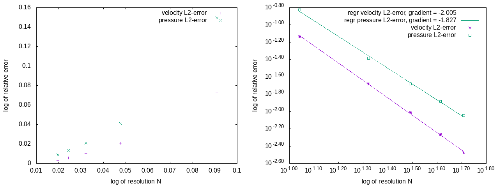

During development or during actual simulations, it might be necessary to parameterize your program.
For this case, $\OpenLB$ provides an XML parser, which can read files produced by OpenGPI [@opengpi-web], thereby providing a user-friendly GUI.
Details on the XML format and functions are given in @sec-xmlparams.

The simulation data is stored in the VTK data format and can be further processed with Paraview.
For output tasks that are performed only once during the simulation, it is recommended to write the data sequentially.
Commonly, the geometry or cuboid information is one of these tasks.
In contrast to the parallel version, it is easier to use and does not produce unnecessary data overhead.
However, if the output is performed regularly in a parallel simulation, the performance may slow down using the sequential output method.
Therefore, $\OpenLB$ has implemented a parallel data output functionality.
At the lowest scope, every thread writes `.vti` files that contain the data.
$\OpenLB$ writes a `.vti` file for every cuboid, to provide parallel data processing.
Those `.vti` files are summarized and put together by the next hierarchy, the `.vtm` file.
A `.vtm` file corresponds to the entire domain with respect to a certain time step.
At the end, the different time steps are packed to a `.pvd` file, that is a collection of `.vtm` according to time steps.

The technical aspects are presented in @sec-vti-pvd-format, whereas the usage is demonstrated with an example in @sec-outPut-vtk.

## Output Data Structure {#sec-vti-pvd-format}

$\OpenLB$ simulation data is stored in the file system according to the VTK data format [@vtkFormat-web].
This format has an XML structure and the data therein is written as binary `Base64` code.
Additionally, the simulation data is compressed by zlib, which allows reducing data tremendously.

On the top level, the parallel output hierarchy contains a `.pvd` file, which consists of links to `.vtm` files.
The `.vtm` files summarize the cuboids represented by `.vti` files.

::: {#lst-pvd-file}
```{.xml}
<?xml version="1.0"?>
<VTKFile type="Collection" version="0.1" byte_order="LittleEndian">
<Collection>
<DataSet timestep="81920" group="" part="" file="data/VTM_iT0081920.vtm"/>
<DataSet timestep="163840" group="" part="" file="data/VTM_iT0163840.vtm"/>
<DataSet timestep="245760" group="" part="" file="data/VTM_iT0245760.vtm"/>
<DataSet timestep="327680" group="" part="" file="data/VTM_iT0327680.vtm"/>
<DataSet timestep="409600" group="" part="" file="data/VTM_iT0409600.vtm"/>
</Collection>
</VTKFile>
```
Example of a `.pvd` file that points for every time step to the corresponding `.vtm` file. Every time step is associated to a `.vtm` file.
:::

::: {#lst-vtm-file}
```{.xml}
<?xml version="1.0"?>
<VTKFile type="vtkMultiBlockDataSet" version="1.0" byte_order="LittleEndian">
<vtkMultiBlockDataSet>
<Block index="0" >
<DataSet index= "0" file="VTM_iT0081920iC00000.vti"></DataSet>
</Block>
<Block index="1" >
<DataSet index= "0" file="VTM_iT0081920iC00001.vti"></DataSet>
</Block>
<Block index="2" >
<DataSet index= "0" file="VTM_iT0081920iC00002.vti"></DataSet>
</Block>
<Block index="3" >
<DataSet index= "0" file="VTM_iT0081920iC00003.vti"></DataSet>
</Block>
</vtkMultiBlockDataSet>
</VTKFile>
```
Example of a `.vtm` file that points to `.vti` files that hold data of cuboids. Every cuboid writes its data to a `.vti` file, which are assembled by a `.vtm` file.
:::

There is also a `BlockVTKwriter` that writes data sequentially.
More details can be found in the source code and its documentation.

## Write Simulation Data to VTK File Format {#sec-outPut-vtk}

VTK data files can be visualized and postprocessed with the free software Paraview [@paraview-web], which offers a graphical interface with extensive functionality.
The following listing shows, on the one hand, how to write VTK files sequentially for a geometry and cuboid functors.
On the other hand, the usage of the parallel write routine for velocity and pressure functors is shown.

::: {#lst-write-vtk}
```{.cpp}
// create VTK writer object
SuperVTMwriter3D<T> vtmWriter("FileNameGoesHere");
// write only the first iteration step
if (iT==0) {
  SuperGeometryF3D<T,DESCRIPTOR> geometry(superGeometry);
  SuperLatticeCuboid3D<T,DESCRIPTOR> cuboid(sLattice);
  // writes the geometry and cuboids to file system, sequentially
  vtmWriter.write(geometry);
  vtmWriter.write(cuboid);
  // mandatory to call the following write()-method
  vtmWriter.createMasterFile();
}
// write every 2 sec (physical time scale)
if (iT%converter.getLatticeTime(2.)==0) {
  // create functors that process data from SuperLattice
  SuperLatticePhysVelocity3D<T,DESCRIPTOR> velocity(sLattice,
                                                    converter);
  SuperLatticePhysPressure3D<T,DESCRIPTOR> pressure(sLattice,
                                                    converter);
  vtmWriter.addFunctor( velocity );
  vtmWriter.addFunctor( pressure );
  // writes the added functors to file system, parallel
  vtmWriter.write(iT);
}
```
An exemplary code to write simulation data to the file system.
:::

::: callout-important
The function call `createMasterFile()` in `iT == 0` is essential to write parallel VTK data.
:::

## Read Simulation Data from VTK File Format

The `.vti` data format stores `ImageData` from the VTK library, which is an XML-based format for structured data.
$\OpenLB$ provides classes to parse such data files using the `BlockVTIReader`.

::: {#lst-blockvti}
```{.cpp}
// Reads the content of a .vti file
BlockVTIReader3D<T, T> readerData("fileName.vti", "physVelocity", PointData);
// Fetches the content from the reader
BlockDataF3D<T, T> data(readerData.getBlockData());
```
`BlockVTIReader`.
:::

The constructor of the `BlockVTIReader` requires the file name, the attribute name, and a specification of whether the lattice data is `PointData` or `CellData`.
The attribute represents the physical metric that the data describes; in the example above, it is the velocity.
`PointData` and `CellData` indicate where in the lattice the data values are stored.
In `PointData`, values are stored at the vertices of the lattice, while in `CellData`, values are stored within each cell of the lattice (see the [VTK documentation](https://vtk.org/) for more details).
Currently, the `BlockVTIReader` can only read one `Piece` tag per file and supports both the `ASCII` and `binary` data formats.
The data structure in the `.vti` file must be a homogeneous lattice with identical spacing in all directions.
A `BlockDataF` object is returned by `BlockVTIReader3D::getBlockData()` for further use, as shown in @lst-blockvti.

## CSV Writer {#sec-csvWriter}

For some data analysis, a CSV format of the data is necessary.
In this case, it is possible to use the CSV writer to create these data files.
The following lines show an application of the CSV writer in the `advectionDiffusion1d` example.
If one only wants to write in one data file, the filename can be given to the constructor of the CSV writer.
However, the `plotFileName` parameter provides the possibility to set a new data file with every call of this function.
The `precision` parameter refers to the precision of the output data.

::: {#lst-csv-writer}
```{.cpp}
CSV<T> csv();
csv.writeDataFile(N, simulationAverage, "averageSimL2RelErr");
```
Exemplary application of the CSV writer.
:::

## Write Images Instantaneously {#sec-writing-image}

$\OpenLB$ is able to output image data directly.
This is helpful to get a brief overview of how the simulation is going on without using external visualization tools.
Note that only 1D data or equivalent scalar-valued data can be represented by images.
Hence, for vector-valued data, e.g. velocity, it is important to take an appropriate norm.
This step transforms the vector into a scalar and the data become one dimensional as required.

For 2D applications it is straightforward to generate images, since every point of the computational grid represents a pixel.
However, for 3D applications this assignment fails.
$\OpenLB$ allows one to reduce the 3D grid to a 2D plane by parametrizing a hyperplane in 3D space.
The resulting 2D block lattice represents the image by assigning lattice points to pixels.

An example of how to take a norm and how to reduce a plane is shown below.

::: {#lst-planeReduction3d}
```{.cpp}
// get the pointwise l2 norm of velocity
SuperEuklidNorm3D<T> normVel( velocity );
// reduce a hyperplane paratrized by normal (0,0,1) and centered in the mother geometry from the 3D data
BlockReduction3D2D<T> planeReduction( normVel, {0, 0, 1} );
```
An exemplary code reducing a plane in 3D.
:::

Note that internally the hyperplane is parametrized using the `Hyperplane3D` class.
This example uses one of the helper constructors of `BlockReduction3D2D` to hide this detail for the common use case of parametrizing a hyperplane by a normal vector.
There are further such helper constructors available if one wishes to, for example, define a hyperplane by two span vectors and its origin.
However, for full control over the hyperplane, a `Hyperplane3D` instance may also be created by hand.

::: {#lst-instantisationHyperplane3D1}
```{.cpp}
SuperEuklidNorm3D<T> normVel( velocity );
BlockReduction3D2D<T> planeReduction(
  normVel,
  // explicitly construct a 3D hyperplane
  Hyperplane3D<T>()
  .centeredIn(superGeometry.getCuboidDecomposition().getMotherCuboid())
  .spannedBy({1, 0, 0}, {0, 1, 0}));
  BlockGifWriter<T> gifWriter;
  gifWriter.write(planeReduction, iT, "vel" );
```
Exemplary code to write images of an explicitly instantiated 3D hyperplane.
:::

Both of these exemplary codes reduce a 3D hyperplane to a 2D lattice with $600$ points on its longest side.
It is possible to change this resolution either by providing it as a constructor argument to `BlockReduction3D2D` or by explicitly instantiating a `HyperplaneLattice3D`.

::: {#lst-instantisationHyperplane3D2}
```{.cpp}
SuperEuklidNorm3D<T> normVel( velocity );
HyperplaneLattice3D<T> gifLattice(
  superGeometry.getCuboidDecomposition(),
  Hyperplane3D<T>()
  .centeredIn(superGeometry.getCuboidDecomposition().getMotherCuboid())
  .normalTo({0, -1, 0}),
  // resolution (floating point values are used as grid spacing instead)
  1000);
```
Exemplary code using an explicitly instantiated 3D hyperplane lattice.
:::

In 2D the reduction of velocity data to a block can be achieved as follows.

::: {#lst-planeReduction2d}
```{.cpp}
SuperEuklidNorm2D<T,DESCRIPTOR> normVel( velocity );
BlockReduction2D2D<T> planeReduction( normVel );
```
Exemplary code reducing data in 2D.
:::

The resolution of $600$ points on the longest side of the object is set as default, but can be altered similarly to @lst-planeReduction3d, @lst-instantisationHyperplane3D1 and @lst-instantisationHyperplane3D2.
There are two options for generating images of the processed values in 2D and 3D.

### GifWriter

In this example, the constructor `gifWriter` generates automatically scaled images of the `PPM` data type, which are scaled according to the minimum and maximum value of the desired value of the time step.

::: {#lst-gifwriter}
```{.cpp}
BlockReduction3D2D<T> planeReduction(normVel, gifLattice);
BlockGifWriter<T> gifWriter;
//gifWriter.write(planeReduction, 0, 0.7, iT, "vel"); //static scale
gifWriter.write( planeReduction, iT, "vel" ); // scaled
```
Exemplary code using `gifWriter` to create `PPM` files.
:::

With `imagemagick`'s command `convert` the `PPM` files generated by `gifWriter` can be combined into an animated `GIF` file as follows.

```{.bash}
convert tmp/imageData/*.ppm animation.gif
```

To reduce the `GIF`'s file size you can use the options `fuzz` and `OptimizeFrame`, for example:

```{.bash}
convert -fuzz 3% -layers OptimizeFrame tmp/imageData/*.ppm animation.gif
```

Even smaller files are possible with `ffmpeg` and conversion to an `MP4` video file.
This could be done using a command like the following.

```{.bash}
ffmpeg -pattern_type glob -i 'tmp2/imageData/*.ppm' animation.mp4
```

### Heatmap

Whereas the `gifWriter` creates only automatically scaled `PPM` images, the functor `heatmap` has more options to adjust the `JPEG` files.
For this purpose, the variable `plotParam` can be created and the desired modifications, e.g. minimum and maximum values of the scale, can be passed on to the optional variable.

::: {#lst-heatmap}
```{.cpp}
SuperEuklidNorm3D<T> normVel( velocity );
BlockReduction3D2D<T> planeReduction( normVel, {0, 0, 1} );
// write output as JPEG and changing properties
heatmap::plotParam<T> jpeg_Param;
jpeg_Param.contourlevel = 5;    //setting the number of contur lines
jpeg_Param.colour = "rainbow";  //colour combination "grey", "pm3d", "blackbody" and "rainbow" can be chosen
heatmap::write(planeReduction, iT, jpeg_Param);
```
Exemplary code using the functor `heatmap` with modified parameters.
:::

@lst-heatmap shows how to change the colour set and number of contour lines in the generated images.
All possible adjustments are listed and used in the `venturi3d` example.

## Gnuplot Interface {#sec-gnuplot}

Often, for the analysis of simulations, a plot of the data is required.
$\OpenLB$ offers an interface which uses `Gnuplot` to create plots.
Furthermore, it is possible to see the particular data that was used for the plots in realtime and to use comparison data, which is directly used in the plot.
An example for the usage from `examples/cylinder2d` is shown below.

::: {#lst-gnuplot-basic}
```{.cpp filename="examples/cylinder2d"}
// Gnuplot constructor (must be static!)
// for real-time plotting: gplot("name", true) // experimental!
static Gnuplot<T> gplot( "drag" );

...

// set data for gnuplot: input={xValue, yValue(s),
// names (optional), position of key (optional)}
gplot.setData( converter.getPhysTime( iT ), {_drag[0], 5.58},
 {"drag(openLB)", "drag(schaeferTurek)"}, "bottom right" );

// writes a png (or optional pdf) in one file for every timestep,
// if the png file is opened by an imageviewer it can be used as a "liveplot"
// optional for pdf output, use: gplot.writePDF()
gplot.writePNG();
}
```
An exemplary code to plot simulation data.
:::

The data `drag[0]` is calculated in the example and compared with the value $5.58$.
This is then plotted as shown in @fig-gnuplotDrag.

{#fig-gnuplotDrag width=70% .lightbox}

In order to have plots for different times, the following usage is recommended.

::: {#lst-gnuplot-timesteps}
```{.cpp}
...

// every (iT%vtkIter) write an png of the plot
if ( iT%( vtkIter ) == 0 ) {
// writes pngs: input={name of the files (optional),
// x range for the plot (optional)}
gplot.writePNG( iT, maxPhysT );
```
Creating plots for different time steps.
:::

### Regression with Gnuplot {#sec-RegressionWithGnuplot}

Moreover, Gnuplot can be used to create a linear regression of datasets.
For instance, the analysis of the experimental order of convergence in a simulation can be executed as in the `poiseuille2dEOC` example.

The possible options are: linear regression to the given data, whereas it is possible to use a loglog-scaling (`LOGLOGINVERTED` for inverting the x-axis).
The implementation is done via the constructor of plot in the `.cpp` file itself as seen below.

::: {#lst-gnuplot-regression}
```{.cpp}
static Gnuplot<T> gplot( "eoc", Gnuplot<T>::LOGLOG, Gnuplot<T>::LINREG);
```
:::

The possible options for the scaling are `LINEAR` (using the data as given), `LOGLOG` (using log of the x- and y-dataset) and `LOGLOGINVERTED` (using log of y-dataset and 1/log of x-dataset).
For the regression type one can choose `LINREG` (linear regression) and `OFF` (no regression).

{#fig-gnuplot-eoc-example width=90% .lightbox}

## Console Output {#sec-consoleOutput}

In $\OpenLB$, there is an extension of the default `ostream`, which handles parallel output and prefixes each line with the name of the class that produced the output.
@lst-consoleOutput is the output of the `bstep2d` example.

It is easy to determine which part of $\OpenLB$ has produced a specific message.
This can be very helpful in the debugging process, as well as for quickly postprocessing console output or filtering out important information without any need to go into the code.
Together with $\OpenLB$'s semi-CSV style output standard, it is possible to easily visualize any data imaginable with diagrams, such as convergence rates, data errors, or simple average mass density.

::: {#lst-ostreammanager}
```{.cpp}
void MyClass::print() {
OstreamManager clout(std::cout, "MyClass");
...
clout << "step=" << step << "; avRho=" << avRho
      << "; maxU=" << maxU << std::endl;
}
```
:::

Using the `OstreamManager` is easy and consists of two parts.
First, an instance of the class `OstreamManager` is needed.
The one created here in line 2 is called `clout` like all the other instances in $\OpenLB$.
This word consists of the two words class and output.
Moreover, it is quite similar to standard `cout`.
The constructor receives two arguments: one describing the ostream to use, the other one setting the prefix text.
In line 4, the usage of an instance of the `OstreamManager` is shown.
There is not much difference in usage between a default `std::cout` and an instance of $\OpenLB$'s `OstreamManager`.
The only thing to consider is that a normal `\n` won't have the expected effect, so use `std::endl` instead.

In classes with many output producing functions however, you wouldn't like to instantiate `OstreamManager` for every single function, so a central instantiation is preferred.
This is done by adding a `mutable OstreamManager` object as a private class member and initializing it in the initialization list of each defined constructor.
An example implementation of this method can be found in `src/utilities/timer.hh`.

Another great benefit of `OstreamManager` is the reduction of output in parallel.
Running a program using `cout` on multiple cores normally means getting one line of output for each process.
`OstreamManager` will avoid this by default and display only the output of the first processor.
If this behavior is unwanted in a specific case, it can be turned off for an instance named `clout` by `clout.setMultiOutput(true)`.

Further scenarios that are not yet implemented in $\OpenLB$ can make use of different streams like the ostream `std::cerr` for separate error output, file streams, or something completely different.
In doing so, every stream needs its own instance.

::: {#lst-consoleOutput}
```{.bash}
$ ./bstep2d
...
[prepareGeometry] Prepare Geometry ...
[SuperGeometry2D] cleaned 0 outer boundary voxel(s)
[SuperGeometry2D] cleaned 0 inner boundary voxel(s)
[SuperGeometry2D] the model is correct!
[SuperGeometryStatistics2D] materialNumber=0; count=13846; minPhysR=(0,0); maxPhysR=(5,0.75)
[SuperGeometryStatistics2D] materialNumber=1; count=92865; minPhysR=(0.0166667,0.0166667); maxPhysR=(19.9833,1.48333)
[SuperGeometryStatistics2D] materialNumber=2; count=2448; minPhysR=(0,0); maxPhysR=(20,1.5)
[SuperGeometryStatistics2D] materialNumber=3; count=43; minPhysR=(0,0.783333); maxPhysR=(0,1.48333)
[SuperGeometryStatistics2D] materialNumber=4; count=89; minPhysR=(20,0.0166667); maxPhysR=(20,1.48333)
[prepareGeometry] Prepare Geometry ... OK
[prepareLattice] Prepare Lattice ...
[prepareLattice] Prepare Lattice ... OK
[main] starting simulation...
[SuperPlaneIntegralFluxVelocity2D] regionSize[m]=1.46667; flowRate[m^2/s]=0; meanVelocity[m/s]=0
[SuperPlaneIntegralFluxPressure2D] regionSize[m]=1.46667; force[N]=0; meanPressure[Pa]=0
[Timer] step=0; percent=0; passedTime=0.846; remTime=101519; MLUPs=0
[LatticeStatistics] step=0; t=0; uMax=1.49167e-154; avEnergy=0; avRho=1
[SuperPlaneIntegralFluxVelocity2D] regionSize[m]=1.46667; flowRate[m^2/s]=0; meanVelocity[m/s]=0
[SuperPlaneIntegralFluxPressure2D] regionSize[m]=1.46667; force[N]=0; meanPressure[Pa]=0
[Timer] step=300; percent=0.25; passedTime=2.503; remTime=998.697; MLUPs=17.2699
[LatticeStatistics] step=300; t=0.1; uMax=5.75006e-07; avEnergy=8.66459e-16; avRho=1
...
```
Terminal output of the `bstep2d` example.
:::

## Console Input

It can be useful to accept some simulation parameters such as e.g. the resolution $N$ as a named CLI argument, i.e. `./case --resolution 42`.
For this purpose, $\OpenLB$ includes the `CLIreader` class which can be used to easily read named and typed arguments from the program's flags.

::: {#lst-clireader}
```{.cpp}
CLIreader args(argc, argv);
// Set resolution to value of "--resolution" or return default of 5 if not provided
const int resolution = args.getValueOrFallback("--resolution", 5);
// Get string from argument
const std::string model = args.getValueOrFallback<std::string>(
  "--bulk-model", "Smagorinsky")
```
Example for reading CLI arguments.
:::

## Read and Write STL Files {#sec-stlfiles}

$\OpenLB$ offers the possibility to read and write geometry data in the Standard Triangulation Language, STL for short.
The $\OpenLB$ class `STLreader` provides the desired functionality.
In the case that the STL file you want to read is too large, you can use Paraview's filter "Decimate" to reduce the number of facets.

The constructor of the class `STLreader` takes two necessary and three optional arguments.

::: {#lst-stlreader-ctor}
```{.cpp}
STLreader(const std::string fName, T voxelSize, T stlSize=1,
          unsigned short int method = 2, bool verbose = false);
```
:::

- `fName`: The filename of the STL file to be read.
- `voxelSize`: The intended spatial step size for the simulation in SI units (m).
- `stlSize`: Conversion factor if the STL file is not given in SI units. E.g. for an STL file in cm, this factor is `stlSize` $= 0.01$.
- `method`: Switch between methods for determining inside and outside of geometry.
    - default: fast, less stable
    - 1: slow, more stable (for untight STLs)
- `verbose`: Switch to get more output.

**Functionality:** The STL file is read and stored in the class `STLmesh`.
A class `Octree` is instantiated of side length $\texttt{rad} = 2^{j-1} \cdot \texttt{voxelSize}, j\in \mathbb{N}$ with $j$ such that a cube with diameter $2\,\texttt{rad}$ covers the entire STL.
Intersections of triangles and the nodes of the `Octree` are computed and an index of the respective triangles is stored in each node.
A node is a leaf if either `rad` $=$ `voxelSize` or if it does not contain any triangles.

In a second step, it is determined whether a leaf is inside the STL geometry by one of the following methods:

- (Default) One ray in Z-direction is defined for each voxel in the XY-layer. All nodes are indicated on the fly (faster, less stable).
- Define three rays (X-, Y-, Z-direction) for each leaf and count intersections with the STL for each ray. An odd number of intersections means inside. The final state is decided by a majority vote (slower, more stable).

## Write Data on Surfaces {#sec-surfaceWriter}

The `VTUsurfaceWriter` class can be used to write data on the surface of a geometry.
This is used in the `aorta3d` example to write the wall shear stress on the surface of the aorta.
It can also write data from any other functor, such as the velocity or pressure.
The constructor of the class `VTUsurfaceWriter` takes three necessary and one optional argument.

::: {#lst-vtusurfacewriter-ctor}
```{.cpp}
VTUsurfaceWriter<T> vtuSurfaceWriter(
  const std::string& fileName, CuboidDecomposition3D<T>& cuboidDecomposition,
  LoadBalancer<T>& loadBalancer, bool binary = false);
```
:::

- `fileName`: The filename of the output file.
- `cuboidDecomposition`: The cuboid decomposition of the geometry.
- `loadBalancer`: The load balancer of the simulation.
- `binary`: If true, the output will be in binary format. Otherwise, it will be in ASCII format.

Note that `loadBalancer` and `cuboidDecomposition` can be obtained from the `superLattice`.
To write functors, the function `addFunctor` can be used.
It takes both analytical functors as well as lattice functors.
The geometry to be written on can be added by either using the function `addSTL` to add an `stlReader` object or by using the function `addPoints` to add a list of points.
If only points are added, connections between the points can be added by using the function `addConnectivity`.
The master file is created by calling the function `createMasterFile` and the data is written by calling the function `write` in the required timestep.

{#fig-aorta3d width=70% .lightbox}

::: {#lst-write-surface-data}
```{.cpp}
// create vtu surface writer object
VTUsurfaceWriter<T> vtuSurfaceWriter("FileNameGoesHere", cuboidDecomposition, loadBalancer);
// add functors to write
vtuSurfaceWriter.addFunctor(velocity);
vtuSurfaceWriter.addFunctor(pressure);
// add geometry to write on
vtuSurfaceWriter.addSTL(stlReader);
// create master file
vtuSurfaceWriter.createMasterFile();
if(iT == 0) {
  // write the first time step to a separate file
  vtuSurfaceWriter.write(0);
}
if(iT % converter.getLatticeTime(2.) == 0) {
  // write every 2 sec (physical time scale)
  vtuSurfaceWriter.write(iT);
}
```
Exemplary code to write data on surfaces.
:::

## XML Parameter Files {#sec-xmlparams}

In $\OpenLB$ essential simulation parameters can be placed in an XML file.
This is a useful feature, since once a program is compiled, the parameters can be changed through the XML file and recompilation is redundant.
As a consequence, whenever parameter fitting or general simulations are wanted, this approach can help you since only editing the XML file is necessary.
The parsing is implemented in the header file `io/xmlReader.h`.

The general format for the XML files is:

::: {#lst-xml-format}
```{.xml}
<Param>
  <Output>
    <Log>
      <VerboseLog> true </VerboseLog>
    </Log>
  </Output>
  <VisualizationImages>
    <Filename> image </Filename
  </VisualizationImages>
</Param>
```
:::

All parameters need to be wrapped in a `<Param>` tag.
To open a config file, you just pass a string with the file name to the class constructor of `XMLreader`.

::: {#lst-xmlreader}
```{.cpp}
std::string fName("demo.xml");
XMLreader config(fName);

bool _verboseLog;
std::string imagename;
XMLreader outputConfig = config["Output"];

config.readOrWarn<bool>("Output", "Log","VerboseLog",_verboseLog);
outputConfig.readOrWarn<bool>("Log", "VerboseLog","",_verboseLog);
config.readOrWarn<std::string>("VisualizationImages", "Filename", "", imagename);
```
:::

First, an `XMLreader` object `config` is created.
There are multiple ways to access the configuration data.
To select the tag you would like to read, you just use an associative array-like syntax as shown above.

To get a specific value out of an XML parameter file, there are multiple methods.
One is to pass a predefined variable to the method `readOrWarn`, which reads the respective value and prints a warning in case the data type is not matching or the value cannot be found.
For large subtrees with lots of parameters, you can also create a subobject.
For this, you just have to reassign your selected subtree to a new `XMLreader` object as is done above for `Output`.

## Visualization with Paraview {#sec-paraview}

There are several data formats that can be used in Paraview.
Use 'File -- Open' and choose the set of data you want to use.
In regards to $\OpenLB$ it is enough to open the file with the ending `.pvd`, since it contains a reference to the `.vti` files.
The chosen files should now be part of the 'Pipeline Browser', which should be on the left-hand side (if any of the panels are missing you can add them in the 'View' menu on the top).
Click on 'Apply' in the 'Properties' panel (usually located below the 'Pipeline Browser') after opening.

Your data should now be visible in the center window.
From within the 'Properties' or in one of the top tool bars, you can change the 'Coloring' properties, which selects what shall be displayed (e.g. physical velocity, physical pressure), which part of this choice shall be displayed (e.g. magnitude, x-value) and the way it is colored.

Make sure that '3D' is part of the tool bar directly above the window where you can see your objects.
If you cannot find it, click on '2D' which should be written instead and change it to '3D' by doing this.
The commands for moving your whole set of visible objects and thus changing the perspective are the following:

- Using the mouse wheel, you can zoom in and out.
- Using the right mouse button or 'Ctrl + left mouse button', you can move the object to the background or the foreground. In comparison to zooming in and out, this changes the level of the 3D effect.
- Using the left mouse button allows you to turn the object.
- Clicking the mouse wheel allows you to move the object centre.

Of course you can also stick to '2D', although in this case the mouse commands might change a bit.

You can visualize the temporal development of your simulation using the 'Play' button and the related buttons directly next to it.
If you want to go to a certain time step, use the input field 'Time', which is also located here.

To manipulate your data in Paraview, numerous so-called 'Filters' are provided in the 'Filters' menu in the top bar.

### Clip

With this filter, you can cut off parts of your objects, for example, to make it possible to look inside the geometry.
There are several tool options to determine which part is cut off.
You can choose between plane, box, and sphere.

If the "wrong" side is cut off, check 'inside out' to make the other side visible.

### Contour

Using 'Contour' you can show lines or planes of certain data values, which you can set.

### Glyph

If you have a point data set, you can represent it as spheres using the filter 'Glyph' and choosing 'Sphere' as the setting for 'Glyph Type'.
Using the resolution settings, you can smooth the surface to make the sphere look more rounded.

There are alternative ways to represent the data.
As an example, arrows can be used to show the direction of a velocity.
Check 'Glyph Type' for further possibilities.

### Stream Tracer

The Stream Tracer filter is a powerful tool that allows users to visualize the flow as streamlines, making, for example, turbulent flow more visible.
By placing the seed of the stream tracer next to the area of interest, users can apply this filter.
There are two possible forms of the seed: it can be set as a pointcloud or a line.

To use the Stream Tracer filter, simply select the seed type that best fits your needs and place it in the desired location.
In the case of a pointcloud seed, the flow that goes through the sphere is transformed, while a line seed transforms the flow along the line.
An example of the $\OpenLB$ example `nozzle3d` visualized with streamlines using a pointcloud seed can be seen in @fig-streamlines.

{#fig-streamlines width=100% .lightbox}

### Resample To Image

Another useful filter for visualization purposes is `(Adaptive) Resample To Image`.
It applies a volumetric raymarching algorithm on the data.
@fig-resample-nozzel3d shows the result when this filter is applied.

To use this filter, simply select the `Resample To Image` option and apply it to your data.
The resulting visualization will be a 3D image that can be rotated and explored in real-time.

{#fig-resample-nozzel3d width=100% .lightbox}

This visualization provides a unique perspective on the data and can help users to better understand the underlying patterns and structures in the data.

::: callout-note
The `Resample To Image` filter requires a significant amount of computational resources to generate the 3D image.
As such, it may not be suitable for use on larger datasets or on less powerful hardware.
Additionally, the parameters of the filter can be adjusted to fine-tune the resulting visualization, but this requires some knowledge of the filter and its underlying algorithm.
:::

## Application of Functors {#sec-functor-application}

### Extract Simulation Data

Velocity, pressure and other information can be extracted from the lattice using predefined functors, see @lst-SuperLatticF.
All they need to know is a `SuperLatticeXD` and a `UnitConverter` -- if dimension or physical units are wanted.

::: {#lst-SuperLatticF}
```{.cpp}
// Create functors
SuperLatticePhysVelocity3D<T,DESCRIPTOR> velocity(sLattice, converter);
SuperLatticePhysPressure3D<T,DESCRIPTOR> pressure(sLattice, converter);
```
Code example for calculating velocity and pressure using functors.
:::

### Define Analytic Functions

Often the inflow velocity has a Poiseuille profile which is defined analytically, by means of a function.
$\OpenLB$ provides analytic functors to define e.g. a Poiseuille velocity profile, random values, linear, and constant values.

::: {#lst-poiseuille-functor}
```{.cpp}
Poiseuille2D<T> poiseuilleU(superGeometry, 3, maxVelocity, distance2Wall);
```
Define a Poiseuille velocity profile for an inflow boundary condition.
:::

### Interpolation

Another case for interpolation functors is the conversion of a given analytical functor, such as an analytical solution, to a `SuperLattice` functor.
Afterwards, the difference can be easily calculated with the help of the functor arithmetic, see @lst-computeErrorNorm.
Finally, specific norms implemented as functors facilitate the analysis of convergence.

::: {#lst-analytical-to-lattice}
```{.cpp}
// define a analytic functor: R^3 -> R
AnalyticalConst3D<double,double> constAna(1.0);
// get analytic functor on the lattice: N^3 -> R
SuperLatticeFfromAnalyticalF3D<double,DESCRIPTOR> constLat(constAna,
                                                           lattice);
```
Transition from an analytical functor to a lattice functor.
:::

An application of this is shown in the `poiseuille2d` example.

### Arithmetic and Advanced Functor Usage {#sec-advancedFunctorUsage}

Functors can be added, subtracted, etc. which is a very useful and elegant method to treat data.
@lst-computeErrorNorm shows how to compute the relative error over the whole three-dimensional domain.

::: {#lst-computeErrorNorm}
```{.cpp}
int input[1];
double normAnaSol[1], absErr[1], relErr[1];
// define analytical solution: R^3 -> R
// for snake of simplicity it is a constant function,
// however it may be any specialization of AnalyticalF3D
AnalyticalConst3D<double,double> dSol(1.0);
// get analytical solution on the lattice: N^3 -> R
SuperLatticeFfromAnalyticalF3D<double,DESCRIPTOR> dSolLattice(dSol, lattice);
// get density out of simulation data
SuperLatticeDensity3D<T,DESCRIPTOR> d(lattice);
// compute absolute error
SuperL2Norm3D<double> dL2Norm(dSolLattice - d, superGeometry, 1);
// compute norm of solution
SuperL2Norm3D<double> dSolL2Norm(dSolLattice, superGeometry, 1);
dL2Norm(absErr, input);         // access absolute error
dSolL2Norm(normAnaSol, input);  // access norm of the solution
relErr[0] = absErr[0] / normAnaSol[0];
clout << "denstity-L2-error(abs)=" << absErr[0] << ";"
      << "denstity-L2-error(rel)=" << relErr[0] << std::endl;
```
Computation of a relative error with respect to the $L^2$-norm.
:::

For more detail, see the source code of the `poiseuille2d` and `poiseuille3d` examples.

Assemble geometry with geometric primitives of type `IndicatorFXD`.

::: {#lst-functor-arithmetic-geometry}
```{.cpp}
Vector<double,2> extendChannel(lx0, ly0);
Vector<double,2> originChannel;
IndicatorCuboid2D<double> channel(extendChannel, originChannel);
// setup step
Vector<double,2> extendStep(lx1, ly1);
Vector<double,2> originStep;
IndicatorCuboid2D<double> step(extendStep, originStep);
// remove step from channel
IndicatorIdentity2D<double> channelIdent(channel-step);
```
Deploy functor arithmetic to build geometry data.
:::

### Setting Boundary Value

Boundary cells are marked by a certain material number in the `SuperGeometryXD`.
Using a functor, velocities can be set simultaneously on all cells of this material.
First, a vector that characterizes the maximum flow velocity and its directions is necessary.
Then, a special functor uses this vector to initialize a Poiseuille profile.
The direction can be extracted in the case of axis-parallel inflow regions automatically from the `SuperGeometryXD`.
In the last step, the `SuperLattice` initializes all cells of a certain material given by the `SuperLatticeXD` with the velocities computed by the functor.

::: {#lst-set-boundary-value}
```{.cpp}
// Creates and sets the Poiseuille inflow profile using functors
double maxVel = converter.getCharLatticeVelocity();
CirclePoiseuille3D<double> poiseuilleU(superGeometry, 3, maxVel, distance2Wall);
sLattice.defineU(superGeometry, 3, poiseuilleU);
```
Code example for setting a Poiseuille velocity profile and a constant pressure boundary in `cylinder3d`.
:::

### Flux Functor

The *flux* of a quantity is defined as the rate at which this quantity passes through a fixed boundary per unit time.
As a *mathematical concept*, flux is represented by the surface integral of a vector field
$$
\Phi = \int \symbf{F} \cdot d\symbf{A},
$$
where $\symbf{F}$ is a vector field, and $d\symbf{A}$ is an area element of the surface $A$, in the direction of the surface normal $\symbf{n}$.

*Flux functors* calculate the discrete flux
$$
\Phi_h = h^2\sum_{i}\symbf{f}_{i}\cdot\symbf{n},
$$
with $h$ as the grid length of the surface and $\symbf{f}_{i}$ the vector of the quantity at grid point $i$.

As the grid of the area has to be independent from the lattice, the value of $\symbf{f}_{i}$ will be interpolated from the surrounding lattice points.
In the general case this discrete value is calculated by `SuperPlaneIntegralF3D`.
Note that the reduction of the relevant surface is performed by `BlockReduction3D2D` and that `SuperPlaneIntegralF3D` adds only the multiplication by the area unit as well as the normal vector for multidimensional $\symbf{f}_{i}$.
In turn specific flux functors such as `SuperPlaneIntegralFluxVelocity3D` only add functor instantiation and print methods.
So, for the `SuperPlaneIntegralF3D` functor a surface needs to be defined.
$\OpenLB$ currently supports using subsets of hyperplanes as the surfaces on which to calculate a flux.

Such a *hyperplane* can be defined by an origin and two span vectors, an origin and a normal vector, or a 3D circle indicator.
`BlockReduction3D2D` interpolates the full intersection of hyperplane and mother geometry.
Optionally, this maximal plane may be further restricted by arbitrary 2D indicators.

Note that `SuperPlaneIntegralF3D` as well as all specific flux functors provide a variety of constructors accepting various hyperplane parametrizations.
For full control, you may consider explicitly constructing a `Hyperplane3D` instance.

The *discretization* of a hyperplane parametrization (given by `Hyperplane3D`) into a discrete lattice is performed by `HyperplaneLattice3D`.

**Step 1**: Define the hyperplane by

a) *origin and two span vectors*

```{.cpp}
Vector<T,3> origin;
Vector<T,3> u, v;
```

b) *origin and normal vector*

```{.cpp}
Vector<T,3> origin;
Vector<T,3> normal;
```

c) *normal vector (centered in mother cuboid)*

```{.cpp}
Vector<T,3> normal;
```

d) *circle indicator*

```{.cpp}
IndicatorCircle3D<T> circleIndicator(center, normal, radius);
```

e) *arbitrary hyperplane*

```{.cpp}
// example parametrization of a hyperplane centered in the mother cuboid and normal to the Z-axis
Hyperplane3D<T> hyperplane()
  .centeredIn(cuboidDecomposition.getMotherCuboid())
  .normalTo({0, 0, 1});
```

**Step 1.1** (optional): Define the hyperplane discretization by

a) *grid length*

```{.cpp}
T h = converter.getLatticeL();
HyperplaneLattice3D<T> hyperplaneLattice(
  cuboidDecomposition,
  Hyperplane3D<T>().originAt(origin).spannedBy(u, v),
  h);
```

b) *grid resolution*

```{.cpp}
HyperplaneLattice3D<T> hyperplaneLattice(
  cuboidDecomposition,
  Hyperplane3D<T>().originAt(origin).spannedBy(u, v),
  600); // resolution
```

**Step 1.2** (optional): Define the flux-relevant lattice points by

a) *list of material numbers*

```{.cpp}
std::vector<int> materials = {1, 2, 3};
```

b) *arbitrary indicator*

```{.cpp}
SuperIndicatorF3D<T> integrationIndicator...
```

**Step 1.3** (optional): Restrict the discretized intersection of hyperplane and geometry by

a) *2D circle indicator (relative to hyperplane origin)*

```{.cpp}
T radius = 1.0;
IndicatorCircle2D<T> subplaneIndicator({0,0}, radius);
```

b) *arbitrary 2D indicator (relative to hyperplane origin)*

```{.cpp}
IndicatorF2D<T> subplaneIndicator...
```

**Step 2**: Create a `SuperF3D` functor for

a) *velocity flow*

```{.cpp}
SuperLatticePhysVelocity3D<T,DESCRIPTOR> f(sLattice, converter);
```

b) *pressure*

```{.cpp}
SuperLatticePhysPressure3D<T,DESCRIPTOR> f(sLattice, converter);
```

c) *any other `SuperF3D` functor*

```{.cpp}
SuperF3D<T> f...
```

**Step 3**: Instantiate the `SuperPlaneIntegralF3D` functor depending on how the hyperplane was defined and discretized.

a) *using origin, two span vectors and materials list*

```{.cpp}
SuperPlaneIntegralF3D<T> fluxF(
  f, superGeometry, origin, u, v, materials);
```

b) *using origin, normal vector and materials list*

```{.cpp}
SuperPlaneIntegralF3D<T> fluxF(
  f, superGeometry, origin, normal, materials);
```

c) *using normal vector and materials list*

```{.cpp}
SuperPlaneIntegralF3D<T> fluxF(f, superGeometry, normal, materials);
```

d) *using 3D circle indicator and materials list*

```{.cpp}
SuperPlaneIntegralF3D<T> fluxF(
  f, superGeometry, circleIndicator, materials);
```

e) *using arbitrary hyperplane and integration point indicator*

```{.cpp}
SuperPlaneIntegralF3D<T> fluxF(
  f, superGeometry, hyperplane, integrationIndicator);
```

f) *using arbitrary hyperplane, integration point indicator and subplane indicator*

```{.cpp}
SuperPlaneIntegralF3D<T> fluxF(f, superGeometry, hyperplane, integrationIndicator, subplaneIndicator);
```

g) *using arbitrary hyperplane lattice, integration point indicator and subplane indicator*

```{.cpp}
SuperPlaneIntegralF3D<T> fluxF(f, superGeometry, hyperplaneLattice, integrationIndicator, subplaneIndicator);
```

**Step 4**: Get results using `operator()`

```{.cpp}
int input[1]; // irrelevant
T output[5];
fluxF(output, input);
```

- `output[0]`: flow rate or plane integral (if quantity has dimension 1)
- `output[1]`: size of the area
- `output[2..4]`: flow vector (i.e. vector of summed quantities)

In many cases, the functor argument is either the velocity or the pressure functor.
Thus **Step 2** and **Step 3** may be combined using `SuperPlaneIntegralFluxVelocity3D` respectively `SuperPlaneIntegralFluxPressure3D`.
Their constructors are mostly identical to the ones provided by `SuperPlaneIntegralF3D`.
In fact, the only difference is that the first functor argument is replaced by references to `SuperLattice` and `UnitConverter`.

**Step 2.1**: Combined steps for velocity flux

```{.cpp}
SuperPlaneIntegralFluxVelocity3D<T> vFlux(superLattice, converter, ...);
```

**Step 2.2**: Combined steps for pressure flux

```{.cpp}
SuperPlaneIntegralFluxPressure3D<T> pFlux(superLattice, converter, ...);
```

**Step 3.1**: Output region size, volumetric flow rate, and mean velocity

```{.cpp}
vFlux.print(std::string regionName,
  std::string fluxSiScaleName, std::string meanSiScaleName);
```

- `fluxSiScaleName`: `'ml/s'` or `'l/s'` or `' '` (default $= m^3/s$)
- `meanSiScaleName`: `'mm/s'` or `' '` (default $= m/s$)

**Step 3.2**: Output region size, force and mean pressure

```{.cpp}
pFlux.print(std::string regionName,
  std::string fluxSiScaleName, std::string meanSiScaleName);
```

- `fluxSiScaleName`: `'MN'` or `'kN'` or `' '` (default $= N$)
- `meanSiScaleName`: `'mmHg'` or `' '` (default $= Pa$)

### Discrete Flux Functor

If a hyperplane is axis-aligned, flux functors may optionally be used in *discrete* mode.
Passing `BlockDataReductionMode::Discrete` as the last argument to any plane integral or flux constructor instructs the internal `BlockReduction3D2D` instance to reduce the hyperplane by evaluating the underlying functor at the nearest lattice points instead of by interpolating physical positions.

Note that this imposes restrictions on the accepted hyperplane and its lattice:

- The `Hyperplane3D` normal must be orthogonal to a pair of unit vectors.
- The `HyperplaneLattice3D` spacing must equal the distance between lattice nodes.

The restriction on the hyperplane lattice spacing is fulfilled implicitly when automatic lattice parameterization is used.

::: {#lst-discrete-flux}
```{.cpp filename="examples/aorta3d"}
// discrete flux usage in examples/aorta3d
SuperPlaneIntegralFluxVelocity3D<T> vFluxInflow( sLattice, converter, superGeometry, inflow, materials, BlockDataReductionMode::Discrete );
```
:::

### Atmospheric Boundary Layer Functor {#sec-atmLayer}

The atmospheric boundary layer `AnalyticalWindProfileF3D` is a logarithmic wind profile meant to set the velocity dependent on the height.
According to Emeis *et al.* [@emeis:18] the velocity relative to the ground $u$ and the friction velocity $u^*$ are defined as
$$
u = \frac{u^*}{\kappa}\ln\left(\frac{z-d+z_0}{z_0}\right),
$$
$$
u^*=\frac{u_{ref}\cdot \kappa}{\ln\left(\frac{z_{ref}+z_0}{z_0}\right)},
$$
where $u_{ref}$ is the reference velocity, $z_{ref}$ the reference height, $d$ the displacement height, $z_0$ the aerodynamic roughness length, and $\kappa$ the Kármán constant.

### Porosity & Velocity Volume Functor

The analytical functors `AnalyticalPorosityVolumeF` and `AnalyticalVelocityVolumeF` are used to import porosity values or velocity values, which are defined in an external file.
It supports `VDB` or `VTK`.
In order to use these functions, the respective libraries have to be installed on the system.
In `config.mk` the chosen library has to be activated under `FEATURES`:

::: {#lst-features-vdb-vtk}
```{.makefile filename="config.mk"}
# Any entries are passed to the compiler as `-DFEATURE_*`
# declarations
# Used to enable some alternative code paths and dependencies
FEATURES        := VTK VDB
```
:::

Depending on the system configuration and the installation path of the library, some adjustments might have to be made to the compiler flags `CXXFLAGS` to link the library.

### Wall Shear Stress Functor

The *wall shear stress* is defined as the parallel force per unit area exerted by a fluid on a wall.
In the context of macroscopic fluid mechanics, the wall shear stress of a Newtonian fluid is given by
$$
\tau_W = \mu \frac{\partial \symbf{u}}{\partial y}\bigg|_{y=0},
$${#eq-wss-analytical}
where $\mu$ is the dynamic viscosity, $u$ is the velocity field and $y$ is the coordinate perpendicular to the wall.
The *wall shear stress functor* calculates the discrete wall shear stress
$$
\tau_W = \symbf{\sigma} \cdot \symbf{n} -((\symbf{\sigma}\cdot \symbf{n})\cdot \symbf{n})\cdot \symbf{n},
$${#eq-wss-traction}
where $\symbf{\sigma}$ is the Cauchy stress tensor and $\symbf{n}$ the local unit normal vector of the surface.
Since the lattice stress tensor $\symbf{\Pi}$ is not defined on boundary cells, it is read out from an adjacent fluid cell in a discrete velocity direction associated with each boundary cell.
The unit normal vector is obtained by a given `IndicatorF3D` instance, which is slightly increased in size.
See `examples/poiseuille3d` for usage details.
Due to the staircase approximation of the boundary, the wall shear stress calculation is first-order accurate.

{#fig-wss-eoc width=60% .lightbox}

### Error Norm Functors

While relative and absolute error norms may be calculated manually using functor arithmetic (see @sec-advancedFunctorUsage), they are also available as distinct functors.
As such, it is preferable to utilize `SuperRelativeErrorLpNormXD` and `SuperAbsoluteErrorLpNormXD` if one uses the common definition of relative and absolute error norms.

Let `wantedF` be the simulated solution functor and `f` the analytical solution.
$$
\begin{aligned}
\texttt{SuperRelativeErrorLpNormXD} &\text{ implements } \frac{\|\texttt{wantedF} - f\|_p}{\|\texttt{wantedF}\|_p} \\
\texttt{SuperAbsoluteErrorLpNormXD} &\text{ implements } \|\texttt{wantedF} - f\|_p
\end{aligned}
$$

An example of how to use these error norm functors in practice is given by the Poiseuille flow example.

::: {#lst-poiseuille2dVelError}
```{.cpp filename="examples/laminar/poiseuille2d"}
Poiseuille2D<T> uSol(axisPoint, axisDirection, maxVelocity, radius);
SuperLatticePhysVelocity2D<T,DESCRIPTOR> u(sLattice, converter);
auto indicatorF = superGeometry.getMaterialIndicator(1);

SuperAbsoluteErrorL1Norm2D<T> absVelErrorNormL1(u, uSol, indicatorF);
absVelErrorNormL1(result, tmp);
clout << "velocity-L1-error(abs)=" << result[0];
SuperRelativeErrorL1Norm2D<T> relVelErrorNormL1(u, uSol, indicatorF);
relVelErrorNormL1(result, tmp);
clout << "; velocity-L1-error(rel)=" << result[0] << std::endl;
```
$L^1$ velocity error in `poiseuille2d`.
:::

### Grid Refinement Metric Functors

`SuperLatticeRefinementMetricKnudsen(2,3)D` implements an automatic block-level grid refinement criterion as described by Lagrava *et al.* [@lagrava:15].
This criterion uses the quality of the cell-local Knudsen number approximation as measured by `SuperLatticeKnudsen*D` to judge the adequacy of the block resolution.
