::: {.content-visible when-profile="website"}
```{=html}
    <div class="logo-slider">
      <div class="logo-slide-track">
        <!-- 1st set -->
        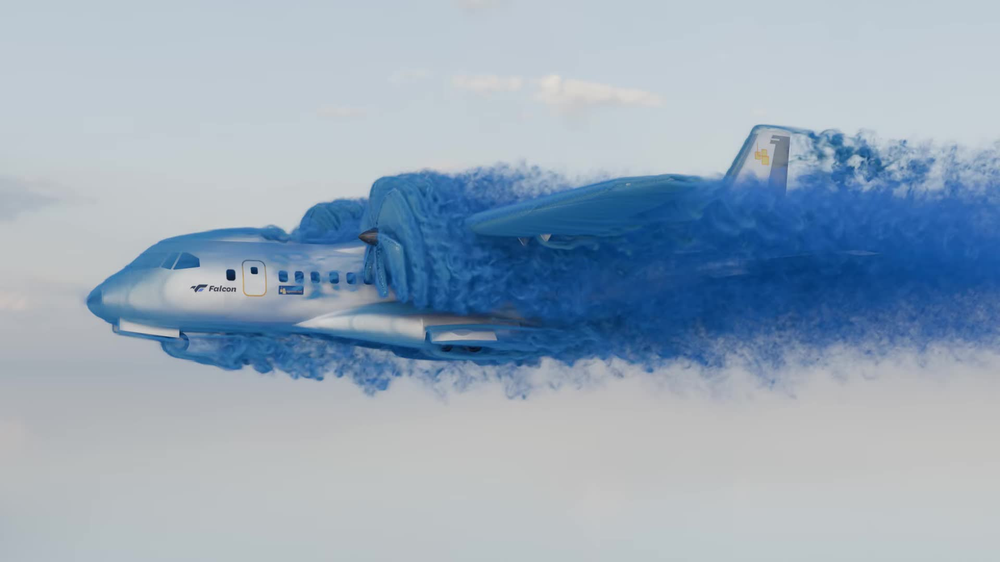
        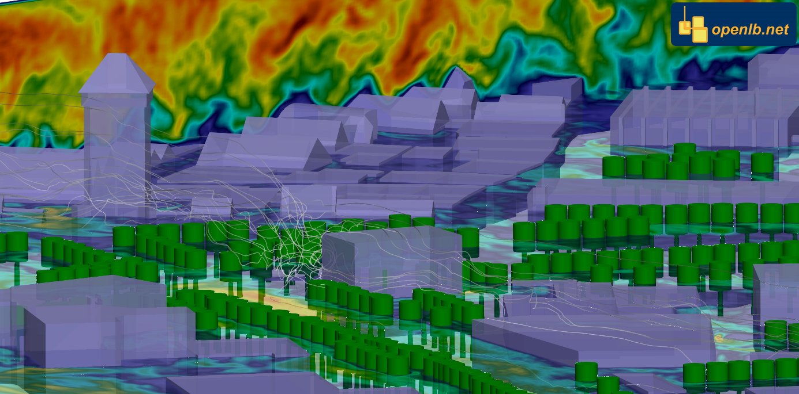
        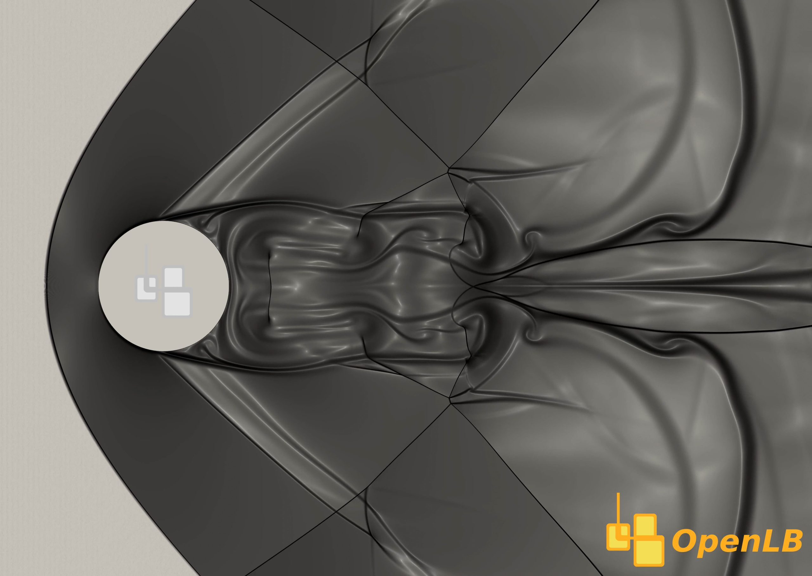
        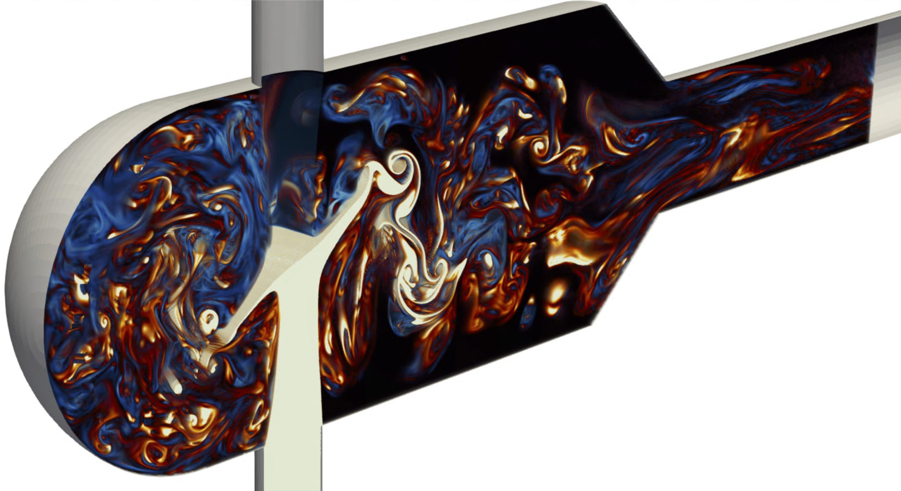
        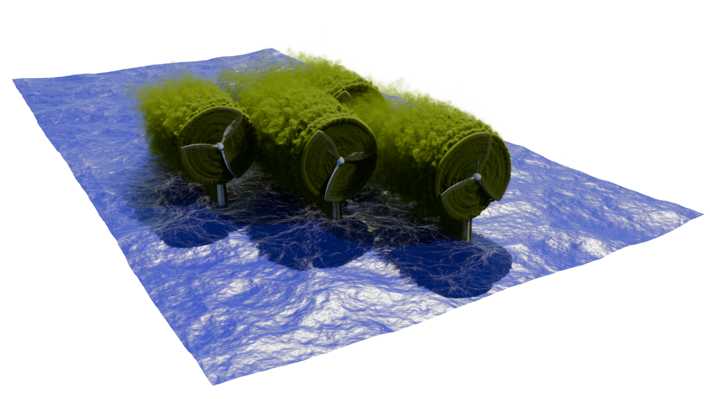
        <!-- 2nd set -->
         
        
        
        
        
        <!-- 3nd set -->
         
        
        
        
        
      </div>
    </div>
```

:::{.columns}
:::{.column width="50%" .mb-3}


## OpenLB User Guide
The OpenLB project provides a C++ package for the implementation of lattice Boltzmann methods that addresses a vast range of multi-physics transport problems, e.g. in computational fluid dynamics. The source code is publicly available and constructed in a well readable, modular and platform-transparent way. This enables for a fast implementation of both academic and advanced engineering applications. It is also easily extensible to include new physical models.

:::
:::{.column width="50%" .mb-3}
```{=html}
<div class="card border-0 shadow-sm p-4 bg-white" style="border-radius: 20px; max-width: 800px; margin: 0 auto;">
  
  <!-- 1. Der YouTube Playlist Player (responsiv im 16:9 Format) -->
  <div class="ratio ratio-16x9 mb-3" style="border-radius: 15px; overflow: hidden;">
    <iframe width="560" height="315" src="https://www.youtube.com/embed/videoseries?si=G0dNMpalEsons2Qk&amp;list=PLdH-CeuRChDw" title="YouTube video player" frameborder="0" allow="accelerometer; autoplay; clipboard-write; encrypted-media; gyroscope; picture-in-picture; web-share" referrerpolicy="strict-origin-when-cross-origin" allowfullscreen></iframe>
  </div>

  <!-- 2. Button zum YouTube-Kanal darunter -->
  <div class="text-center mt-3">
    <a href="https://www.youtube.com/@openlb" 
       target="_blank" 
       class="btn btn-light border px-4 py-2 shadow-sm card-link">
       <i class="bi bi-youtube text-danger me-2"></i> Visit our YouTube-Channel. &rarr;
    </a>
  </div>

</div>
```
:::
:::


<!-- navigation grid -->

::: {layout-ncol=6}

[
  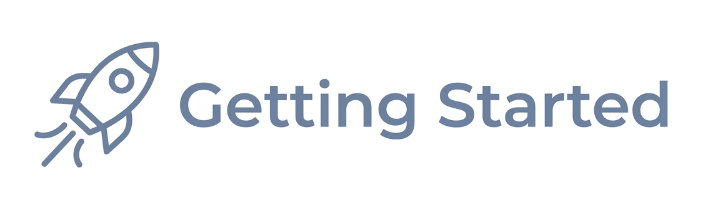{.img-normal height="30px"}
  {.img-hover height="30px"}
](/content/10_building_and_running.html){.card-link}

[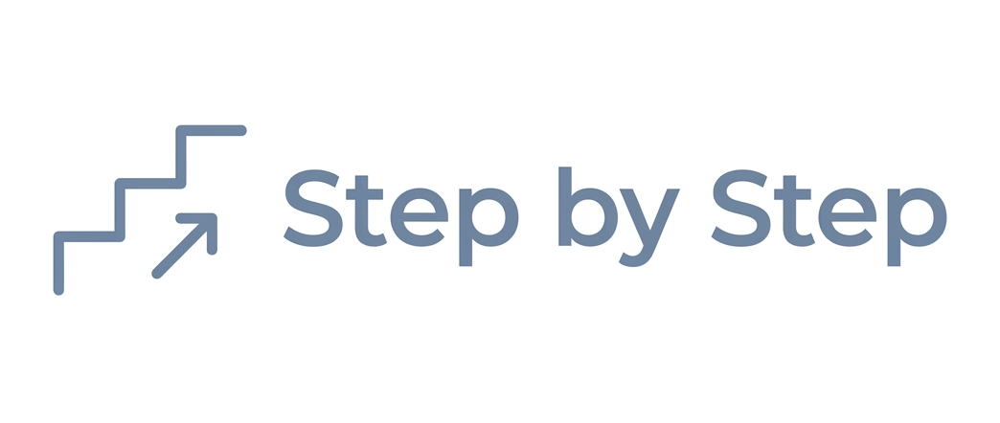{fig-alt="Logo 1" height="30px"} ](content/11_step_by_step.html){.card-link}


[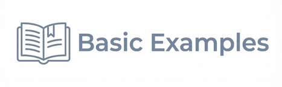{.img-normal fig-alt="Logo 2" height="30px"}
 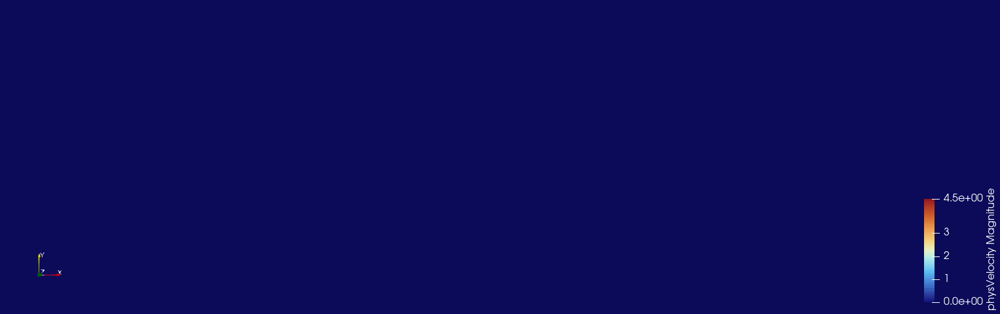{.img-hover fig-alt="Logo 2" height="30px"}
](/examples/forBeginners/forBeginners.html){.card-link}

[{fig-alt="Logo 1" height="30px"} ](mailto:info@openlb.net){.card-link}

[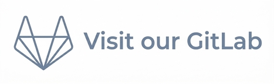{fig-alt="Logo 1" height="30px"} ](https://gitlab.com/openlb/release){.card-link}

[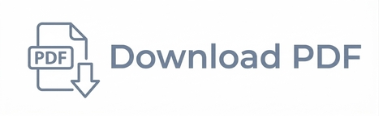{.img-normal fig-alt="Logo 1" height="30px"}
 {.img-hover fig-alt="Logo 1" height="30px"}
 ](/ug_pdf/OpenLB-User-Guide.pdf){.card-link}

:::

<!-- Showcase -->
:::{.columns}

:::{.column width="55%"}
<!-- LINKE SEITE: Das große Showcase-Bild -->
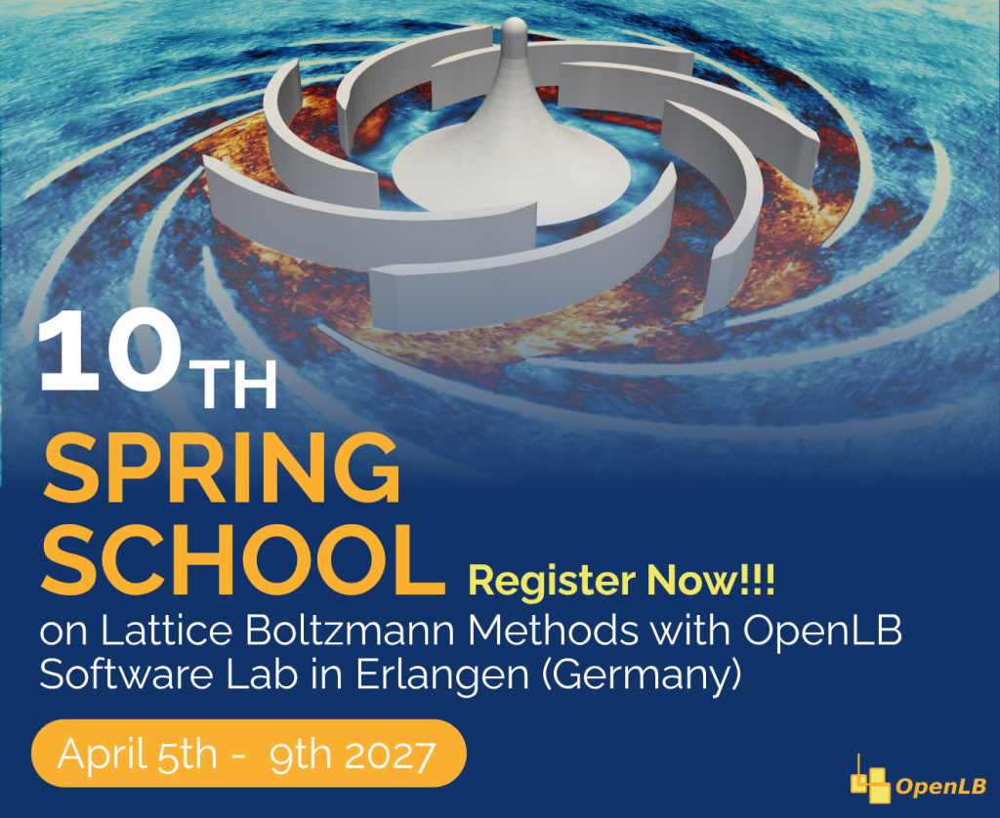{.img-fluid style="border-radius: 15px; box-shadow: 0 4px 15px rgba(0,0,0,0.1); width: 100%; height: 100%; object-fit: cover;"}
:::

:::{.column width="5%"}
<!-- Abstandhalter -->
:::

:::{.column width="40%"}
<!-- RECHTE SEITE: Buttons als Zeilen untereinander -->
<div class="d-grid gap-3">
  
  <a href="https://www.openlb.net/spring-school-registration/" class="btn btn-light border p-3 text-start shadow-sm showcase-row-btn">
    <strong>Register</strong><br>
    <small class="text-muted">Register for the next springschool.</small>
  </a>

  <a href="https://www.openlb.net/spring-school-program-2/" class="btn btn-light border p-3 text-start shadow-sm showcase-row-btn">
    <strong>Program</strong><br>
    <small class="text-muted">Explore the preliminary schedule.</small>
  </a>

</div>
:::

:::

Permission is granted to copy, distribute and/or modify this document
under the terms of the GNU Free Documentation License, Version 1.2
or any later version published by the Free Software Foundation;
with no Invariant Sections, no Front-Cover Texts, and no Back-Cover
Texts.  A copy of the license is included in the Section entitled "GNU
Free Documentation License" (Section~\ref{sec:license}).
:::

# {.unnumbered .unlisted}
```{=html}
<script>
document.addEventListener("DOMContentLoaded", function() {
  // Alle Kacheln auswählen
  const cards = document.querySelectorAll('.card-link');

  cards.forEach(card => {
    // Das GIF-Bild innerhalb der Kachel finden
    const gif = card.querySelector('img.img-hover');

    if (gif) {
      // Speichert den ursprünglichen Pfad zum GIF
      const baseSrc = gif.src;

      card.addEventListener('mouseenter', function() {
        // Hängt einen eindeutigen Zeitstempel an die Bild-URL an.
        // Das zwingt den Browser, das GIF sofort von Frame 0 neu abzuspielen,
        // ohne es aus dem Speicher an der alten Stelle fortzusetzen.
        gif.src = baseSrc.split('?')[0] + '?t=' + new Date().getTime();
      });
    }
  });
});
</script>
```